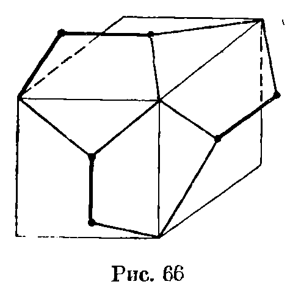
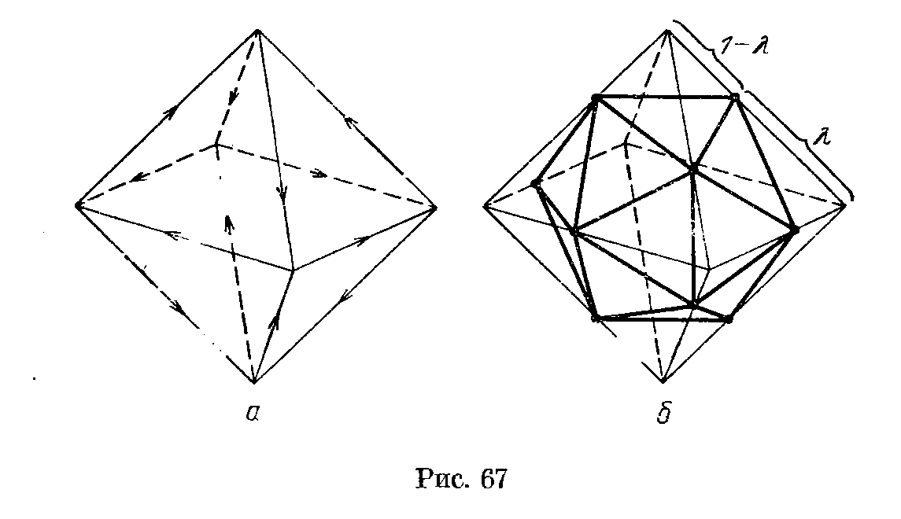
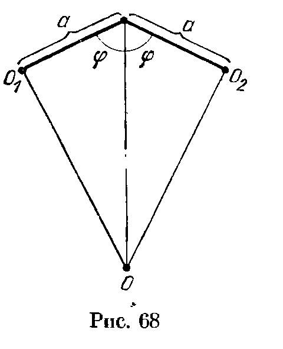
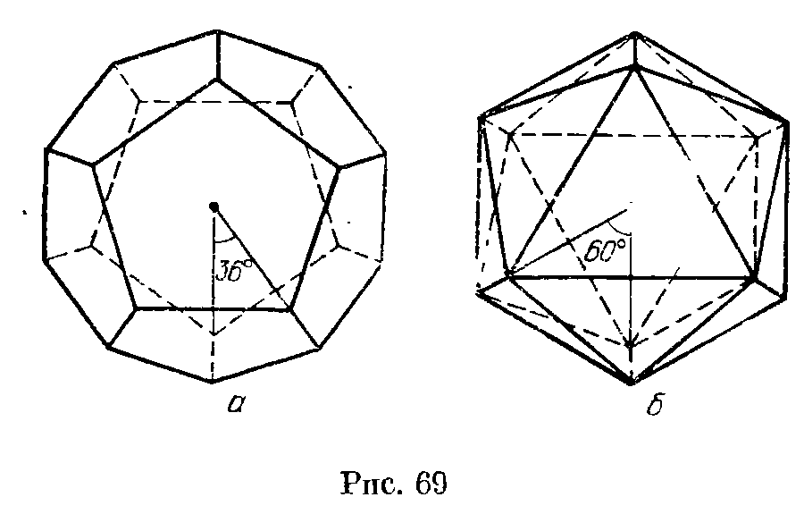
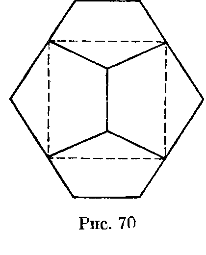
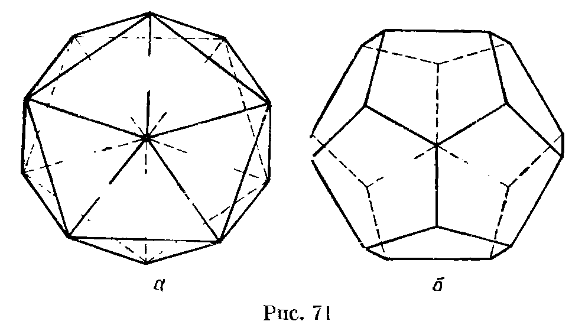
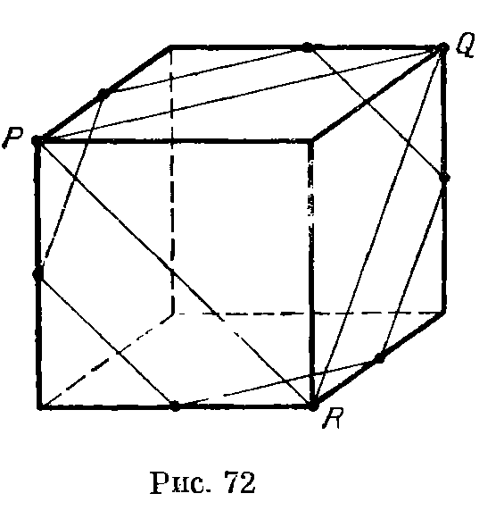
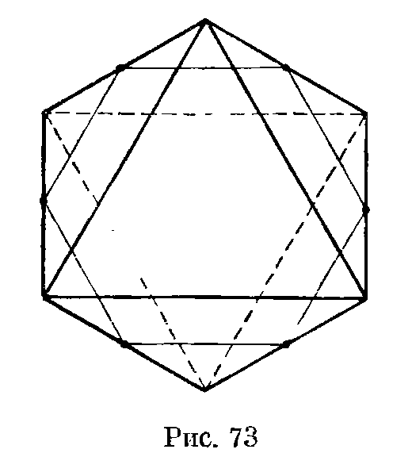
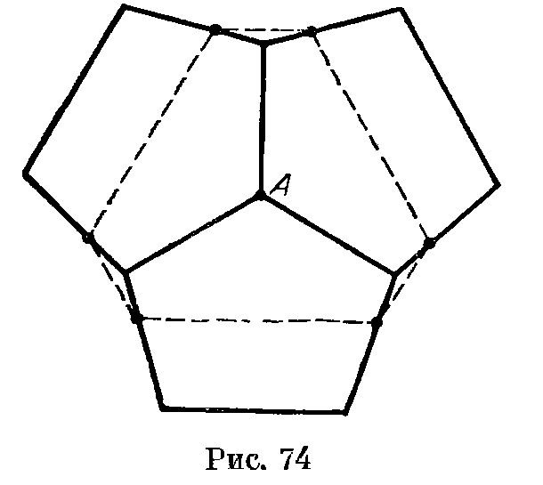

## 9.6. Решения

---
**стр. 179, продолжение**
---

## Решения

**9.1.** Рассмотрим произвольный правильный многогранник. Пусть все его грани — правильные $n$-угольники, а все многогранные углы содержат по $m$ граней. Каждое ребро соединяет две вершины, а из каждой вершины выходит $m$ ребер. Поэтому $2Р=mВ$. Аналогично каждое ребро принадлежит двум граням, а каждой грани принадлежит $n$ ребер. Поэтому $2Р=nГ$. Подставив эти выражения в формулу Эйлера $В-Р+Г=2$ (см. задачу 8.14), получим

$$
\frac{2}{m}Р-Р+\frac{2}{n}Р=2,
$$

т. е.

$$
\frac1n+\frac1m=\frac12+\frac1Р>\frac12.
$$

Следовательно, либо $n<4$, либо $m<4$. Таким образом, одно из чисел $m$ и $n$ равно 3; обозначим другое число через $x$. Теперь нужно найти все целочисленные решения уравнения

$$
\frac13+\frac1x=\frac12+\frac1Р.
$$

Ясно, что

$$
x=\frac{6Р}{Р+6}<6,
$$

т. е. $x=3,4,5$. Следовательно, имеется лишь 5 различных пар чисел $(m,n)$:

1. $(3,\ 3)$; соответствующий многогранник — тетраэдр, у него 6 ребер, 4 грани и 4 вершины;
2. $(3,\ 4)$; соответствующий многогранник — куб, у него 12 ребер, 6 граней и 8 вершин;
3. $(4,\ 3)$; соответствующий многогранник — октаэдр, у него 12 ребер, 8 граней и 6 вершин;
4. $(3,\ 5)$; соответствующий многогранник — додекаэдр, у него 30 ребер, 12 граней и 20 вершин;
5. $(5,\ 3)$; соответствующий многогранник — икосаэдр, у него 30 ребер, 20 граней и 12 вершин.

Число ребер, граней и вершин здесь вычислялось по формулам

$$
\frac1n+\frac1m=\frac12+\frac1Р,\qquad Г=\frac2nР\quad\text{и}\quad В=\frac2mР.
$$

**Замечание.** Многогранники каждого описанного выше типа определены однозначно с точностью до подобия. В самом деле, преобразованием подобия можно совместить пару граней двух многогранников одного типа так, чтобы многогранники лежали по одну сторону от плоскости совмещенных граней. Если многогранные углы равны, то многогранники, как легко убедиться, совпадут. Равенство многогранных углов очевидно в случае трехгранных углов, т. е. для тетраэдра, куба и доде-

---
**стр. 180**
---

каэдра. А для октаэдра и икосаэдра можно совместить двойственные им многогранники, поэтому равны и исходные многогранники (см. задачи 9.5, 9.11 и 9.12).

**9.2.** Доказательство будет основано на свойствах фигуры, состоящей из трех одинаковых правильных пятиугольников с общей вершиной, каждые два из которых имеют общее ребро. В решении задачи 7.33 доказано, что выделенные на рис. 53 отрезки образуют прямой трехгранный угол, т. е. рассматриваемую фигуру можно так приложить к кубу, что эти отрезки совпадут с его ребрами, выходящими из одной вершины (рис. 66).

Докажем, что полученную фигуру можно достроить до додекаэдра с помощью симметрий относительно плоскостей, параллельных граням куба и проходящих через его центр.

Стороны пятиугольника, параллельные ребрам куба, симметричны относительно указанных плоскостей. Кроме того, расстояния от каждой из этих сторон до той грани куба, с которой она соединена тремя отрезками, равны (они равны $\sqrt{a^2-b^2}$, где $a$ — длина отрезка, соединяющего вершину правильного пятиугольника с серединой соседней стороны, $b$ — половина диагонали грани куба). Следовательно, с помощью указанных симметрий рассматриваемую фигуру действительно можно достроить до некоторого многогранника. Остается доказать, что этот многогранник правильный, т. е. двугранные углы при ребрах $p_i$, выходящих из вершин куба, равны двугранным углам при ребрах $q_j$, параллельных граням куба. Рассмотрим для этого симметрию относительно плоскости, проходящей через середину ребра $p_i$ перпендикулярно ему. При этой симметрии ребро $q_j$, выходящее из второго конца ребра $p_i$ и параллельное грани куба, переходит в ребро $p_k$, выходящее из вершины куба.

**9.3.** Для смежных граней это утверждение очевидно. Если $\Gamma_1$ и $\Gamma_2$ — несмежные грани додекаэдра, то грань, параллельная $\Gamma_1$, будет смежной с $\Gamma_2$.

**9.4.** Икосаэдр будем строить, располагая его вершины на ребрах октаэдра. Расставим на ребрах октаэдра стрелки так, как это показано на рис. 67, а. Теперь поделим все ребра в одном и том же отношении $\lambda:(1-\lambda)$, учитывая при этом их ориентацию. Полученные точки являются вершинами выпуклого многогранника с треугольными гранями и пятигранными углами при вершинах (рис. 67, б). Поэтому достаточно подобрать $\lambda$ так,

---
**стр. 181**
---

чтобы этот многогранник был правильным. У него есть два типа ребер — принадлежащие граням октаэдра и не принадлежащие им. Квадрат длины любого ребра, принадлежащего грани октаэдра, равен
$\lambda^2+(1-\lambda)^2-2\lambda(1-\lambda)\cos 60^\circ=3\lambda^2-3\lambda+1$,
а квадрат длины любого ребра, не принадлежащего грани октаэдра, равен $2(1-\lambda)^2=2-4\lambda+2\lambda^2$ (при доказательстве последнего равенства нужно учесть, что угол между несоседними ребрами октаэдра, выходящими из одной вершины, равен $90^\circ$).

Таким образом, если
$$
3\lambda^2-3\lambda+1=2-4\lambda+2\lambda^2,
$$
т. е.
$$
\lambda=\frac{\sqrt5-1}{2}
$$
(отрицательный корень мы отбросили), то все грани полученного многогранника являются правильными треугольниками. Остается доказать, что равны все двугранные углы при его ребрах. Это легко следует из того, что (для любого $\lambda$) вершины полученного многогранника равноудалены от центра октаэдра, т. е. лежат на одной сфере.

**9.5.** Проведем через центры всех граней перпендикуляры к ним. Легко убедиться, что для двух соседних граней такие перпендикуляры пересекаются в одной точке, причем она удалена от каждой грани на расстояние $a\operatorname{ctg}\varphi$, где $a$ — расстояние от центра грани до ее сторон, а $\varphi$ — половина двугранного угла между гранями многогранника. Для этого нужно рассмотреть сечение, проходящее через центры двух соседних граней и середину их общего ребра (рис. 68). Таким образом, на каждом нашем перпендикуляре можно отметить точку, причем для соседних граней эти точки совпадают. Следовательно, все эти перпендикуляры имеют общую точку $O$.

Ясно, что расстояние от точки $O$ до каждой вершины многогранника равно $a/\cos\varphi$, а до каждой грани — $a\operatorname{ctg}\varphi$, т. е. точка

---
**стр. 182**
---

$O$ является как центром описанной, так и центром вписанной сферы.

**9.6.** Нужно доказать, что сумма векторов, соединяющих центр описанной сферы правильного многогранника с его вершинами, равна нулю. Обозначим эту сумму векторов через $\mathbf{x}$.

При любом повороте, совмещающем многогранник с самим собой, центр описанной сферы остается на месте, и поэтому вектор $\mathbf{x}$ переходит в себя. Но ненулевой вектор может переходить в себя лишь при повороте вокруг оси, параллельной ему. Остается заметить, что у любого правильного многогранника есть несколько осей, повороты вокруг которых переводят его в самого себя.

**9.7.** а) Если $ABCDA_1B_1C_1D_1$ — куб, то $AB_1CD_1$ и $A_1BC_1D$ — правильные тетраэдры.

б) Легко проверить, что середины ребер правильного тетраэдра являются вершинами октаэдра. Из этого видно, что можно выбрать 4 грани октаэдра так, чтобы они были плоскостями граней правильного тетраэдра, причем сделать это можно двумя способами.

**9.8.** Пусть ребро куба $ABCDA_1B_1C_1D_1$ равно $4a$. Возьмем на ребрах, выходящих из вершины $A$, точки, удаленные от нее на расстояние $3a$. Аналогично возьмем 3 точки на ребрах, выходящих из вершины $C_1$. Используя равенство $3^2+3^2=1+4^2+1$, легко проверить, что длины всех ребер многогранника с вершинами в выбранных точках равны $3\sqrt2\,a$.

**9.9.** а) Из решения задачи 9.2 видно, что существует куб, вершины которого находятся в вершинах додекаэдра. При этом на каждой грани додекаэдра расположено одно ребро куба. Ясно также, что выбор в качестве ребра куба любой из пяти диагоналей некоторой грани додекаэдра однозначно задает весь куб. Поэтому имеется 5 различных кубов с вершинами в вершинах додекаэдра.

б) Расположив куб так, что его вершины находятся в вершинах додекаэдра, можно затем расположить правильный тетраэдр так, что его вершины находятся в вершинах этого куба.

**9.10.** а) Из решения задачи 9.4 видно, что можно выбрать 8 граней икосаэдра так, что они будут гранями октаэдра. При этом из каждой вершины икосаэдра выходит ровно одно ребро, не лежащее в плоскости грани октаэдра. Ясно также, что выбор любого из пяти ребер, выходящих из некоторой вер-

---
**стр. 183**
---

шины икосаэдра, в качестве ребра, не принадлежащего плоскости грани октаэдра, однозначно задает октаэдр. Поэтому имеется 5 различных октаэдров, плоскости граней которых проходят через грани икосаэдра.

б) Выбрав 8 плоскостей граней икосаэдра так, что они являются плоскостями граней октаэдра, из них можно выбрать 4 плоскости так, что они являются плоскостями граней правильного тетраэдра.

**9.11.** При повороте относительно прямой, соединяющей вершину исходного многогранника с его центром, переводящем многогранник в себя, центры граней, прилегающих к этой вершине, переходят в себя, т. е. они являются вершинами правильного многогранника. Аналогично, рассматривая поворот относительно прямой, соединяющей центр грани исходного многогранника с его центром, получаем, что многогранные углы двойственного многогранника правильные. Так как движением можно совместить любые два многогранных угла исходного многогранника, все грани двойственного многогранника равны. А так как можно совместить любые две грани исходного многогранника, равны все многогранные углы двойственного многогранника.

**9.12.** Для доказательства достаточно заметить, что если у исходного многогранника $m$-гранные углы при вершинах и $n$-угольные грани, то у двойственного ему многогранника будут $n$-гранные углы при вершинах и $m$-угольные грани.

**Замечание.** Решения задач 9.2 и 9.4 фактически являются двумя разными решениями одной и той же задачи. В самом деле, если существует додекаэдр, то существует двойственный ему многогранник — икосаэдр (и наоборот).

**9.13.** а) Пусть $O$ — центр исходного многогранника, $A$ — одна из его вершин, $B$ — центр одной из граней с вершиной $A$. Рассмотрим грань двойственного многогранника, образованного центрами граней исходного многогранника, прилегающего к вершине $A$. Пусть $C$ — центр этой грани, т. е. точка пересечения этой грани с прямой $OA$. Ясно, что $AB\perp OB$ и $BC\perp OA$. Поэтому $OC:OB=OB:OA$, т. е. $r_2:R_2=r_1:R_1$, где $r_1$ и $R_1$ (соответственно $r_2$ и $R_2$) — радиусы вписанной и описанной сфер исходного многогранника (соответственно двойственного ему многогранника).

б) Если плоскость удалена на расстояние $r$ от центра сферы радиуса $R$, то она высекает на ней окружность радиуса $\sqrt{R^2-r^2}$. Поэтому радиус описанных окружностей граней многогранника, вписанного в сферу радиуса $R$ и описанного около сферы радиуса $r$, равен $\sqrt{R^2-r^2}$. В частности, если и

---
**стр. 184**
---

у двух многогранников $R$ и $r$ равны, то равны и радиусы описанных окружностей их граней.

**9.14.** Если додекаэдр и икосаэдр вписаны в одну сферу, то радиусы их вписанных сфер равны (задача 9.13,а), т. е. равны расстояния между их противоположными гранями. Будем называть «центром сферической грани» додекаэдра (или икосаэдра) точку пересечения описанной сферы с прямой, проходящей через его центр и центр одной из граней. Фиксируем один из центров сферических граней додекаэдра и рассмотрим расстояния от него до вершин; среди этих расстояний ровно 4 различных. Для решения задачи достаточно доказать, что этот набор из четырех различных расстояний совпадает с таким же набором для икосаэдра.

Легко проверить, что центры сферических граней додекаэдра являются вершинами икосаэдра, а центры сферических граней полученного икосаэдра являются вершинами исходного додекаэдра. Поэтому любое расстояние между центром сферической грани и вершиной додекаэдра является расстоянием между вершиной и центром сферической грани икосаэдра.

**9.15.** Для доказательства достаточно заметить, что эти многогранники переходят в себя при повороте, совмещающем проекцию верхней грани с проекцией нижней грани. Таким образом, проекция додекаэдра является 10-угольником, переходящим в себя при повороте на $36^\circ$ (рис. 69, а), а проекция икосаэдра является шестиугольником, переходящим в себя при повороте на $60^\circ$ (рис. 69, б).

**9.16.** Рассмотрим куб, вершины которого расположены в вершинах додекаэдра (см. задачу 9.2). В нашей задаче речь идет о проекции на плоскость, параллельную грани этого куба. Теперь легко убедиться, что проекцией додекаэдра действительно является шестиугольник (рис. 70).

---
**стр. 185**
---

**9.17.** а) Рассматриваемая проекция икосаэдра переходит в себя при повороте на $36^\circ$ (при этом проекции верхних граней переходят в проекции нижних граней). Следовательно, она является правильным 10-угольником (рис. 71, а).

б) Рассматриваемая проекция додекаэдра является 12-угольником, переходящим в себя при повороте на $60^\circ$ (рис. 71, б). Половина его сторон является проекциями ребер, параллельных плоскости проекции, а другая половина сторон — проекциями ребер, не параллельных плоскости проекции. Следовательно, этот 12-угольник неправильный.

**9.18.** Существует. Середины указанных на рис. 72 ребер куба являются вершинами правильного шестиугольника. Это следует из того, что стороны этого шестиугольника параллельны сторонам правильного треугольника $PQR$, а их длины вдвое меньше длин сторон этого треугольника.

**9.19.** Существует. Проведем плоскость, параллельную двум противоположным граням октаэдра и равноудаленную от них. Легко проверить, что сечение этой плоскостью будет правильным шестиугольником (на рис. 73 изображена проекция на секущую плоскость).

**9.20.** Существует. Возьмем три пятиугольные грани с общей вершиной $A$ и рассмотрим сечение плоскостью, пересекающей эти грани и параллельной плоскости, в которой лежат три попарно общие вершины рассматриваемых граней (рис. 74). Это сечение является шестиугольником с попарно параллельными противоположными сторонами. При повороте на $120^\circ$

---
**стр. 186**
---

относительно оси, проходящей через вершину $A$ и перпендикулярной секущей плоскости, додекаэдр и секущая плоскость переходят в себя. Поэтому сечение является выпуклым шестиугольником с углами $120^\circ$, длины сторон которого, чередуясь, принимают два значения. Для того чтобы этот шестиугольник

был правильный, достаточно, чтобы эти два значения были равны. Когда секущая плоскость движется от одного своего крайнего положения до другого, удаляясь от вершины $A$, первое из этих значений возрастает от 0 до $d$, а второе убывает от $d$ до $a$, где $a$ — длина ребра додекаэдра, $d$ — длина диагонали грани ($d>a$). Поэтому в некоторый момент эти значения равны, т. е. сечение является правильным шестиугольником.

**9.21.** Нет, не верно. Рассмотрим проекцию икосаэдра на плоскость $ABC$. Она является правильным шестиугольником (см. задачу 9.15 и рис. к ней). Поэтому рассматриваемое сечение было бы правильным шестиугольником, лишь если бы все 6 вершин, соединенных ребрами с точками $A$, $B$ и $C$ (и отличных от $A$, $B$ и $C$), лежали в одной плоскости. Но, как легко убедиться, это неверно (иначе получилось бы, что все вершины икосаэдра расположены на трех параллельных плоскостях).

**9.22.** Легко проверить, что все правильные многогранники, кроме тетраэдра, имеют центр симметрии.

---
**стр. 187**
---

**9.23.** Плоскость симметрии разрезает многогранник на две части, поэтому она пересекает хотя бы одно ребро. Рассмотрим два случая.

1. Плоскость симметрии проходит через вершину многогранника. Тогда она является плоскостью симметрии многогранного угла при этой вершине.

2. Плоскость симметрии проходит через неконцевую точку ребра. Тогда это ребро переходит в себя при симметрии относительно этой плоскости, т. е. плоскость проходит через середину ребра перпендикулярно ему.

**9.24.** а) Для тетраэдра, куба и октаэдра утверждение задачи очевидно. Для додекаэдра и икосаэдра нужно воспользоваться решениями задач 9.2 и 9.4 соответственно. Для додекаэдра при этом удобно рассмотреть плоскость, проходящую через середину ребра, параллельного грани куба, а для икосаэдра — плоскость, проходящую через середину ребра, не лежащего в плоскости грани октаэдра.

б) Нужно выяснить, для каких многогранных углов правильных многогранников существуют плоскости симметрии, не проходящие через середины ребер. Любая плоскость симметрии многогранных углов тетраэдра, додекаэдра и икосаэдра проходит через середины ребер. У куба и октаэдра есть плоскости симметрии многогранных углов, не проходящие через середины ребер. Эти плоскости проходят через пары противоположных ребер.

**9.25.** Сначала рассмотрим плоскости симметрии, проходящие через середины ребер перпендикулярно им. Нужно выяснить, через сколько середин сразу проходит такая плоскость. Легко проверить, что для тетраэдра каждая плоскость проходит через середину одного ребра, для октаэдра, додекаэдра и икосаэдра — через середины двух ребер, а для куба — через середины четырех ребер. Поэтому число таких плоскостей для тетраэдра равно 4, для куба — $12/4=3$, для октаэдра — $12/2=6$, для додекаэдра и икосаэдра — $30/2=15$.

У куба и октаэдра есть еще и другие плоскости симметрии, проходящие через пары противоположных ребер, причем для куба такая плоскость проходит через 2 ребра, а для октаэдра — через 4. Поэтому число таких плоскостей для куба равно $12/2=6$, а для октаэдра — $12/4=3$. Всего у куба и октаэдра по 9 плоскостей симметрии.

**9.26.** Ось вращения пересекает поверхность многогранника в двух точках. Рассмотрим одну из них. Возможны три варианта.

1. Точка является вершиной многогранника.

---
**стр. 188**
---

2. Точка принадлежит ребру многогранника, но не является вершиной. Тогда это ребро переходит в себя при некотором повороте относительно нее. Следовательно, эта точка является серединой ребра, причем угол поворота равен $180^\circ$.

3. Точка принадлежит грани многогранника, но не принадлежит ребру. Тогда эта грань переходит в себя при некотором повороте относительно нее. Следовательно, эта точка является центром грани.

**9.27.** а) Для каждого правильного многогранника прямые, проходящие через середины противоположных ребер, являются их осями симметрии. В тетраэдре таких осей 3, в кубе и октаэдре — 6, в додекаэдре и икосаэдре — 15. Кроме того, в кубе осями симметрии являются прямые, проходящие через центры граней, а в октаэдре — прямые, проходящие через вершины; таких осей у них по 3.

б) Прямая называется осью вращения $n$-го порядка (для данной фигуры), если при повороте на угол $\dfrac{2\pi}{n}$ фигура переходит в себя.

Прямые, проходящие через вершины и центры граней тетраэдра, являются осями третьего порядка; этих осей 4.

Прямые, проходящие через пары вершин куба, являются осями третьего порядка; этих осей 4. Прямые, проходящие через пары центров граней куба, являются осями четвертого порядка; этих осей 3.

Прямые, проходящие через пары центров граней октаэдра, являются осями третьего порядка; этих осей 4. Прямые, проходящие через пары вершин октаэдра, являются осями четвертого порядка; этих осей 3.

Прямые, проходящие через пары вершин додекаэдра, являются осями третьего порядка; этих осей 10. Прямые, проходящие через пары центров граней додекаэдра, являются осями пятого порядка; этих осей 6.

Прямые, проходящие через пары центров граней икосаэдра, являются осями третьего порядка; этих осей 10. Прямые, проходящие через пары вершин икосаэдра, являются осями пятого порядка; этих осей 6.

**9.28.** Любую грань правильного многогранника можно перевести движением в любую другую. Если грани многогранника $n$-угольные, то имеется ровно $2n$ самосовмещений, сохраняющих одну из граней: $n$ поворотов и $n$ симметрий относительно плоскостей. Поэтому число самосовмещений (включая тождественное преобразование) равно $2nГ$.

Число самосовмещений тетраэдра равно 24, куба и октаэдра — 48, додекаэдра и икосаэдра — 120.

---
**стр. 189**
---

**Замечание.** Аналогичными рассуждениями можно показать, что число самосовмещений правильного многогранника равно удвоенному произведению числа его вершин на число граней его многогранных углов.

**9.29.** Нужно доказать, что равны все многогранные углы нашего многогранника. Но его двугранные углы равны по условию, а плоские углы являются углами равных многоугольников.

**9.30.** Нужно доказать, что все грани равны и многогранные углы тоже равны. Докажем сначала равенство граней. Рассмотрим все грани, сходящиеся в некоторой вершине. Многогранный угол при этой вершине правильный, поэтому равны все его плоские углы, а значит, равны углы рассматриваемых правильных многоугольников. Кроме того, все стороны правильных многоугольников, имеющих общую сторону, равны. Следовательно, все рассматриваемые многоугольники равны, а значит, равны и все грани многогранника.

Докажем теперь равенство многогранных углов. Рассмотрим все многогранные углы при вершинах одной из граней. Одним из плоских углов каждого из них является угол этой грани, поэтому все плоские углы рассматриваемых многогранных углов равны. Кроме того, многогранные углы, вершинами которых являются концы одного ребра, имеют общий двугранный угол, поэтому равны все их двугранные углы. Следовательно, все рассматриваемые многогранные углы равны, а значит, равны и все многогранные углы нашего многогранника.

**9.31.** Нужно доказать, что все многогранные углы нашего многогранника правильные. Рассмотрим концы всех ребер, выходящих из некоторой вершины. Как следует из условия задачи, многогранник с вершинами в этих точках и точке $A$ является пирамидой, основание которой — правильный многоугольник, причем все ребра пирамиды равны. Поэтому точка $A$ принадлежит пересечению плоскостей, проходящих через середины сторон основания перпендикулярно им, т. е. она лежит на перпендикуляре к основанию, проходящему через его центр. Следовательно, пирамида правильная, а значит, многогранный угол при ее вершине правильный.

**9.32.** Нет, не обязательно. Рассмотрим прямоугольный параллелепипед $ABCDA_1B_1C_1D_1$, отличный от куба. В тетраэдре $AB_1CD_1$ все грани и все трехгранные углы равны, но он не является правильным.

**9.33.** Нет, не обязательно. Рассмотрим выпуклый многогранник, вершинами которого являются середины ребер куба. Легко проверить, что у этого многогранника равны все ребра, все двугранные углы и все многогранные углы.
