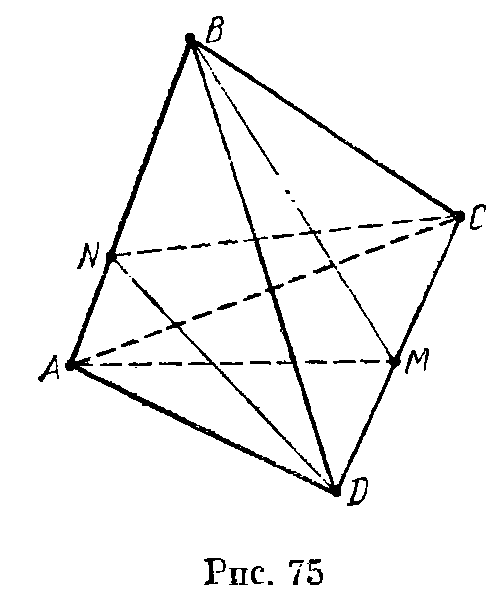
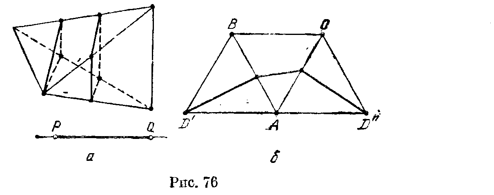
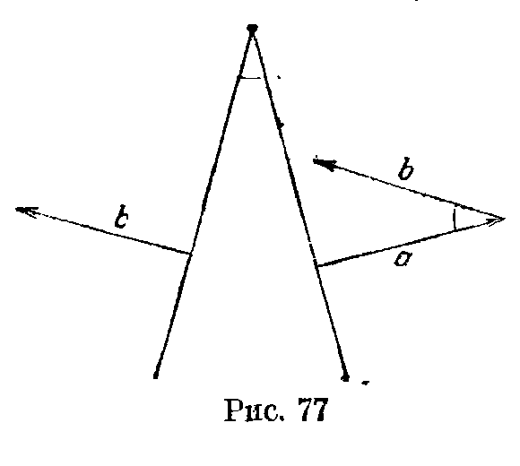
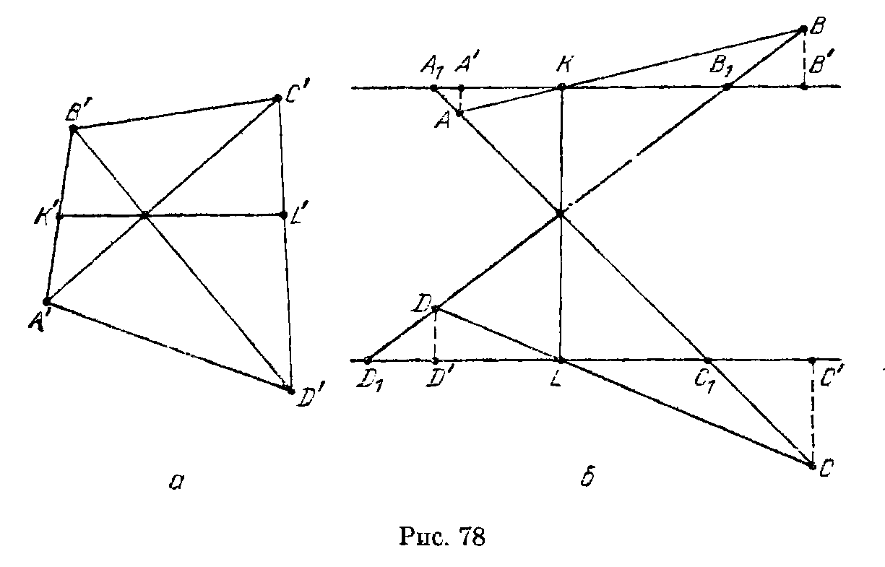
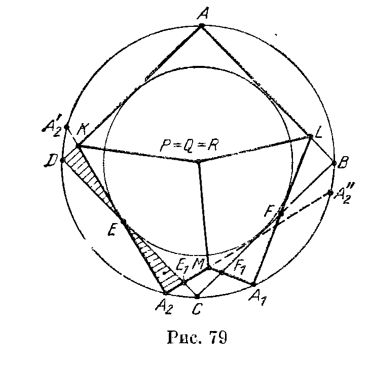
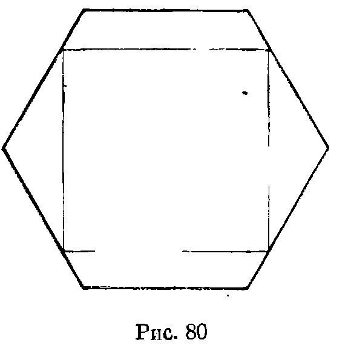

## 10.7. Решения

---
**стр. 194, продолжение**
---

## Решения

**10.1.** Так как $d\leqslant a+b+c$, то
$$
d^2\leqslant a^2+b^2+c^2+2ab+2bc+2ca\leqslant3(a^2+b^2+c^2).
$$

**10.2.** Если $PQ$ — диагональ куба с ребром 1, а $X$ — произвольная точка, то $PX+QX\geqslant PQ=\sqrt3$. Так как у куба 4 диагонали, сумма расстояний от точки $X$ до всех вершин куба не меньше $4\sqrt3$.

**10.3.** Докажем сначала, что если $\angle BAC=60^\circ$, то $AB+AC\leqslant2BC$. Рассмотрим для этого точки $B'$ и $C'$, симметричные точкам $B$ и $C$ относительно биссектрисы угла $A$. Так как в любом выпуклом четырехугольнике сумма длин диагоналей

---
**стр. 195**
---

больше суммы длин пары противоположных сторон, то $BC+B'C'\geqslant CC'+BB'$ (равенство достигается, если $AB=AC$). Остается заметить, что $B'C'=BC$, $CC'=AC$ и $BB'=AB$. Аналогично доказываются неравенства $AC+AD\leqslant 2CD$ и $AD+AB\leqslant 2DB$. Складывая все эти неравенства, получаем требуемое.

**10.4.** Проведем через прямую $b$ плоскость $\Pi$, параллельную $a$. Пусть $C_i$ — проекция точки $A_i$ на плоскость $\Pi$. По теореме о трех перпендикулярах $C_iB_i\perp b$, поэтому длина отрезка $B_2C_2$ заключена между $B_1C_1$ и $B_3C_3$; длины всех трех отрезков $A_iC_i$ равны.

**10.5.** При доказательстве мы несколько раз будем использовать следующее планиметрическое утверждение: «Если точка $X$ лежит на стороне $BC$ треугольника $ABC$, то либо $AB\geqslant AX$, либо $AC\geqslant AX$». (В самом деле, один из углов $BXA$ или $CXA$ не меньше $90^\circ$; если $\angle BXA\geqslant90^\circ$, то $AB\geqslant AX$, а если $\angle CAX\geqslant90^\circ$, то $AC\geqslant AX$.)

Продолжим данный отрезок до пересечения с гранями многогранника в некоторых точках $P$ и $Q$; при этом его длина может только увеличиться. Пусть $MN$ — произвольный отрезок с концами на ребрах многогранника, проходящий через точку $P$. Тогда либо $MQ\geqslant PQ$, либо $NQ\geqslant PQ$. Пусть для определенности $MQ\geqslant PQ$. Точка $M$ лежит на некотором ребре $AB$ и либо $AQ\geqslant MQ$, либо $BQ\geqslant MQ$. Мы заменили отрезок $PQ$ на больший отрезок, один из концов которого лежит в вершине многогранника. Проведя теперь точно такие же рассуждения для конца $Q$ полученного отрезка, мы заменим отрезок $PQ$ на больший отрезок с концами в вершинах многогранника.

**10.6.** Пусть $a=PA$, $b=PB$ и $c=PC$. Можно считать, что $a\leqslant b\leqslant c$; тогда по условию $c<a+b$. Пусть, далее, $h=PM$. Требуется доказать, что
$$
\sqrt{c^2+h^2}<\sqrt{a^2+h^2}+\sqrt{b^2+h^2},
$$
т. е.
$$
c\sqrt{1+\left(\frac hc\right)^2}
<a\sqrt{1+\left(\frac ha\right)^2}
+b\sqrt{1+\left(\frac hb\right)^2}.
$$

Остается заметить, что
$$
c\sqrt{1+\left(\frac hc\right)^2}
<(a+b)\sqrt{1+\left(\frac hc\right)^2}
\leqslant
a\sqrt{1+\left(\frac ha\right)^2}
+b\sqrt{1+\left(\frac hb\right)^2}.
$$

**10.7.** Рассмотрим плоскость $\Pi$, проходящую через середину отрезка $PQ$ перпендикулярно ему. Предположим, что все вершины многогранника удалены от точки $Q$ не менее, чем от точки

---
**стр. 196**
---

$P$. Тогда все вершины многогранника лежат по ту же сторону от плоскости $\Pi$, что и точка $P$. Следовательно, точка $Q$ лежит вне многогранника, что противоречит условию.

**10.8.** Пусть $M$ и $N$ — точки пересечения плоскостей $AOB$ и $COD$ с ребрами $CD$ и $AB$ соответственно (рис. 75).

Так как треугольник $AOB$ лежит внутри треугольника $AMB$, то $AO+BO\leqslant AM+BM$. Аналогично $CO+DO\leqslant CN+DN$. Поэтому достаточно доказать, что сумма длин отрезков $AM$, $BM$, $CN$ и $DN$ не превосходит суммы длин ребер тетраэдра $ABCD$.

Докажем сначала, что если $X$ — точка на стороне $A'B'$ треугольника $A'B'C'$, то длина отрезка $C'X$ не превосходит половины периметра треугольника $A'B'C'$. В самом деле, $C'X\leqslant C'B'+B'X$ и $C'X\leqslant C'A'+A'X$. Поэтому
$$
2C'X\leqslant A'B'+B'C'+C'A'.
$$
Таким образом,
$$
2AM\leqslant AC+CD+DA,\qquad
2BM\leqslant BC+CD+DB,
$$
$$
2CN\leqslant BA+AC+CB,\qquad
2DN\leqslant BA+AD+DB.
$$
Складывая все эти неравенства, получаем требуемое.

**10.9.** Занумеруем отрезки и рассмотрим отрезок с номером $i$. Пусть $l_i$ — его длина, а $x_i$, $y_i$, $z_i$ — длины проекций на ребра куба. Легко проверить, что $l_i\leqslant x_i+y_i+z_i$. С другой стороны, если любая плоскость, параллельная грани куба, пересекает не более одного отрезка, то проекции этих отрезков на каждое ребро куба не имеют общих точек. Поэтому $\sum x_i\leqslant1$, $\sum y_i\leqslant1$ и $\sum z_i\leqslant1$, а значит, $\sum l_i\leqslant3$.

**10.10.** Рассмотрим проекции на 3 непараллельных ребра куба. Проекция данной ломаной на любое ребро содержит оба конца ребра, поэтому она совпадает с самим ребром. Следовательно, сумма длин проекций звеньев ломаной на любое ребро не менее 2, а сумма длин проекций звеньев ломаной на все три ребра не менее 6.

Одна из трех длин проекций любого звена ломаной на ребра куба нулевая, пусть две другие длины проекций равны $a$ и $b$. Так как $(a+b)^2\leqslant2(a^2+b^2)$, то сумма длин звеньев ломаной не меньше суммы длин проекций звеньев ломаной на три ребра куба, деленной на $\sqrt2$, а значит, она не меньше $6/\sqrt2=3\sqrt2$.

**10.11.** Пусть $\mathbf v_1$, $\mathbf v_2$, $\mathbf v_3$ и $\mathbf v_4$ — векторы, идущие из центра сферы в вершины тетраэдра. Так как центр сферы лежит внутри

---
**стр. 197**
---

тетраэдра, то существуют такие положительные числа $\lambda_1,\ldots,\lambda_4$, что
$$
\lambda_1\mathbf v_1+\lambda_2\mathbf v_2+\lambda_3\mathbf v_3+\lambda_4\mathbf v_4=0
$$
(см. задачу 7.16). Можно считать, что $\lambda_1+\ldots+\lambda_4=1$. Докажем, что тогда $\lambda_i\leqslant1/2$. Пусть, например, $\lambda_1>1/2$. Тогда
$$
R/2<|\lambda_1\mathbf v_1|
=|\lambda_2\mathbf v_2+\lambda_3\mathbf v_3+\lambda_4\mathbf v_4|
\leqslant(\lambda_2+\lambda_3+\lambda_4)R
=(1-\lambda_1)R<R/2.
$$
Получено противоречие, поэтому $\lambda_i\leqslant1/2$. Следовательно,
$$
|\mathbf v_1+\ldots+\mathbf v_4|
=|(1-2\lambda_1)\mathbf v_1+\ldots+(1-2\lambda_4)\mathbf v_4|
\leqslant((1-2\lambda_1)+\ldots+(1-2\lambda_4))R=2R.
$$
Так как
$$
\sum|\mathbf v_i-\mathbf v_j|^2=(4R)^2-\left|\sum\mathbf v_i\right|^2
$$
(см. решение задачи 14.15), а $\left|\sum\mathbf v_i\right|\leqslant2R$, то
$$
\sum|\mathbf v_i-\mathbf v_j|^2\geqslant(16-4)R^2=12R^2.
$$
А так как $2R>|\mathbf v_i-\mathbf v_j|$, то
$$
2R\sum|\mathbf v_i-\mathbf v_j|>\sum|\mathbf v_i-\mathbf v_j|^2\geqslant12R^2.
$$

**10.12.** Рассмотрим все сечения тетраэдра плоскостями, параллельными данному сечению. Те из них, которые являются четырехугольниками, при проектировании на прямую, перпендикулярную плоскостям сечений, попадают во внутренние точки некоторого отрезка $PQ$, причем точкам $P$ и $Q$ соответствуют сечения плоскостями, проходящими через вершины тетраэдра (рис. 76, *а*). Длина стороны сечения, принадлежащей фиксированной грани тетраэдра, является линейной функцией на отрезке $PQ$.

Поэтому периметр сечения, как сумма линейных функций, является линейной функцией на отрезке $PQ$. Значение линейной функции в произвольной точке отрезка $PQ$ заключено между ее значениями в точках $P$ и $Q$. Поэтому достаточно проверить, что периметр сечения правильного тетраэдра плоскостью, проходящей через его вершину, заключен между $2a$ и $3a$ (кроме случая, когда сечение состоит из единственной точки; но такое сечение не может соответствовать точкам $P$ и $Q$). Если сечение является ребром тетраэдра, то для него значение рассматриваемой линейной функции равно $2a$.

Так как длина любого отрезка с концами на сторонах правильного треугольника не превосходит длины его стороны, периметр треугольного сечения тетраэдра не превосходит $3a$.

---
**стр. 198**
---

Если плоскость сечения проходит через вершину $D$ тетраэдра $ABCD$ и пересекает ребра $AB$ и $AC$, то развернем грани $ABD$ и $ACD$ на плоскость $ABC$ (рис. 76, б). Стороны сечения соединяют точки $D'$ и $D''$, поэтому сумма их длин не меньше $D'D''=2a$.

**10.13.** Если вершины пространственного четырехугольника $ABCD$ не лежат в одной плоскости, то $\angle ABC<\angle ABD+\angle DBC$ и $\angle ADC<\angle ADB+\angle BDC$ (см. задачу 5.4). Складывая эти неравенства и затем прибавляя к обеим частям углы $\angle BAD$ и $\angle BCD$, получаем требуемое, так как суммы углов треугольников $ABD$ и $DBC$ равны $180^\circ$.

**10.14.** Предположим, что указанным свойством обладают вершины $A$ и $B$ тетраэдра $ABCD$. Тогда $\angle CAB+\angle DAB>180^\circ$ и $\angle CBA+\angle DBA>180^\circ$. С другой стороны, $\angle CAB+\angle CBA=180^\circ-\angle ACB<180^\circ$ и $\angle DBA+\angle DAB<180^\circ$. Получено противоречие.

**10.15.** Согласно задаче 5.4 $\angle ASB<\angle ASO+\angle BSO$. А так как луч $SO$ лежит внутри трехгранного угла $SABC$, то $\angle ASO+\angle BSO<\angle ASC+\angle BSC$ (см. задачу 5.6). Записывая еще две пары таких неравенств и складывая их, получаем требуемое.

**10.16.** а) Пусть $\alpha$, $\beta$ и $\gamma$ — углы между ребрами $SA$, $SB$ и $SC$ и плоскостями противолежащих им граней. Так как угол между прямой $l$ и плоскостью $\Pi$ не превосходит угла между прямой $l$ и любой прямой плоскости $\Pi$, то $\alpha\leqslant\angle ASB$, $\beta\leqslant\angle BSC$ и $\gamma\leqslant\angle CSA$.

б) Двугранные углы трехгранного угла $SABC$ острые, поэтому проекция $SA_1$ луча $SA$ на плоскость $SBC$ лежит внутри угла $BSC$. Поэтому из неравенств $\angle ASB\leqslant\angle BSA_1+\angle ASA_1$ и $\angle ASC\leqslant\angle ASA_1+\angle CSA_1$ следует, что $\angle ASB+\angle ASC-\angle BSC\leqslant2\angle ASA_1$. Записав аналогичные неравенства для ребер $SB$ и $SC$ и сложив их, получим требуемое.

**10.17.** Пусть $O$ — центр прямоугольного параллелепипеда $ABCDA_1B_1C_1D_1$. Высота $OH$ равнобедренного треугольника $AOC$ параллельна ребру $AA_1$, поэтому $\angle AOC=2\alpha$, где $\alpha$ — угол между ребром $AA_1$ и диагональю $AC_1$. Аналогичные рассуждения показывают, что плоские углы трехгранного угла $OAC_1D_1$ равны $2\alpha$, $2\beta$ и $2\gamma$. Следовательно, $2\alpha+2\beta+2\gamma<2\pi$.

**10.18.** Пусть $S$ — вершина данного угла. Из решения задачи 5.16, б следует, что его можно так пересечь плоскостью, что в сечении получится ромб $ABCD$, причем $SA=SC$ и $SB=SD$, а проекция вершины $S$ на плоскость сечения совпадает с точкой $O$ пересечения диагоналей ромба. Угол $ASC$ будет острым, если $AO<SO$, и тупым, если $AO>SO$. Так как $\angle ASB=60^\circ$, то $AB^2=AS^2+BS^2-AS\cdot BS$. Выразив по теореме Пифагора $AB$, $AS$ и $BS$ через $AO$, $BO$ и $SO$, после сокращения и возведения

---
**стр. 199**
---

в квадрат получим $(1+a^2)(1+b^2)=4$, где $a=AO/SO$ и $b=BO/SO$. Следовательно, как неравенства $a>1$ и $b>1$, так и неравенства $a<1$ и $b<1$ не могут выполняться одновременно.

**10.19.** Пусть $O$ — точка внутри тетраэдра $ABCD$; $\alpha$, $\beta$ и $\gamma$ — углы, под которыми видны из нее ребра $AD$, $BD$ и $CD$; $a$, $b$ и $c$ — углы, под которыми видны ребра $BC$, $CA$ и $AB$; $P$ — точка пересечения прямой $DO$ с гранью $ABC$. Так как луч $OP$ лежит внутри трехгранного угла $OABC$, то $\angle AOP+\angle BOP<\angle AOC+\angle BOC$ (см. задачу 5.6), т. е. $\pi-\alpha+\pi-\beta<b+a$, а значит, $\alpha+\beta+a+b>2\pi$. Аналогично $\beta+\gamma+b+c>2\pi$ и $\alpha+\gamma+a+c>2\pi$. Складывая эти неравенства, получаем требуемое.

**10.20.** а) Применим утверждение задачи 7.19 к тетраэдру $ABCD$. Пусть $\mathbf a$, $\mathbf b$, $\mathbf c$ и $\mathbf d$ — векторы, соответствующие граням $BCD$, $ACD$, $ABD$ и $ABC$. Сумма этих векторов равна нулю, поэтому существует пространственный четырехугольник, векторами последовательных сторон которого являются $\mathbf a$, $\mathbf b$, $\mathbf c$ и $\mathbf d$. Угол между сторонами $\mathbf a$ и $\mathbf b$ этого четырехугольника равен двугранному углу при ребре $CD$ (см. рис. 77). Аналогичные рассуждения показывают, что рассматриваемая сумма двугранных углов равна сумме плоских углов полученного четырехугольника, которая меньше $2\pi$ (задача 10.13).

б) Запишем полученное в задаче а) неравенство для каждой пары противоположных ребер тетраэдра и сложим эти три неравенства. Каждый двугранный угол тетраэдра входит в два таких неравенства, поэтому удвоенная сумма двугранных углов тетраэдра меньше $6\pi$.

Сумма двугранных углов любого трехгранного угла больше $\pi$ (задача 5.5). Запишем такое неравенство для каждой из четырех вершин тетраэдра и сложим эти неравенства. Каждый двугранный угол тетраэдра входит в два таких неравенства (соответствующих концам ребра), поэтому удвоенная сумма двугранных углов тетраэдра больше $4\pi$.

**10.21.** Вершины всех конусов можно заключить в шар радиуса $r$. Рассмотрим сферу радиуса $R$ с тем же центром $O$. Если $R/r$ стремится к бесконечности, то доля поверхности этой сферы, заключенной внутри данных конусов, стремится к доле ее по-

---
**стр. 200**
---

верхности, заключенной внутри конусов с теми же углами раствора, вершинами в точке $O$ и осями, параллельными осям данных конусов. Так как телесный угол конуса с углом раствора $\varphi$ равен $4\pi\sin^2(\varphi/4)$ (задача 4.50), то
$$
4\pi\bigl(\sin^2(\varphi_1/4)+\ldots+\sin^2(\varphi_n/4)\bigr)\geqslant4\pi.
$$
Остается заметить, что $x\geqslant\sin x$.

**10.22.** Проекции на плоскость грани тетраэдра трех остальных его граней полностью покрывают эту грань. Ясно также, что площадь проекции треугольника на плоскость, ему не параллельную, меньше площади самого треугольника (см. задачу 2.13).

**10.23.** Построим внешним образом на гранях внутреннего многогранника как на основаниях прямоугольные призмы, ребра которых достаточно велики: все они должны пересекать поверхность внешнего многогранника. Эти призмы высекают на поверхности внешнего многогранника попарно непересекающиеся фигуры, площадь каждой из которых не меньше площади основания призмы, т. е. грани внутреннего многогранника. В самом деле, проекция каждой такой фигуры на плоскость основания призмы совпадает с самим основанием, а при проецировании площадь фигуры может только уменьшиться.

**10.24.** Пусть плоскость $\Pi$ параллельна двум скрещивающимся ребрам тетраэдра. Докажем, что требуемые две плоскости можно найти даже среди плоскостей, перпендикулярных к $\Pi$. Проекцией тетраэдра на любую такую плоскость является трапеция (или треугольник) с постоянной высотой, равной расстоянию между выбранными скрещивающимися ребрами тетраэдра. Средняя линия этой трапеции является проекцией параллелограмма с вершинами в серединах четырех ребер тетраэдра. Таким образом, остается проверить, что для любого параллелограмма найдутся две такие прямые (в той же плоскости), что отношение длин проекций параллелограмма на них не меньше $\sqrt2$. Пусть $a$ и $b$ — длины сторон параллелограмма, причем $a\leqslant b$; $d$ — длина его наибольшей диагонали. Длина проекции параллелограмма на прямую, перпендикулярную стороне $b$, не превосходит $a$; длина проекции на прямую, параллельную диагонали $d$, равна $d$. Ясно также, что $d^2\geqslant a^2+b^2\geqslant2a^2$.

**10.25.** а) Если треугольное сечение не проходит через вершину тетраэдра, то существует параллельное ему треугольное сечение, проходящее через вершину; площадь последнего сечения больше. Поэтому достаточно рассмотреть случаи, когда сечение проходит через вершину или ребро тетраэдра.

Пусть точка $M$ лежит на ребре $CD$ тетраэдра $ABCD$. Длина высоты, опущенной из точки $M$ на прямую $AB$, заключена между длинами высот, опущенных на эту прямую из точек $C$ и $D$ (задача 10.4). Поэтому $S_{ABM}\leqslant S_{ABC}$ или $S_{ABM}\leqslant S_{ABD}$.

Пусть точки $M$ и $N$ лежат на ребрах $CD$ и $CB$ тетраэдра

---
**стр. 201**
---

$ABCD$. К сечению $AMN$ тетраэдра $AMBC$ можно применить только что доказанное утверждение. Поэтому $S_{AMN}\leqslant S_{ACM}\leqslant S_{ACD}$ или $S_{AMN}\leqslant S_{ABM}$.

б) Пусть плоскость пересекает ребра $AB$, $CD$, $BD$ и $AC$ тетраэдра $ABCD$ в точках $K$, $L$, $M$ и $N$ соответственно. Рассмотрим проекцию на плоскость, перпендикулярную прямой $MN$ (рис. 78, а). Так как $K'L'=KL\sin\varphi$, где $\varphi$ — угол между прямыми $KL$ и $MN$, то площадь сечения тетраэдра равна $K'L'\times MN/2$. Поэтому достаточно доказать, что $K'L'\leqslant A'C'$ или $K'L'\leqslant B'D'$.

Остается доказать следующее планиметрическое утверждение: «Длина отрезка $KL$, проходящего через точку пересечения диагоналей выпуклого четырехугольника $ABCD$, не превосходит длины одной из его диагоналей (концы отрезка лежат на сторонах четырехугольника)». Проведем через концы отрезка $KL$ прямые, ему перпендикулярные, и рассмотрим проекции на них вершин четырехугольника, а также точки пересечения с ними прямых $AC$ и $BD$ (рис. 78, б). Пусть для определенности точка $A$ лежит внутри полосы, заданной этими прямыми, а точка $B$ вне ее. Тогда можно считать, что $D$ лежит внутри полосы, так как иначе $BD>KL$ и доказательство завершено. Так как

$$
\frac{AA'}{BB'}\leqslant\frac{A_1K}{B_1K}
=\frac{C_1L}{D_1L}\leqslant\frac{CC'}{DD'},
$$

то либо $AA'\leqslant CC'$ (и тогда $AC>KL$), либо $BB'\geqslant DD'$ (и тогда $BD>KL$).

---
**стр. 202**
---

**10.26.** Пусть данная плоскость пересекает ребра $AB$, $AD$ и $AA'$ в точках $K$, $L$ и $M$; $P$, $Q$ и $R$ — центры граней $ABB'A'$, $ABCD$ и $ADD'A'$; $O$ — точка касания плоскости со сферой. Плоскости $KOM$ и $KPM$ касаются сферы в точках $O$ и $P$, поэтому $\triangle KOM=\triangle KPM$, а значит, $\angle KOM=\angle KPM$. Аналогичные рассуждения показывают, что

$$
\angle KPM+\angle MRL+\angle LQK
=\angle KOM+\angle MOL+\angle LOK=360^\circ.
$$

Ясно также,

что $KP=KQ$, $LQ=LR$ и $MR=MP$, поэтому четырехугольники $AKPM$, $AMRL$ и $ALQK$ можно сложить так, как показано на рис. 79. В шестиугольнике $ALA_1MA_2K$ углы при вершинах $A$, $A_1$ и $A_2$ прямые, поэтому

$$
\angle K+\angle L+\angle M=4\pi-1{,}5\pi=2{,}5\pi,
$$

а так как углы $K$, $L$ и $M$ больше $\pi/2$, то два из них, например, $K$ и $L$, меньше $\pi$. Тогда точка $A_2$ лежит на дуге $DC$, $A_1$ — на дуге $CB$, а значит, точка $M$ лежит внутри квадрата $ABCD$.

При симметрии относительно серединного перпендикуляра к отрезку $DA_2$ обе окружности переходят в себя, поэтому касательные прямые $DA$ и $DC$ переходят в $A_2A'_2$ и $A_2A''_2$, а значит, $\triangle DKE=\triangle A_2E_1E$. Аналогично $\triangle BLF=\triangle A_1F_1F$. Следовательно, площадь шестиугольника $ALA_1MA_2K$, равная площади поверхности данной пирамиды, меньше площади квадрата $ABCD$.

**10.27.** Если два тетраэдра имеют общий трехгранный угол, то отношение их объемов равно произведению отношений длин ребер, лежащих на ребрах этого трехгранного угла (см. задачу 3.1). Поэтому произведение отношений объемов рассматриваемых четырех тетраэдров к объему исходного равно произведению чисел вида $A_iB_{ij}:A_iA_j$, где $A_i$ и $A_j$ — вершины тетраэдра, $B_{ij}$ —

---
**стр. 203**
---

отмеченная точка на ребре $A_iA_j$. Каждому ребру $A_iA_j$ соответствует пара таких чисел $A_iB_{ij}:A_jA_i$ и $A_jB_{ij}:A_iA_j$. Если $A_iA_j=a$ и $A_iB_{ij}=x$, то $A_jB_{ij}=a-x$. Поэтому произведение пары чисел, соответствующих ребру $A_iA_j$, равно

$$
\frac{x(a-x)}{a^2}\leqslant\frac14.
$$

Так как у тетраэдра 6 ребер, рассматриваемое произведение четырех отношений объемов тетраэдров не превосходит $1/4^6=1/8^4$. Поэтому одно из отношений объемов не превосходит $1/8$.

**10.28.** Пусть длины всех ребер тетраэдра $ABCD$, кроме ребра $CD$, не превосходят 1. Если $h_1$ и $h_2$ — высоты, опущенные из вершин $C$ и $D$ на прямую $AB$, и $a=AB$, то объем $V$ тетраэдра $ABCD$ равен $ah_1h_2\sin\varphi/6$, где $\varphi$ — двугранный угол при ребре $AB$. В треугольнике со сторонами $a$, $b$ и $c$ квадрат высоты, опущенной на $a$, равен

$$
\frac{b^2-x^2+c^2-(a-x)^2}{2}
\leqslant\frac{b^2+c^2-a^2/2}{2}.
$$

В нашем случае $h^2\leqslant1-a^2/4$, поэтому

$$
V\leqslant\frac{a(1-a^2/4)}6,
$$

причем $0<a\leqslant1$. Вычисляя производную функции $a(1-a^2/4)$, получаем, что она монотонно возрастает на интервале от 0 до $\sqrt{4/3}$, а значит, и на интервале от 0 до 1. При $a=1$ величина $a(1-a^2/4)/6$ равна $1/8$.

**10.29.** а) Пусть $O$ — центр данной сферы. Разобьем данный многогранник на пирамиды с вершиной $O$, основаниями которых служат его грани. Высоты этих пирамид не меньше $r$, поэтому сумма их объемов не меньше $Sr/3$, а значит, $V\geqslant Sr/3$.

б) Построим на гранях данного многогранника как на основаниях внутренним образом прямоугольные призмы высотой $h=V/S$. Эти призмы могут пересекаться и вылезать за пределы многогранника, а сумма их объемов равна $hS=V$, поэтому останется точка многогранника, ими не покрытая. Сфера радиуса $V/S$ с центром в этой точке не пересекает граней данного многогранника.

в) Согласно задаче б) во внутренний многогранник можно поместить сферу радиуса $r=V_2/S_2$. А так как эта сфера лежит внутри внешнего многогранника, то согласно задаче а)

$$
\frac{V_1}{S_1}\geqslant\frac r3.
$$

**10.30.** На каждом ребре куба есть точка многогранника, так как иначе его проекция вдоль этого ребра не совпадала бы с гранью. Возьмем на каждом ребре куба по одной точке многогранника и рассмотрим новый выпуклый многогранник с вершинами в этих точках. Так как он содержится в исходном многограннике, достаточно доказать, что его объем не меньше $1/3$ объема куба.

Можно считать, что длина ребра куба равна 1. Рассматриваемый многогранник получается путем отсечения тетраэдров от трехгранных углов при вершинах куба. Докажем, что сумма объемов двух тетраэдров для вершин, принадлежащих одному

---
**стр. 204**
---

ребру куба, не превосходит $1/6$. Эта сумма равна $\frac13S_1h_1+\frac13S_2h_2$, где $h_1$ и $h_2$ — высоты, опущенные на противоположные грани куба из вершины многогранника, лежащей на данном ребре куба, а $S_1$ и $S_2$ — площади соответствующих граней тетраэдров. Остается заметить, что $S_1\leqslant1/2$, $S_2\leqslant1/2$ и $h_1+h_2=1$.

Четыре параллельных ребра куба задают разбиение его вершин на 4 пары. Поэтому объем всех отрезанных тетраэдров не превосходит $4/6=2/3$, т. е. объем оставшейся части не меньше $1/3$.

Если $ABCDA_1B_1C_1D_1$ — данный куб, то многогранниками, для которых достигается равенство, являются тетраэдры $AB_1CD_1$ и $A_1BC_1D$.

**10.31.** Проведем плоскости, параллельные координатным плоскостям и удаленные от них на расстояние $n\varepsilon$, где $n$ пробегает целые числа, $\varepsilon$ — некоторое фиксированное число. Они разбивают пространство на кубики с ребром $\varepsilon$. Доказательство достаточно провести для тел, состоящих из этих кубиков. В самом деле, если $\varepsilon$ устремить к нулю, то объем и площади проекций тела, состоящего из лежащих внутри исходного тела кубиков, будут стремиться к объему и площадям проекций исходного тела.

Докажем сначала, что если тело разрезано на две части плоскостью, параллельной плоскости координат, причем для обеих частей справедливо указанное неравенство, то оно справедливо и для всего тела. Пусть $V$ — объем всего тела, $S_1,S_2$ и $S_3$ — площади его проекций на координатные плоскости; объем и площади для первой и второй его частей будем обозначать одним и соответственно двумя штрихами. Нужно доказать, что из неравенств $V'\leqslant\sqrt{S'_1S'_2S'_3}$ и $V''\leqslant\sqrt{S''_1S''_2S''_3}$ следуют неравенство
$$
V=V'+V''\leqslant\sqrt{S_1S_2S_3}.
$$
Так как $S'_3\leqslant S_3$ и $S''_3\leqslant S_3$, достаточно проверить неравенство
$$
\sqrt{S'_1S'_2}+\sqrt{S''_1S''_2}\leqslant\sqrt{S_1S_2}.
$$
Можно считать, что $S_3$ — площадь проекции на плоскость, разрезающую тело. Тогда $S_1=S'_1+S''_1$ и $S_2=S'_2+S''_2$. Остается проверить неравенство
$$
\sqrt{ab}+\sqrt{cd}\leqslant\sqrt{(a+c)(b+d)}.
$$
Для его доказательства нужно обе части возвести в квадрат и воспользоваться неравенством
$$
\sqrt{(ad)(bc)}\leqslant\frac12(ad+bc).
$$

Доказательство требуемого неравенства будем проводить индукцией по высоте тела, т. е. по числу слоев кубиков, из которых оно состоит. Предыдущим рассуждением фактически доказан шаг индукции. Но пока еще не доказана база индукции —

---
**стр. 205**
---

не разобран случай тела, состоящего из одного слоя кубиков. В этом случае доказательство снова проведем по индукции с помощью доказанного выше утверждения: будем разрезать тело на прямоугольные параллелепипеды размером $\varepsilon\times\varepsilon\times n\varepsilon$. Справедливость требуемого неравенства для одного такого параллелепипеда, т. е. база индукции, легко проверяется.

**10.32.** Рассмотрим сечение тетраэдра плоскостью, параллельной грани $ABC$ и проходящей через центр его вписанной сферы. Это сечение является треугольником $A_1B_1C_1$, подобным треугольнику $ABC$, причем коэффициент подобия меньше 1. Треугольник $A_1B_1C_1$ содержит окружность радиуса $r$, где $r$ — радиус вписанной сферы тетраэдра. Проводя к этой окружности касательные, параллельные сторонам треугольника $A_1B_1C_1$, получим еще меньший треугольник, описанный около окружности радиуса $r$.

**10.33.** Согласно задаче 7.12
$$
\overrightarrow{OM}=p\overrightarrow{OA}+q\overrightarrow{OB}+r\overrightarrow{OC},
$$
где
$$
p=S_{MBC}:S_{ABC},\qquad q=S_{MAC}:S_{ABC}\qquad\text{и}\qquad r=S_{MAB}:S_{ABC}.
$$
Остается заметить, что $OM\leqslant pOA+qOB+rOC$.

**10.34.** Пусть $2a$ — сторона основания пирамиды, $h$ — ее высота. Тогда $r$ — радиус вписанной окружности равнобедренного треугольника с высотой $h$ и основанием $2a$; $R$ — радиус описанной окружности равнобедренного треугольника с высотой $h$ и основанием $2\sqrt2a$. Поэтому
$$
r\bigl(a+\sqrt{a^2+h^2}\bigr)=ah,
$$
т. е.
$$
rh=a\bigl(\sqrt{a^2+h^2}-a\bigr).
$$
Если $b$ — боковая сторона равнобедренного треугольника, то $2R:b=b:h$, т. е. $2Rh=b^2=2a^2+h^2$. Следовательно,
$$
k=R/r=\frac{2a^2+h^2}{2a(\sqrt{a^2+h^2}-a)},
$$
т. е.
$$
(2a^2k+2a^2+h^2)^2=4a^2k^2(a^2+h^2).
$$
Пусть $x=h^2/a^2$. Тогда
$$
x^2+4x(1+k-k^2)+4+8k=0.
$$
Дискриминант этого квадратного уравнения относительно $x$ равен $16k^2(k^2-2k-1)$. Так как $k>0$ и это квадратное уравнение имеет корни, то $k\geqslant1+\sqrt2$.

**10.35.** Можно. Проекцией куба с ребром $a$ на плоскость, перпендикулярную диагонали, является правильный шестиугольник со стороной $b=a\sqrt2/\sqrt3$. Впишем в полученный шестиугольник квадрат так, как показано на рис. 80. Легко проверить, что сторона этого квадрата равна
$$
\frac{2\sqrt3b}{1+\sqrt3}=\frac{2\sqrt2a}{1+\sqrt3}>a,
$$
а значит, он содержит внутри себя квадрат $K$ со стороной $a$. Вырезав часть куба, проецирующуюся в $K$, получим требуемый вырез.

**10.36.** а) Да, верно. Пусть $O$ — центр симметрии данного многогранника; $M'_2$ — многоугольник, симметричный $M_2$ относительно точки $O$. Рассмотрим наименьший выпуклый много-

---
**стр. 206**
---

гранник $P$, содержащий $M_2$ и $M'_2$. Докажем, что площадь части сечения $M_1$, лежащей внутри $P$, не меньше площади $M_2$. Пусть $A$ — внутренняя точка некоторой грани $N$ многогранника $P$, отличной от $M_2$ и $M'_2$, а точка $B$ симметрична $A$ относительно $O$.

Плоскость, параллельная $N$, пересекает грани $M_2$ и $M'_2$ только если она пересекает отрезок $AB$; при этом она пересекает и $M_1$. Пусть плоскость, проходящая через точку отрезка $AB$ параллельно грани $N$, пересекает грани $M_2$ и $M'_2$ по отрезкам длиной $l$ и $l'$, а часть грани $M_1$, лежащую внутри $P$, — по отрезку длиной $m$. Тогда $m\geqslant(l+l')/2$, так как многогранник $P$ — выпуклый. Следовательно, площадь $M_1$ не меньше полусуммы площадей $M_2$ и $M'_2$, т. е. площади $M_2$.

б) Нет, не верно. Рассмотрим правильный октаэдр с ребром $a$. Радиус описанной окружности грани равен $a/\sqrt3$. Сечение, параллельное грани и проходящее через центр октаэдра, является правильным шестиугольником со стороной $a/2$; радиус его описанной окружности равен $a/2$. Ясно, что $a/\sqrt3>a/2$.

**10.37.** Рассмотрим тело, состоящее из точек, удаленных от данного многогранника на расстояние не больше $d$. Площадь поверхности этого тела равна
$$
S+d\sum l_i^2(\pi-\varphi_i)+4\pi d^2,
$$
где $S$ — площадь поверхности многогранника (задача 3.13). Так как это тело заключено внутри сферы радиуса $d+R$, то площадь его поверхности не превосходит $4\pi(d+R)^2$ (это утверждение получается предельным переходом из утверждения задачи 10.23). Следовательно,
$$
S+d\sum l_i^2(\pi-\varphi_i)\leqslant8\pi dR+4\pi R^2.
$$
Устремляя $d$ к бесконечности, получим требуемое.
