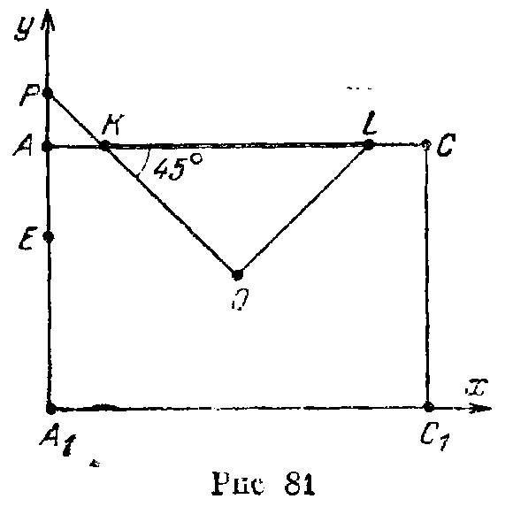
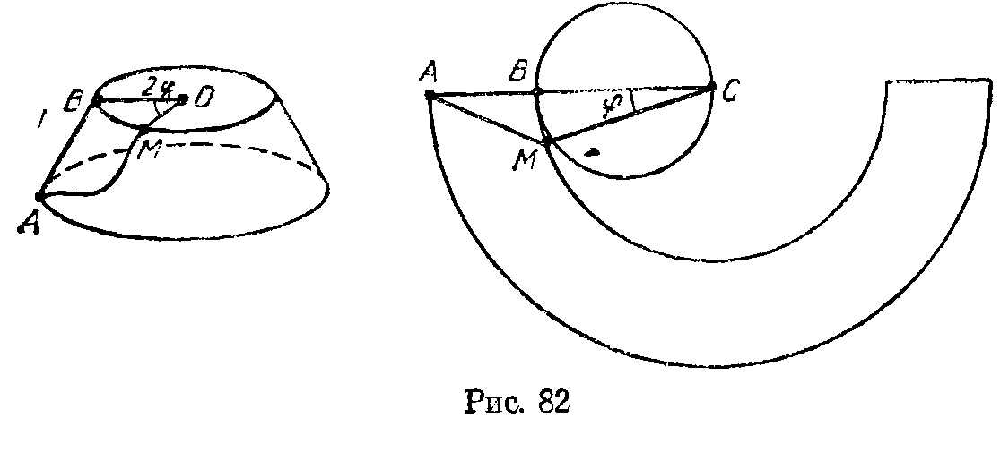
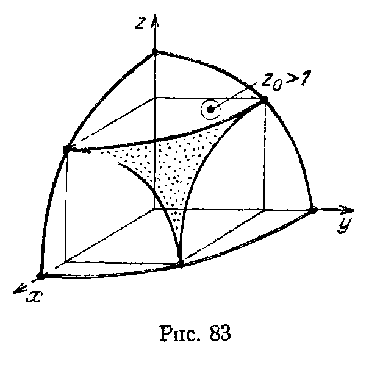
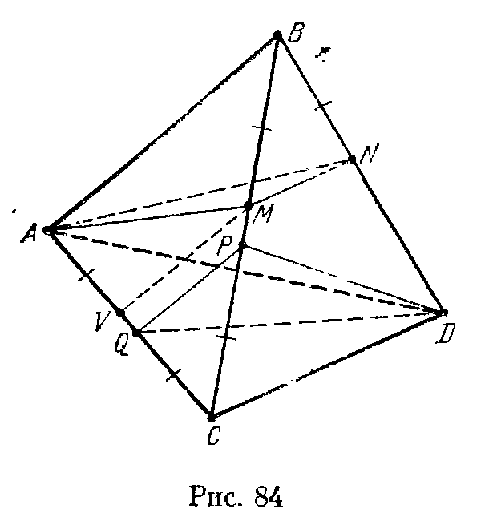

## 11.6. Решения

---
**стр. 210, продолжение**
---

## Решения

**11.1.** Проведем через прямую $b$ плоскость П, параллельную $a$. Пусть $A'$ — проекция точки $A$ на плоскость П. Тогда
$$
AB^2=A'B^2+A'A^2=A'B^2+h^2,
$$
где $h$ — расстояние между прямой $a$ и плоскостью П. Точка $A'$ совпадает с $B$, если $AB\perp\text{П}$.

**11.2.** Пусть плоскость проходит через диагональ $AC_1$ куба $ABCDA_1B_1C_1D_1$ и пересекает его ребра $BB_1$ и $DD_1$ в точках $P$ и $Q$ соответственно. Площадь параллелограмма $APC_1Q$ равна произведению длины отрезка $AC_1$ на расстояние от точки $P$ до прямой $AC_1$. Расстояние от точки $P$ до прямой $AC_1$ минимально, когда $P$ лежит на общем перпендикуляре к прямым $AC_1$ и $BB_1$; этим общим перпендикуляром является прямая, проходящая через середины ребер $BB_1$ и $DD_1$. Итак, площадь сечения будет наименьшей, когда $P$ и $Q$ — середины ребер $BB_1$ и $DD_1$. Это сечение является ромбом с диагоналями $AC_1=a\sqrt3$ и $PQ=a\sqrt2$; его площадь равна $a^2\sqrt6/2$.

**11.3.** Если $M'$ и $N'$ — проекции точек $M$ и $N$ на плоскость $ABC$, то $M'N'\parallel AB$. Пусть $CM'=x$. Тогда $M'N'=x$, а длина проекции отрезка $MN$ на прямую $CC_1$ равна $|a-2x|$. Следовательно,

---
**стр. 211**
---

$$
MN^2=x^2+(a-2x)^2=5x^2-4ax+a^2.
$$

Наименьшая длина отрезка $MN$ равна $a/\sqrt5$.

**11.4.** Пусть точки $M$ и $N$ лежат на прямых $AA_1$ и $BC$ соответственно и отрезок $MN$ пересекает ребро $C_1D_1$ в точке $L$. Тогда точки $M$ и $N$ лежат на лучах $AA_1$ и $BC$, причем $x=AM>a$ и $y=BN>a$. Рассматривая проекции на плоскости $AA_1B$ и $ABC$, получаем соответственно
$$
C_1L:LD_1=a:(x-a)
$$
и
$$
C_1L:LD_1=(y-a):a.
$$
Поэтому $(x-a)(y-a)=a^2$, т. е. $xy=(x+y)a$, а значит,
$$
(xy)^2=(x+y)^2a^2\geqslant4xya^2,
$$
т. е. $xy\geqslant4a^2$. Следовательно,
$$
MN^2=x^2+y^2+a^2=(x+y)^2-2xy+a^2
=\frac{(xy)^2}{a^2}-2xy+a^2
=\frac{(xy-a^2)^2}{a^2}\geqslant9a^2.
$$
Наименьшее значение длины отрезка $MN$ равно $3a$; оно достигается, когда $AM=BN=2a$.

**11.5.** Введем систему координат, направив оси $Ox$, $Oy$ и $Oz$ по лучам $BC$, $BA$ и $BB_1$ соответственно. Пусть точка $M$ прямой $BC_1$ имеет координаты $(x,0,x)$, а точка $N$ прямой $B_1A$ имеет координаты $(0,y,a-y)$. Тогда квадрат длины отрезка $MN$ равен
$$
x^2+y^2+(a-x-y)^2,
$$
а квадрат длины его проекции $M_1N_1$ на плоскость грани $ABCD$ равен $x^2+y^2$. Так как угол между прямыми $MN$ и $M_1N_1$ равен $60^\circ$, то $MN=2M_1N_1$, т. е.
$$
(a-x-y)^2=3(x^2+y^2).
$$

Пусть $u^2=x^2+y^2$ и $v=x+y$. Тогда $MN=2M_1N_1=2u$. Кроме того, $(a-v)^2=3u^2$ по условию и $2u^2\geqslant v^2$. Следовательно,
$$
(a-v)^2\geqslant3v^2/2,
$$
а значит, $v\leqslant a(\sqrt6-2)$. Поэтому
$$
u^2=(a-v)^2/3\geqslant a^2(3-\sqrt6)^2/3
=a^2(\sqrt3-\sqrt2)^2,
$$
т. е.
$$
MN\geqslant2a(\sqrt3-\sqrt2).
$$
Равенство достигается, когда
$$
x=y=\frac{a(\sqrt6-2)}2.
$$

**11.6.** Пусть $r$ — радиус данной сферы. Если осевое сечение конуса является равнобедренным треугольником с высотой $h$ и основанием $2a$, то
$$
ah=S=r\left(a+\sqrt{h^2+a^2}\right).
$$
Следовательно,
$$
a^2(h-r)^2=r^2(h^2+a^2),
$$
т. е.
$$
a^2=\frac{r^2h^2}{h-2r}.
$$
Поэтому объем конуса равен
$$
\frac{\pi r^2h^3}{3(h-2r)}.
$$
Так как
$$
\frac d{dh}\left(\frac{h^2}{h-2r}\right)
=-\frac{4rh-h^2}{(h-2r)^2},
$$
то объем конуса минимален при $h=4r$. В этом случае отношение объемов конуса и цилиндра равно $4/3$.

**11.7.** Пусть $V$ — объем сферического сегмента, $R$ — радиус сферы. Так как $S=2\pi Rh$ (задача 4.24) и
$$
V=\frac{\pi h^2(3R-h)}3
$$
(задача 4.27), то
$$
V=\frac{Sh}{2}-\frac{\pi h^3}{3}.
$$
Поэтому производная $V$ по $h$ равна $S/2-\pi h^2$. Наибольшим объем будет при
$$
h=\sqrt{\frac S{2\pi}};
$$
он равен
$$
S\sqrt{\frac S{18\pi}}.
$$

---
**стр. 212**
---

**11.8.** Пусть $h$ — высота правильной пирамиды, $r$ — радиус вписанной окружности ее основания. Тогда объем и площадь полной поверхности пирамиды равны
$$
\frac n3\tan\frac\pi n\,(r^2h)
\quad\text{и}\quad
n\tan\frac\pi n\left(r^2+r\sqrt{h^2+r^2}\right)
$$
соответственно. Итак, фиксирована величина
$$
r^2+r\sqrt{h^2+r^2}=a
$$
и нужно выяснить, когда максимальна величина $r^2h$ (уже видно, что ответ не зависит от $n$). Так как
$$
h^2+r^2=(a/r-r)^2=(a/r)^2-2a+r^2,
$$
то
$$
(r^2h)^2=a^2r^2-2ar^4.
$$
Производная этой функции по $r$ равна $2a^2r-8ar^3$. Поэтому объем пирамиды максимален, если $r^2=a/4$, а значит, $h^2=2a$. Следовательно, если $\varphi$ — двугранный угол при ребре основания этой пирамиды, то $\tan^2\varphi=8$, т. е. $\cos\varphi=1/3$.

**11.9.** Введем систему координат, направив ее оси по ребрам данного трехгранного угла. Пусть точка $M$ имеет координаты $(\alpha,\beta,\gamma)$; плоскость пересекает ребра трехгранного угла в точках, удаленных от его вершины на расстояния $a$, $b$ и $c$. Тогда эта плоскость задается уравнением
$$
x/a+y/b+z/c=1.
$$
Так как она проходит через точку $M$, то
$$
\alpha/a+\beta/b+\gamma/c=1.
$$
Объем отсеченного тетраэдра равен $abc/6$. Произведение $abc$ будет наименьшим, когда величина $\alpha\beta\gamma/abc$ будет наибольшей, т. е. когда
$$
\alpha/a=\beta/b=\gamma/c=1/3.
$$

**11.10.** Проекция тетраэдра может быть треугольником или четырехугольником. В первом случае она является проекцией одной из граней, поэтому ее площадь не превосходит $\sqrt3a^2/4$. Во втором случае диагонали четырехугольника являются проекциями ребер тетраэдра, поэтому площадь тени, равная половине произведения длин диагоналей на синус угла между ними, не превосходит $a^2/2$; равенство достигается, когда пара противоположных ребер тетраэдра параллельна данной плоскости. Остается заметить, что
$$
\sqrt3a^2/4<a^2/2.
$$

**11.11.** Площадь проекции параллелепипеда вдвое больше площади проекции одного из треугольников с вершинами в концах трех ребер параллелепипеда, выходящих из одной точки; например, если проекцией параллелепипеда является шестиугольник, то в качестве такой вершины нужно взять вершину, проекция которой лежит внутри шестиугольника. Для прямоугольного параллелепипеда все такие треугольники равны. Поэтому площадь проекции параллелепипеда будет наибольшей, когда один из этих треугольников параллелен плоскости проекции. Она будет равна
$$
\sqrt{a^2b^2+b^2c^2+c^2a^2}
$$
(см. задачу 1.22).

**11.12.** Пусть $ABCD$ — квадрат со стороной $a$; точка $X$ удалена от прямой $AB$ на расстояние $b$, причем $b>a$; $C'$ и $D'$ —

---
**стр. 213**
---

точки пересечения продолжений отрезков $XC$ и $XD$ за точки $C$ и $D$ с прямой $AB$. Так как $\triangle C'D'X\sim\triangle CDX$, то $x:b=a:(b-a)$, где $x=C'D'$. Поэтому $x=ab/(b-a)$. Эти рассуждения показывают, что тень, отбрасываемая верхней гранью куба, всегда представляет собой квадрат со стороной $ab/(b-a)$. Следовательно, площадь тени, отбрасываемой кубом, будет наименьшей, когда эта тень совпадает с тенью, отбрасываемой одной лишь верхней гранью, т. е. когда источник света расположен над верхней гранью. При этом площадь тени равна $(ab/(a-b))^2$; нижняя грань куба считается входящей в тень.

**11.13.** а) Проведем через вершины правильного тетраэдра $ABCD$ плоскости, параллельные противоположным граням. Эти плоскости также образуют правильный тетраэдр. Поэтому сумма расстояний от них до внутренней точки $X$ тетраэдра $ABCD$ постоянна (задача 8.1, а). Расстояние от точки $X$ до каждой плоскости не превосходит расстояния от точки $X$ до соответствующей вершины тетраэдра, причем сумма расстояний от точки $X$ до вершин тетраэдра равна сумме расстояний от точки $X$ до этих плоскостей, только если $X$ — центр тетраэдра.

б) Пусть в тетраэдре $ABCD$ ребра $AB$ и $CD$ равны $b$ и $c$, а остальные ребра равны $a$. Если $M$ и $N$ — середины ребер $AB$ и $CD$, то прямая $MN$ является осью симметрии тетраэдра $ABCD$. Пусть $X$ — произвольная точка пространства; точка $Y$ симметрична ей относительно прямой $MN$; $K$ — середина отрезка $XY$ (она лежит на прямой $MN$). Тогда
$$
XA+XB=XA+YA\geqslant2KA=KA+KB.
$$
Аналогично
$$
XC+XD\geqslant KC+KD.
$$
Поэтому достаточно выяснить, чему равно наименьшее значение суммы расстояний до вершин тетраэдра для точек прямой $MN$. Для точек этой прямой сумма расстояний до вершин тетраэдра $ABCD$ не изменится, если отрезок $AB$ повернуть относительно нее так, чтобы он стал параллелен $CD$. При этом получим равнобедренную трапецию $ABCD$ с основаниями $b$ и $c$ и высотой
$$
MN=\sqrt{a^2-(b^2+c^2)/4}.
$$
Для любого выпуклого четырехугольника сумма расстояний до вершин достигает наименьшего значения в точке пересечения диагоналей; при этом она равна сумме длин диагоналей. Легко проверить, что сумма длин диагоналей полученной трапеции $ABCD$ равна $\sqrt{4a^2+2bc}$.

**11.14.** Пусть $O$ — центр куба. Рассмотрим две сферы с центром $O$, содержащие соответственно окружности $S_1$ и $S_2$. Пусть $R_1$ и $R_2$ — радиусы этих сфер. Расстояние между точками окружностей $S_1$ и $S_2$ не может быть меньше $|R_1-R_2|$. Если два конуса с общей вершиной $O$, проходящие соответственно через $S_1$ и $S_2$, пересекаются (т. е. имеют общую образующую), то расстояние между $S_1$ и $S_2$ равно $|R_1-R_2|$. Если же эти конусы не пересекаются, то расстояние между $S_1$ и $S_2$ равно

---
**стр. 214**
---

наименьшему из расстояний между их точками, лежащими в плоскости, проходящей через точку $O$ и центры окружностей, т. е. в плоскости $AA_1CC_1$. Пусть $KL$ — диаметр окружности $S_1$, лежащий в указанной плоскости; $P$ — точка пересечения прямых $OK$ и $AA_1$ (рис. 81).

Введем систему координат, направив оси $Ox$ и $Oy$ по лучам $A_1C_1$ и $A_1A$. Точки $E$, $O$ и $K$ имеют координаты $(0,b)$, $(a/\sqrt2,a/2)$ и $(a(\sqrt2-1)/2,a)$ соответственно, поэтому
$$
R_2=OE=\sqrt{b^2-ab+3a^2/4}
$$
и
$$
EK=\sqrt{4b^2-8ab+(7-2\sqrt2)a^2}/2.
$$
Ясно также, что $R_1=a/\sqrt2$.

Конусы пересекаются, если
$$
b=A_1E\geqslant A_1P=a(\sqrt2+1)/2.
$$
В этом случае наименьшее значение $MN$ равно $R_2-R_1$.

Если же $b<a(\sqrt2+1)/2$, то конусы не пересекаются и наименьшее значение $MN$ равно $EK$.

**11.15.** Докажем, что кратчайший путь, идущий из точки $A$ границы большего основания в диаметрально противоположную точку $C$ другого основания, состоит из образующей $AB$ и диаметра $BC$; длина этого пути равна $2R$. Пусть $r$ — радиус меньшего основания, $O$ — его центр. Рассмотрим путь, идущий из $A$ в некоторую точку $M$ меньшего основания. Так как развертка боковой поверхности конуса с углом $\alpha$ между осью и образующей представляет

собой сектор окружности радиуса $R$, имеющий длину дуги $2\pi R\sin\alpha$, то развертка боковой поверхности данного усеченного конуса с углом $\alpha=30^\circ$ представляет собой полукольцо с

---
**стр. 215**
---

внешним радиусом $2R$ и внутренним радиусом $2r$. Кроме того, если $\angle BOM=2\varphi$, то на развертке $\angle BCM=\varphi$ (см. рис. 82). Длина любого пути из $A$ в $M$ не меньше длины отрезка $AM$ на развертке конуса. Следовательно, длина пути из $A$ в $C$ не меньше $AM+CM$, где
$$
AM^2=AC^2+CM^2-2AM\cdot CM\cos\angle ACM
=4R^2+4r^2-8Rr\cos\varphi
$$
(на развертке) и $CM=2r\cos\varphi$ (на поверхности конуса). Остается проверить, что
$$
\sqrt{4R^2+4r^2-8rR\cos\varphi}+2r\cos\varphi\geqslant2R.
$$
Так как $2R-2r\cos\varphi>0$, то, перенося $2r\cos\varphi$ в правую часть и возводя обе части нового неравенства в квадрат, легко получаем требуемое.

**11.16.** Пусть углы между прямой $l$ и прямыми $OA$, $OB$ и $OC$ равны $\alpha$, $\beta$ и $\gamma$. Тогда
$$
\cos^2\alpha+\cos^2\beta+\cos^2\gamma=1
$$
(задача 1.21), а значит,
$$
\sin^2\alpha+\sin^2\beta+\sin^2\gamma=2.
$$
Сумма расстояний от точек $A$, $B$ и $C$ до прямой $l$ равна
$$
a\sin\alpha+b\sin\beta+c\sin\gamma.
$$
Пусть $x=\sin\alpha$, $y=\sin\beta$, $z=\sin\gamma$. В задаче требуется найти наибольшее и наименьшее значение величины $ax+by+cz$ при следующих условиях:
$$
x^2+y^2+z^2=2,\qquad 0\leqslant x,y,z\leqslant1.
$$
Эти условия выделяют на поверхности сферы $x^2+y^2+z^2=2$ криволинейный треугольник (рис. 83).

Пусть плоскость
$$
ax+by+cz=p_0
$$
касается поверхности сферы $x^2+y^2+z^2=2$ в точке $M_0$ с координатами $(x_0,y_0,z_0)$, причем $x_0,y_0,z_0\geqslant0$. Тогда
$$
x_0=\lambda a,\qquad y_0=\lambda b,\qquad z_0=\lambda c
$$
и
$$
\lambda^2(a^2+b^2+c^2)=2,
$$
а
$$
p_0=\lambda(a^2+b^2+c^2)=\sqrt{2(a^2+b^2+c^2)}.
$$
Если $z_0\leqslant1$ (т. е. $c^2\leqslant a^2+b^2$), то $M_0$ принадлежит выделенному криволинейному треугольнику, а значит, в этом случае $p_0$ — искомое наибольшее значение функции $ax+by+cz$.

Пусть теперь $z_0>1$, т. е. $c^2>a^2+b^2$. Плоскость $ax+by+cz=p$, где $p<p_0$, пересекает рассматриваемую сферу по окружности. Нас интересуют те значения $p$, при которых эта окружность пересекается с выделенным криволинейным треугольником. Наибольшее из таких $p$ соответствует значению $z'_0=1$. Нахождение $x'_0$ и $y'_0$ сводится к задаче: при каких $x$ и $y$ достигает наибольшего значения выражение $ax+by$, если $x^2+y^2=1$. Легко проверить, что
$$
x'_0=\frac a{\sqrt{a^2+b^2}}
\quad\text{и}\quad
y'_0=
$$

---
**стр. 216**
---

$=b/\sqrt{a^2+b^2}$, т. е. в этом случае искомое наибольшее значение $p$ равно $\sqrt{a^2+b^2}+c$.

Докажем теперь, что наименьшее значение выражения $ax+by+cz$ на выделенном треугольнике достигается в вершине $x_1=y_1=1$, $z_1=0$. В самом деле, так как $0\leqslant x,y,z\leqslant1$, то
$x+y+z\geqslant x^2+y^2+z^2=2$, а значит, $y+z-1\geqslant1-x$.
Обе части этого неравенства неотрицательны, поэтому $b(y+z-1)\geqslant a(1-x)$. Следовательно,
$ax+by+cz\geqslant ax+by+bz\geqslant a+b$.

**11.17.** Пусть $A$ — точка пересечения прямой $l$ с ребром двугранного угла. Отложим на прямой $l$ отрезок $AB$ длиной 1. Пусть $B'$ — проекция точки $B$ на плоскость другой грани, $O$ — проекция точки $B$ на ребро двугранного угла. Тогда
$\sin BAB'=BB'=OB\sin BOB'=\sin BAO\sin BOB'$.
Так как $\sin BOB'$ — синус данного двугранного угла, то $\sin BAB'$ максимален, когда $\angle BAO=90^\circ$.

**11.18.** Пусть $AA_1=1$, $AM=x$. Введем систему координат, оси которой параллельны ребрам призмы. Векторы $\overrightarrow{MA_1}$ и $\overrightarrow{MC_1}$ имеют координаты $(0,1,-x)$ и $(2,1,2-x)$; их скалярное произведение равно $1-2x+x^2=(1-x)^2\geqslant0$. Поэтому $\angle A_1MC_1\leqslant90^\circ$; при $x=1$ этот угол равен $90^\circ$.

**11.19.** Существует параллелепипед $ABCDA_1B_1C_1D_1$, ребра $AA_1$, $DC$ и $B_1C_1$ которого лежат на осях данных цилиндров (задача 1.19); ясно, что этот параллелепипед является кубом с ребром $2R$.

а) Центр этого куба удален от всех ребер на расстояние $\sqrt2R$, а любая другая точка удалена на расстояние больше $\sqrt2R$ хотя бы от одной из прямых $AA_1$, $DC$, $B_1C_1$ (задача 1.31). Поэтому радиус наименьшего шара, касающегося всех трех цилиндров, равен $(\sqrt2-1)R$.

б) Пусть $K$, $L$ и $M$ — середины ребер $AD$, $A_1B_1$ и $CC_1$, т. е. точки попарного касания данных цилиндров. Тогда треугольник $KLM$ — правильный, причем его центр $O$ совпадает с центром куба (задача 1.3). Пусть $K'$, $L'$ и $M'$ — середины ребер $B_1C_1$, $DC$ и $AA_1$; эти точки симметричны точкам $K$, $L$ и $M$ относительно $O$. Докажем, что прямая $l$, проходящая через точку $O$ перпендикулярно плоскости $KLM$, удалена от прямых $B_1C_1$, $DC$ и $AA_1$ на расстояние $\sqrt2R$. В самом деле, $K'O\perp l$ и $K'O\perp B_1C_1$, поэтому расстояние между прямыми $l$ и $B_1C_1$ равно $K'O=\sqrt2R$; для остальных прямых доказательство аналогично. Следовательно, радиус цилиндра с осью $l$, касающегося трех данных цилиндров, равен $(\sqrt2-1)R$. Остается-

---
**стр. 217**
---

проверить, что расстояние от любой прямой $l'$, пересекающей треугольник $KLM$, до одной из точек $K'$, $L'$, $M'$ не превосходит $\sqrt2R$. Пусть, например, точка $X$ пересечения прямой $l'$ с плоскостью $KLM$ лежит внутри треугольника $KOL$. Тогда $M'X\leqslant\sqrt2R$.

**11.20.** В процессе прохождения тетраэдра сквозь отверстие обязательно будет момент, когда вершина $B$ находится по одну сторону от плоскости отверстия, вершина $A$ — в плоскости отверстия, а вершины $C$ и $D$ — по другую сторону от плоскости отверстия (или в плоскости отверстия). Пусть в этот момент плоскость отверстия пересекает ребра $BC$ и $BD$ в точках $M$ и $N$; окружность отверстия содержит треугольник $AMN$. Выясним теперь, при каком положении точек $M$ и $N$ радиус наименьшей окружности, содержащей треугольник $AMN$, будет наименьшим.

Предположим сначала, что треугольник $AMN$ — остроугольный. Тогда наименьшей окружностью, его содержащей, является его описанная окружность (см. Прасолов, II, 15.127). Если сфера, экватором которой является описанная окружность треугольника $AMN$, не касается, например, ребра $BC$, то внутри этой сферы на ребре $BC$ можно взять вблизи точки $M$ такую точку $M'$, что треугольник $AM'N$ остроугольный и радиус его описанной окружности меньше радиуса описанной окружности треугольника $AMN$. Поэтому в том положении, когда радиус описанной окружности треугольника $AMN$ минимален, рассматриваемая сфера касается ребер $BC$ и $BD$, а значит, $BM=BN=x$. Треугольник $AMN$ — равнобедренный, и в нем
$MN=x$, $AM=AN=\sqrt{x^2-x+1}$.
Пусть $K$ — середина $MN$, $L$ — проекция $B$ на плоскость $AMN$. Так как центр сферы лежит в этой плоскости, а прямые $BM$ и $BN$ касаются данной сферы, то $LN$ и $LM$ — касательные к описанной окружности треугольника $AMN$. Если $\angle MAN=\alpha$, то
$$LK=MK\tg\alpha=\frac{x^2\sqrt{3x^2-4x+4}}{2(x^2-2x+2)}.$$
В треугольнике $AKB$ угол $AKB=\beta$ тупой и
$$\cos\beta=\frac{3x-2}{\sqrt{3(3x^2-4x+4)}}.$$
Поэтому
$$LK=-KB\cos\beta=\frac{x(2-3x)}{2\sqrt{3x^2-4x+4}}.$$
Приравнивая два выражения для $LK$, получим для $x$ уравнение
$$3x^3-6x^2+7x-2=0. \tag{1}$$

Радиус $R$ описанной окружности треугольника $AMN$ равен
$$\frac{x^2-x+1}{\sqrt{3x^2-4x+4}}.$$
Приближенные вычисления корня уравнения дают значения $x\approx0{,}3913$, $R\approx0{,}4478$ (с ошибкой, не превосходящей $0{,}00005$).

Предположим теперь, что треугольник $AMN$ — не остроугольный. Пусть $BM=x$, $BN=y$. Тогда $AM^2=1-x+x^2$,

---
**стр. 218**
---

$AN^2=1-y+y^2$ и $MN^2=x^2+y^2-xy$. Угол $MAN$ — острый, так как $AM^2+AN^2>MN^2$. Пусть для определенности угол $ANM$ — не острый, т. е.
$$1-x+x^2\geqslant(x^2+y^2-xy)+(1-y+y^2).$$
Тогда $0\leqslant x\leqslant y(1-2y)/(1-y)$, поэтому $y\leqslant0{,}5$, а значит, $x\leqslant2y(1-2y)\leqslant1/4$. На отрезке $[0,1/2]$ квадратный трехчлен $1-x+x^2$ убывает, поэтому
$$AM^2\geqslant1-\frac14+\frac1{16}=\frac{13}{16}>(0{,}9)^2,$$
т. е. в случае тупоугольного треугольника $AMN$ радиус наименьшей окружности, его содержащей, больше, чем в случае остроугольного.

Докажем, что в отверстие найденного радиуса $R$ тетраэдр может пройти. Отложим на ребрах тетраэдра отрезки длины $x$, где $x$ — корень уравнения (1), так, как показано на рис. 84, и проделаем следующую последовательность движений:

а) расположим тетраэдр так, чтобы окружность отверстия была описанной окружностью треугольника $AMN$, и будем поворачивать тетраэдр вокруг прямой $MN$ до тех пор, пока точка $V$ не попадет в плоскость отверстия;

б) сдвинем тетраэдр так, чтобы плоскость $VMN$ оставалась параллельной своему исходному положению, а точки $P$ и $Q$ попали на границу отверстия;

в) будем поворачивать тетраэдр вокруг прямой $PQ$ до тех пор, пока вершина $D$ не попадет в плоскость отверстия.

Докажем, что все эти операции осуществимы. При повороте тетраэдра вокруг прямой $MN$ плоскость отверстия пересекает его по трапеции, диагональ которой уменьшается от $NA$ до $NV$, а острый угол при большем основании возрастает до $90^\circ$. Следовательно, радиус описанной около трапеции окружности уменьшается. Поэтому операция а) и аналогичная ей операция в) осуществимы.

Возьмем на ребре $BC$ точку $T$. Сечение тетраэдра $ABCD$, параллельное $VMN$ и проходящее через точку $T$, является прямоугольником с диагональю
$$\sqrt{t^2+(1-t)^2}=\sqrt{2(t-0{,}5)^2+0{,}5^2},$$
где $t=BT$. Из этого следует осуществимость операции б).

**Ответ:** через отверстие радиуса $0{,}45$ тетраэдр пройти может, а через отверстие радиуса $0{,}44$ не может.
