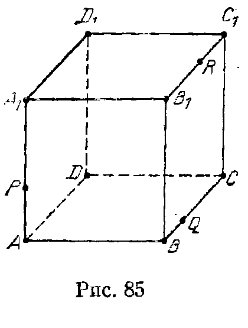

## 12.4. Построения на изображениях

---
**стр. 221, продолжение**
---

## § 4. Построения на изображениях

**12.20.** Дано изображение проекции на некоторую плоскость куба $ABCDA_1B_1C_1D_1$ с отмеченными точками $P$, $Q$, $R$ на ребрах $AA_1$, $BC$, $B_1C_1$ (рис. 85). Постройте на этом изображении сечение куба плоскостью $PQR$.

**12.21.** Дано изображение проекции на некоторую плоскость куба $ABCDA_1B_1C_1D_1$ с отмеченными точками $P$, $Q$, $R$ из ребрах $AA_1$, $BC$ и $C_1D_1$. Постройте на этом изображении сечение куба плоскостью $PQR$.

**12.22.** а) Дано изображение проекции на некоторую плоскость трехгранного угла $Oabc$, на гранях $Obc$ и $Oac$ которого отмечены точки $A$ и $B$. Постройте на этом изображении точку пересечения прямой $AB$ с плоскостью $Oab$.

б) Дано изображение проекции на некоторую плоскость трехгранного угла с тремя отмеченными на его гранях точками. Постройте на этом изображении сечение трехгранного угла плоскостью, проходящей через отмеченные точки.

**12.23.** Дано изображение проекции на некоторую плоскость трехгранной призмы с параллельными ребрами $a$, $b$ и $c$, на боковых гранях которой отмечены

---
**стр. 222**
---

точки $A$, $B$ и $C$. Постройте на этом изображении сечение призмы плоскостью $ABC$.

**12.24.** $ABCDA_1B_1C_1D_1$ — выпуклый шестигранник с четырехугольными гранями. Дано изображение проекций на некоторую плоскость трех его граней, сходящихся в вершине $B$ (и тем самым — семи его вершин). Постройте изображение восьмой его вершины $D_1$.
