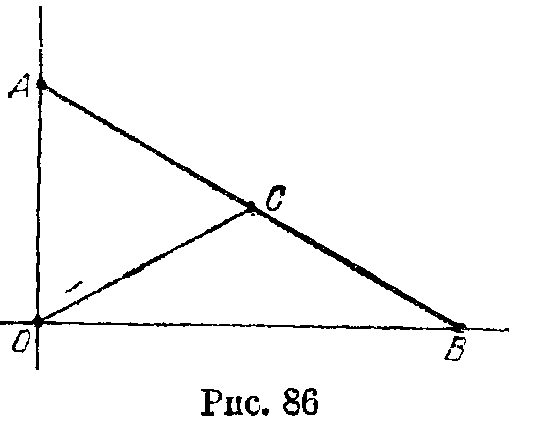
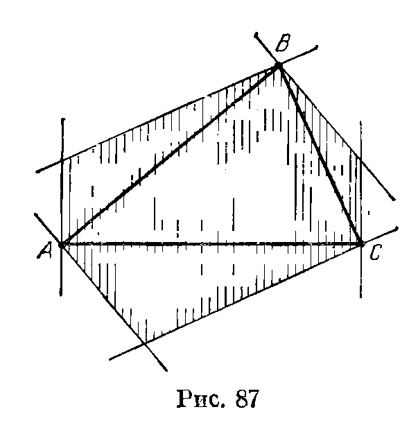
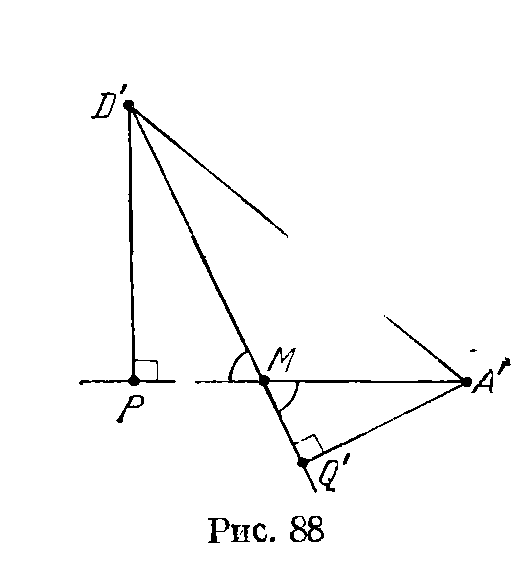
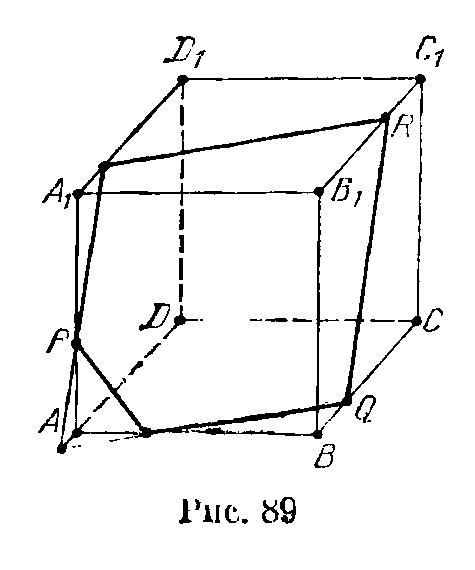
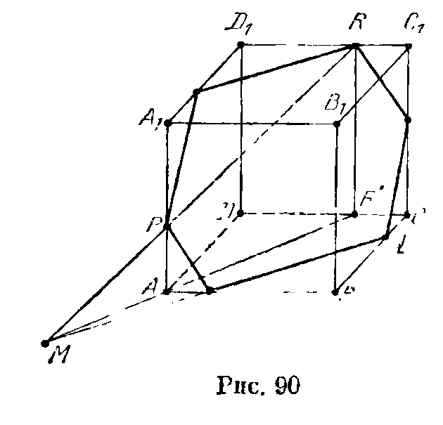
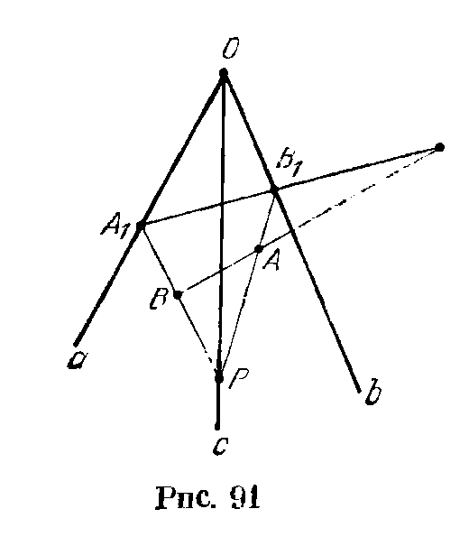
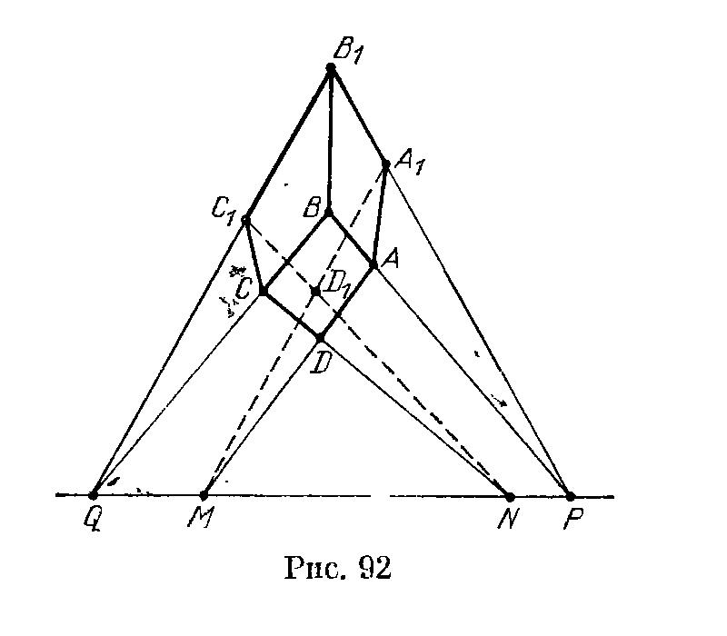
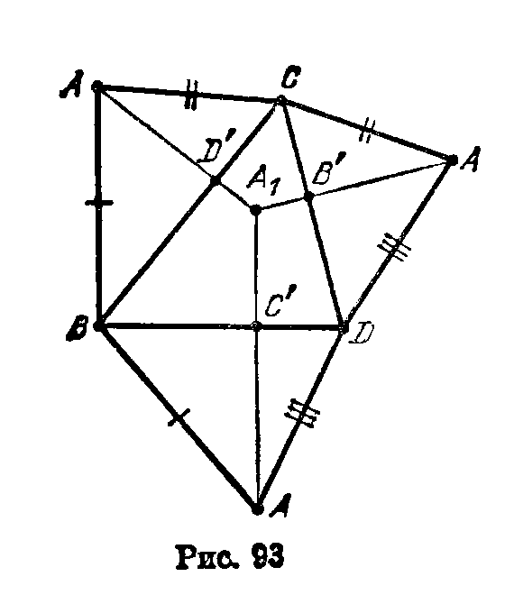
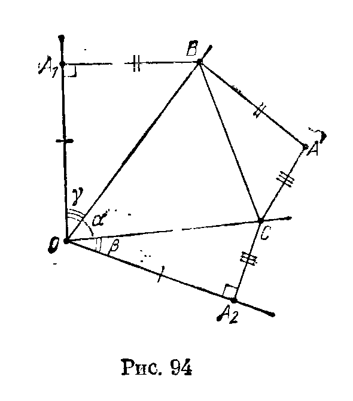
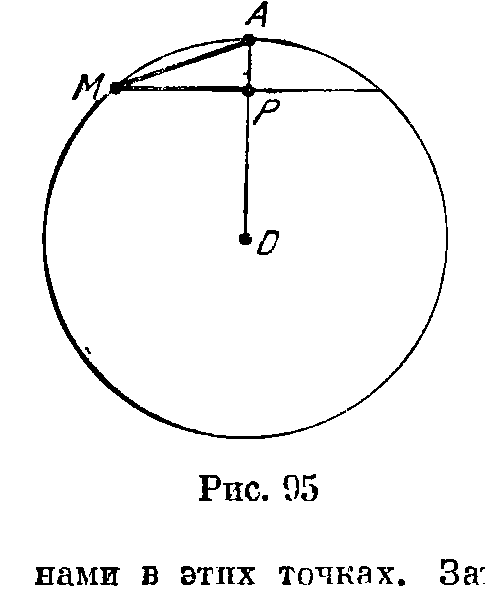

## 12.6. Решения

---
**стр. 222, продолжение**
---

## Решения

**12.1.** Пусть данные прямые $l_1$ и $l_2$ пересекают данную плоскость $\Pi$ в точках $P$ и $Q$ (если $l_1\parallel\Pi$ или $l_2\parallel\Pi$, то искомых отрезков нет). Проведем через середину $M$ отрезка $PQ$ прямые $l'_1$ и $l'_2$, параллельные прямым $l_1$ и $l_2$ соответственно. Пусть некоторая плоскость, параллельная плоскости $\Pi$, пересекает прямые $l_1$ и $l_2$ в точках $A_1$ и $A_2$, а прямые $l'_1$ и $l'_2$ — в точках $M_1$ и $M_2$. Тогда $A_1A_2$ — искомый отрезок, причем его середина совпадает с серединой отрезка $M_1M_2$, так как $M_1A_1M_2A_2$ — параллелограмм. Середины отрезков $M_1M_2$ лежат на одной прямой, так как все эти отрезки параллельны друг другу.

**12.2.** Середина любого отрезка с концами на двух скрещивающихся прямых лежит в плоскости, параллельной им и равноудаленной от них. Пусть расстояние между данными прямыми равно $a$. Тогда длина проекции на рассматриваемую «серединную» плоскость отрезка длиной $d$ с концами на данных прямых равна $\sqrt{d^2-a^2}$. Поэтому искомое ГМТ состоит из середин отрезков длиной $\sqrt{d^2-a^2}$ с концами на проекциях данных прямых «на серединную» плоскость (рис. 86). Легко проверить, что $OC=AB/2$, т. е. искомое ГМТ является окружностью с центром $O$ и радиусом $\sqrt{d^2-a^2}/2$.

---
**стр. 223**
---

**12.3.** Геометрическим местом середин сторон $AB$ указанных треугольников является прямая $l$ (см. задачу 12.1). Искомое ГМТ состоит из точек, делящих в отношении $1:2$ отрезки, параллельные данной плоскости и концы которых лежат на прямой $l$ и на третьей данной прямой. Слегка изменив решение задачи 12.1, можно доказать, что это ГМТ тоже является прямой.

**12.4.** Пусть $\pi_1$ и $\pi_2$ — перпендикулярные плоскости, проходящие через прямые $l_1$ и $l_2$; $l$ — прямая их пересечения; $X$ — проекция на прямую $l$ точки $A$, лежащей на прямой $l_1$. Проведем через точку $A$ плоскость $\Pi$, перпендикулярную прямой $l_2$. Так как $\Pi\perp l_2$, то $\Pi\perp\pi_2$. Поэтому прямая $AX$ лежит в плоскости $\Pi$. А значит, если $B$ — точка пересечения $\Pi$ и $l_2$, то $\angle BXA=90^\circ$, т. е. точка $X$ лежит на окружности с диаметром $AB$, построенной в плоскости $\Pi$.

**12.5.** Проведем через точку $A$ плоскость, перпендикулярную прямой $l$. Пусть $M'$ и $N'$ — проекции точек $M$ и $N$ на эту плоскость. Так как $MN\perp l$, то $M'N'\parallel MN$. Прямая $MN$ перпендикулярна плоскости $AMM'$, так как $NM\perp MM'$ и $NM\perp AM$; поэтому $NM\perp AM'$, а значит, точка $M'$ лежит на окружности с диаметром $N'A$. Следовательно, искомое ГМТ — цилиндр, диаметрально противоположными образующими которого являются прямая $l$ и прямая $t$, проходящая через точку $A$ параллельно $l$; прямые $l$ и $t$ следует исключить.

**12.6.** При проекции на плоскость, перпендикулярную $l_3$, прямая $l_3$ переходит в точку $A_3$, а проекция $M'N'$ прямой $MN$ проходит через эту точку; кроме того, проекции прямых $l_1$ и $l_2$ параллельны. Поэтому
$$
\overrightarrow{A_1M'}:\overrightarrow{A_2N'}
=\overrightarrow{A_1A_3}:\overrightarrow{A_2A_3}
=\lambda
$$
— постоянное число, а значит, $\overrightarrow{A_1M'}=t\vec a$ и $\overrightarrow{A_2N'}=t\vec b$. Пусть $O$ и $X$ — середины отрезков $A_1A_2$ и $MN$. Тогда
$$
2\overrightarrow{OX}
=\overrightarrow{A_1M}+\overrightarrow{A_2N}
=t(\vec a+\vec b),
$$
т. е. все точки $X$ лежат на одной прямой.

**12.7.** Пусть $B_1B_2$ — общий перпендикуляр к данным прямым (точки $A_1$ и $B_1$ лежат на одной данной прямой). Так как $A_2B_1\perp A_1B_1$, точка $B_1$ принадлежит сфере с диаметром $A_1A_2$. Аналогично точка $B_2$ принадлежит этой сфере. Геометрическим местом середин отрезков $A_1A_2$, т. е. центров рассматриваемых сфер, является некоторая прямая $l$ (задача 12.1). Любая точка этой прямой равноудалена от $B_1$ и $B_2$, поэтому $l\perp B_1B_2$. Пусть $M$ — середина отрезка $B_1B_2$; $O$ — основание перпендикуляра,

---
**стр. 224**
---

опущенного из точки $M$ на прямую $l$. Окружность радиуса $OB_1$ с центром $O$, проходящая через точки $B_1$ и $B_2$, будет искомой.

**12.8.** Пусть $A_1$ и $B_1$ — положения точек $A$ и $B$ в другой момент времени; $\Pi$ — плоскость, параллельная данным скрещивающимся прямым. Рассмотрим проекцию на плоскость $\Pi$ параллельно прямой $A_1B_1$. Пусть $A'$, $B'$, $M'$ и $N'$ — проекции точек $A$, $B$, $M$ и $N$; $C'$ — проекция прямой $A_1B_1$. Точки $M$ и $N$ двигаются в фиксированных плоскостях, параллельных плоскости $\Pi$, поэтому достаточно проверить, что точки $M'$ и $N'$ двигаются по двум перпендикулярным прямым. Так как
$$
A'M':M'B'=k=A'C':C'B',
$$
то $C'M'$ — биссектриса угла $A'C'B'$. Аналогично $C'N'$ — биссектриса угла, смежного с углом $A'C'B'$. Биссектрисы двух смежных углов перпендикулярны.

**12.9.** Пусть прямая $l_1$, содержащая точку $M$, касается сферы в точке $A$, а прямая $l_2$ — в точке $B$. Проведем через прямую $l_1$ плоскость, параллельную $l_2$, и рассмотрим проекцию на эту плоскость параллельно прямой $AB$. Пусть $N'$ и $X'$ — образы точек $N$ и $X$ при этой проекции. Так как $AM=MX$ и $BN=NX$, то
$$
AM:AN'=AM:BN=XM:XN=X'M:X'N',
$$
а значит, $AX'$ — биссектриса угла $MAN'$. Поэтому точка $X$ лежит в плоскости, проходящей через прямую $AB$ и образующей равные углы с прямыми $l_1$ и $l_2$ (таких плоскостей две). Искомое ГМТ состоит из двух окружностей, по которым эти плоскости пересекают данную сферу; точки $A$ и $B$ при этом следует исключить.

**12.10.** Пусть $C$ — точка пересечения прямой $AB$ с данной плоскостью, $M$ — точка касания одной из искомых сфер с плоскостью $\Pi$. Так как $CM^2=CA\cdot CB$, точка $M$ лежит на окружности радиуса $\sqrt{CA\cdot CB}$ с центром $C$. Следовательно, центр $O$ сферы принадлежит боковой поверхности прямого цилиндра, основанием которого служит эта окружность. Кроме того, центр сферы принадлежит плоскости, проходящей через середину отрезка $AB$ перпендикулярно ему.

Предположим теперь, что точка $O$ равноудалена от $A$ и $B$ и расстояние от точки $C$ до проекции $M$ точки $O$ на плоскость $\Pi$ равно $\sqrt{CA\cdot CB}$. Пусть $CM_1$ — касательная к сфере радиуса $OA$ с центром $O$. Тогда $CM=CM_1$, поэтому
$$
OM^2=CO^2-CM^2=CO^2-CM_1^2=OM_1^2,
$$
т. е. точка $M$ принадлежит рассматриваемой сфере. А так как $OM\perp\Pi$, то $M$ — точка касания этой сферы с плоскостью $\Pi$.

Итак, искомое ГМТ является пересечением боковой поверхности цилиндра с плоскостью.

**12.11.** а) Пусть данные сферы пересекают плоскость $\Pi$ по окружностям $S_1$ и $S_2$. Общие внутренние касательные к этим

---
**стр. 225**
---

окружностями разбивают плоскость на 4 части. Рассмотрим прямой круговой конус, осевым сечением которого являются те части, которые содержат $S_1$ и $S_2$. Плоскости, касающиеся данных сфер внутренним образом, касаются этого конуса. Любая такая плоскость пересекает плоскость $\Pi$ по прямой, лежащей вне осевого сечения конуса. Искомое ГМТ состоит из точек, лежащих вне осевого сечения конуса (граница осевого сечения входит в ГМТ).

б) Решается аналогично задаче а). Проводятся общие внешние касательные и рассматривается осевое сечение, состоящее из части плоскости, содержащей обе окружности, и части, ей симметричной.

**12.12.** Пересечением плоскостей $ABC_1$ и $AB_1C$ является прямая $AM$, где $M$ — точка пересечения диагоналей $BC_1$ и $B_1C$ трапеции $BCC_1B_1$. Точка $M$ лежит на прямой $l$, проходящей через середины отрезков $BC$ и $B_1C_1$ и вершину данного трехгранного угла (см. [Прасолов, 1.22]). Прямая $l$ однозначно определяется плоскостью $\Pi$; поэтому однозначно определена плоскость $\Pi_a$, содержащая прямую $l$ и точку $A$. Точка пересечения прямой $AM$ с плоскостью $A_1BC$ принадлежит плоскости $\Pi_a$, так как этой плоскости принадлежит вся прямая $AM$. Аналогично $\Pi_a$ построим плоскость $\Pi_b$; пусть $m$ — прямая пересечения этих плоскостей (плоскость $\Pi_c$ тоже проходит через прямую $m$). Искомое ГМТ состоит из точек этой прямой, лежащих внутри данного трехгранного угла.

**12.13.** На ребрах данного трехгранного угла с вершиной $O$ выберем точки $A$, $B$ и $C$, расстояния от которых до плоскостей граней равны данному числу $a$. Площадь $S$ каждого из треугольников $OAB$, $OBC$ и $OCA$ равна $3V/a$, где $V$ — объем тетраэдра $OABC$. Пусть точка $X$ лежит внутри трехгранного угла $OABC$, причем расстояния от нее до плоскостей его граней равны $a_1$, $a_2$ и $a_3$. Тогда сумма объемов пирамид с вершиной $X$ и основаниями $OAB$, $OBC$ и $OCA$ равна $S(a_1+a_2+a_3)/3$. Поэтому
$$
V=S(a_1+a_2+a_3)/3\pm v,
$$
где $v$ — объем тетраэдра $XABC$. Так как $V=Sa/3$, то $a_1+a_2+a_3=a$ тогда и только тогда, когда $v=0$, т. е. $X$ лежит в плоскости $ABC$.

Пусть точки $A'$, $B'$ и $C'$ симметричны $A$, $B$ и $C$ относительно точки $O$. Так как любая точка лежит внутри одного из 8 трехгранных углов, образованных плоскостями граней данного трехгранного угла, то искомым ГМТ является поверхность выпуклого многогранника $ABCA'B'C'$.

**12.14.** Введем прямоугольную систему координат, направив ее оси по ребрам данного трехгранного угла. Пусть $O_1$ — центр окружности; $\Pi$ — плоскость окружности; $\alpha$, $\beta$ и $\gamma$ — углы между плоскостью $\Pi$ и координатными плоскостями. Так как

---
**стр. 226**
---

расстояние от точки $O_1$ до прямой пересечения плоскостей $\Pi$ и $Oyz$ равно $R$, а угол между этими плоскостями равен $\alpha$, то расстояние от точки $O_1$ до плоскости $Oyz$ равно $R\sin\alpha$. Аналогичные рассуждения показывают, что точка $O_1$ имеет координаты
$$
(R\sin\alpha,\ R\sin\beta,\ R\sin\gamma).
$$
Так как $\cos^2\alpha+\cos^2\beta+\cos^2\gamma=1$ (задача 1.21), то $\sin^2\alpha+\sin^2\beta+\sin^2\gamma=2$, а значит, $OO_1=\sqrt2R$. Кроме того, расстояние от точки $O_1$ до любой грани трехгранного угла не больше $R$. Искомое ГМТ является частью сферы радиуса $\sqrt2R$ с центром в начале координат, ограниченной плоскостями $x=R$, $y=R$ и $z=R$.

**12.15.** Если углы $XAB$ и $XBA$ острые, то точка $X$ лежит между плоскостями, проведенными через точки $A$ и $B$ перпендикулярно прямой $AB$ (для точек $X$, не лежащих на отрезке $AB$, верно и обратное). Поэтому искомое ГМТ лежит внутри (но не на сторонах) выпуклого шестиугольника, стороны которого проходят через вершины треугольника $ABC$ перпендикулярно его сторонам (рис. 87). Если расстояние от точки $X$ до плоскости $ABC$ больше, чем наибольшая сторона треугольника $ABC$, то углы $AXB$, $AXC$ и $BXC$ острые. Поэтому искомое ГМТ — внутренность указанного шестиугольника.

**12.16.** Достаточно проверить, что точка $P$ удалена от каждой стороны треугольника $ABC$ не более, чем его противоположная вершина. Докажем это утверждение, например, для стороны $BC$. Рассмотрим для этого проекцию на плоскость, перпендикулярную прямой $BC$; точки $B$ и $C$ при этой проекции переходят в одну точку $M$ (рис. 88). Пусть $A'Q'$ — проекция соответствующей высоты тетраэдра. Так как $D'P\leqslant A'Q'$ по условию, то $D'M\leqslant A'M$. Ясно также, что $PM\leqslant D'M$.

**12.17.** Каждый рассматриваемый многогранник получается из данного куба $ABCDA_1B_1C_1D_1$ путем отсечения тетраэдров от каждой из его вершин. Тетраэдр, отсекаемый от вершины $A_1$, содержится в тетраэдре $AA_1BD_1$. Таким образом, если от куба отсечь тетраэдры, каждый из которых задан тремя ребрами куба, выходящими из одной точки, то оставшаяся часть куба содержится в любом из рассматриваемых многогранников. Легко проверить, что оставшаяся часть является октаэдром с вершинами в центрах граней куба. Если же точка не принадлежит этому октаэдру, то нетрудно указать многогранник, которому она не принадлежит; в качестве такого многогранника можно взять тетраэдр $AB_1CD_1$ или тетраэдр $A_1BC_1D$.

**12.18.** Пусть $P$ и $Q$ — точки пересечения продолжений противоположных сторон четырехугольника $ABCD$. Тогда $MP$ и $MQ$ — прямые пересечения плоскостей противоположных граней пирамиды $MABCD$. Сечение пары плоскостей, перес-

---
**стр. 227**
---

кающихся по прямой $l$, представляет собой две параллельные прямые, только если плоскость сечения параллельна $l$. Поэтому сечение пирамиды $MABCD$ является параллелограммом, только если плоскость сечения параллельна плоскости $MPQ$; при этом стороны параллелограмма параллельны $MP$ и $MQ$.

а) В сечении может получиться прямоугольник, только если $\angle PMQ=90^\circ$, т. е. точка $M$ лежит на сфере с диаметром $PQ$; точки этой сферы, лежащие в плоскости данного четырехугольника, следует исключить.

б) Пусть $K$ и $L$ — точки пересечения продолжений диагоналей $AC$ и $BD$ с прямой $PQ$. Так как диагонали параллелограмма, получающегося в сечении пирамиды $MABCD$, параллельны прямым $MK$ и $ML$, то он будет ромбом, только если $\angle KML=90^\circ$, т. е. точка $M$ лежит на сфере с диаметром $KL$; точки этой сферы, лежащие в плоскости данного четырехугольника, следует исключить.

**12.19.** Пусть $(x,y,z)$ — координаты конца ломаной, $(x_i,y_i,z_i)$ — координаты вектора $i$-го звена ломаной. Из условия задачи следует, что числа $x_i$, $y_i$ и $z_i$ ненулевые и имеют тот же знак, что и числа $x$, $y$ и $z$ соответственно. Поэтому
$$
|x|+|y|+|z|=\sum\bigl(|x_i|+|y_i|+|z_i|\bigr)
$$
и
$$
|x_i|+|y_i|+|z_i|>l_i,
$$
где $l_i$ — длина $i$-го звена ломаной. Следовательно,
$$
|x|+|y|+|z|>\sum l_i=a.
$$
Кроме того, длина вектора $(x,y,z)$ не превосходит длины ломаной, т. е. она не превосходит $a$.

Докажем теперь, что все точки шара радиуса $a$ с центром в начале координат, лежащие вне октаэдра, задаваемого уравнением $|x|+|y|+|z|\leqslant a$, кроме точек координатных плоскостей, принадлежат искомому ГМТ. Пусть $M=(x,y,z)$ — точка грани указанного октаэдра. Тогда ломаная с вершинами $(0,0,0)$, $(x,0,0)$, $(x,y,0)$ и $(x,y,z)$ имеет длину $a$. «Растягивая»

---
**стр. 228**
---

эту ломаную, т. е. перенося ее конец по лучу $OM$, заметем все точки луча $OM$, лежащие между сферой и октаэдром (исключая точку грани октаэдра).

**12.20.** В процессе построения можно использовать то, что прямые, по которым некоторая плоскость пересекает пару параллельных плоскостей, параллельны. Ход построения виден из рис. 89. Сначала через точку $P$ проводим прямую, параллельную прямой $RQ$, и находим ее точки пересечения с прямыми $AD$ и $A_1D_1$. Эти точки соединяем с точками $Q$ и $R$ и получаем сечения граней $ABCD$ и $A_1B_1C_1D_1$. На сечении одной из двух оставшихся граней уже построены две точки, и остается только соединить их.

**12.21.** В этом случае для построения уже не достаточно соображений, использованных в предыдущей задаче. Построим поэтому сначала точку $M$ пересечения прямой $PR$ и плоскости грани $ABCD$ следующим образом. Проекцией точки $P$ на плоскость грани $ABCD$ является точка $A$, а проекцию $R'$ точки $R$ на эту плоскость легко построить ($BC_1CR'$ — параллелограмм). $M$ является точкой пересечения прямых $PR$ и $AR'$. Соединив точки $M$ и $Q$, получим сечение грани $ABCD$. Дальнейшее построение проводится таким же способом, как и в предыдущей задаче (рис. 90).

**12.22.** а) Пусть $P$ — произвольная точка ребра $c$. Плоскость $PAB$ пересекает ребра $a$ и $b$ в тех же точках, в каких их пересекают прямые $PB$ и $PA$ соответственно. Обозначим эти

---
**стр. 229**
---

точки $A_1$ и $B_1$. Тогда искомая точка является точкой пересечения прямых $A_1B_1$ и $AB$ (рис. 91).

б) Пусть на гранях $Obc$, $Oac$ и $Oab$ отмечены точки $A$, $B$ и $C$. Воспользовавшись задачей а), можно построить точку пересечения прямой $AB$ с плоскостью $Oab$. Теперь на плоскости $Oab$ известны две точки плоскости $ABC$: только что построенная точка и точка $C$. Соединив их, получим искомое сечение плоскости $Oab$. Дальнейшее построение очевидно.

**12.23.** Пусть точки $A$, $B$ и $C$ лежат на гранях, противолежащих прямым $a$, $b$ и $c$. Построим точку $X$ пересечения прямой $AB$ с гранью, в которой лежит точка $C$. Выберем для этого на прямой $c$ произвольную точку $P$ и построим сечение призмы плоскостью $PAB$, т. е. найдем точки $A_1$ и $B_1$, в которых прямые $PA$ и $PB$ пересекают ребра $b$ и $a$ соответственно. Ясно, что $X$ является точкой пересечения прямых $AB$ и $A_1B_1$. Соединив точки $X$ и $C$, получим искомое сечение грани, противолежащей ребру $c$. Дальнейшее построение очевидно.

**12.24.** Построим сначала прямую пересечения плоскостей граней $ABCD$ и $A_1B_1C_1D_1$. Этой прямой принадлежит точка $P$ пересечения прямых $AB$ и $A_1B_1$ и точка $Q$ пересечения прямых $BC$ и $B_1C_1$. Пусть $M$ — точка пересечения прямых $DA$ и $PQ$. Тогда $M$ — точка пересечения грани $ADD_1A_1$ с прямой $PQ$, т. е. точка $D_1$ лежит на прямой $MA_1$. Аналогично, если $N$ — точка пересечения прямых $CD$ и $PQ$, то точка $D_1$ лежит на прямой $C_1N$ (рис. 92).

**12.25.** Опустим из вершины $A$ тетраэдра $ABCD$ перпендикуляр $AA_1$ на плоскость $BCD$ и перпендикуляры $AB'$, $AC'$ и $AD'$ на прямые $CD$, $BD$ и $BC$. По теореме о трех перпендикулярах $A_1B'\perp CD$, $A_1C'\perp BD$ и $A_1D'\perp BC$.

---
**стр. 230**
---

Из этого вытекает следующее построение. Построим развертку тетраэдра $ABCD$ и опустим из вершины $A$ высоты во всех гранях, ее содержащих (рис. 93). Точка $A_1$ является точкой пересечения продолжений этих высот, а искомый отрезок является катетом прямоугольного треугольника с гипотенузой $AB'$ и катетом $A_1B'$.

**12.26.** Рассмотрим трехгранный угол с плоскими углами $\alpha$, $\beta$ и $\gamma$. Пусть $O$ — его вершина. На ребре, противолежащем углу $\alpha$, возьмем точку $A$ и проведем через нее в плоскостях граней перпендикуляры $AB$ и $AC$ к ребру $OA$. Это построение можно выполнить на данной плоскости для развертки трехгранного угла (рис. 94). Построим теперь треугольник $BA'C$ со сторонами $BA'=BA_1$ и $CA'=CA_2$. Угол $BA'C$ является искомым.

**12.27.** Построим с помощью циркуля на данном шаре окружность с некоторым центром $A$ и возьмем на ней три произвольные точки. С помощью циркуля легко построить на плоскости треугольник, равный треугольнику с вершинами в этих точках. Затем построим описанную окружность этого треугольника и тем самым найдем ее радиус.

Рассмотрим сечение данного шара, проходящее через его центр $O$, точку $A$ и некоторую точку $M$ построенной на шаре окружности. Пусть $P$ — основание перпендикуляра, опущенного из точки $M$ на отрезок $OA$ (рис. 95). Длины отрезков $AM$ и $MP$ известны, поэтому можно построить отрезок $AO$.

