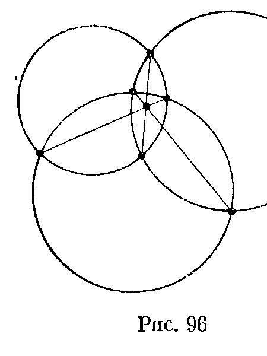
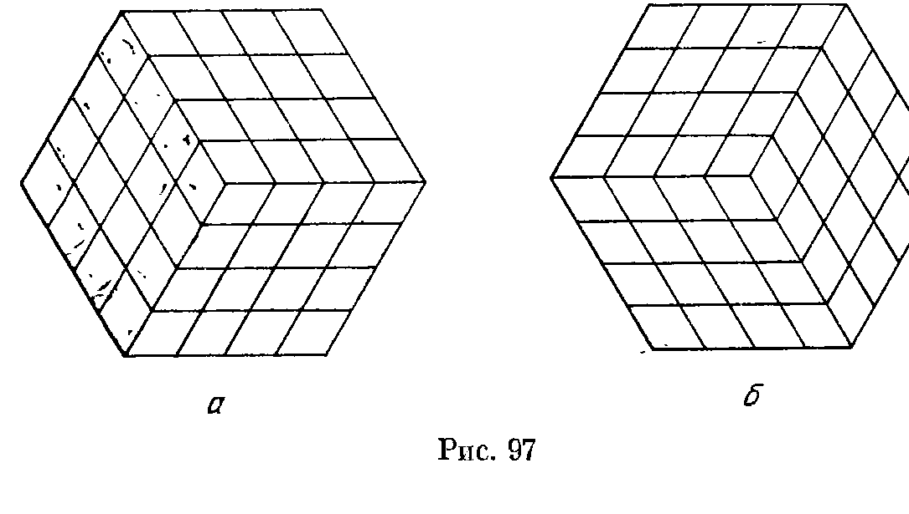
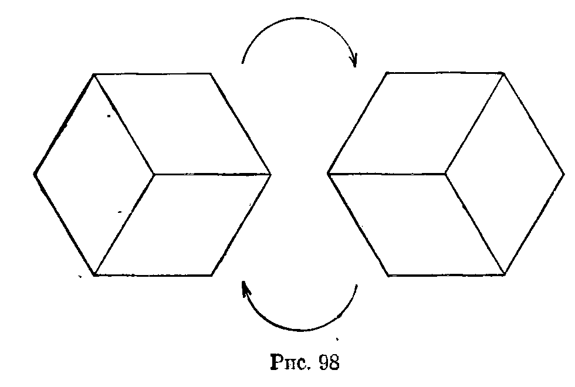
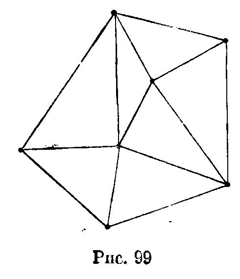

## 13.3. Выход в пространство

---
**стр. 232, продолжение**
---

## § 3. Выход в пространство

При решении планиметрических задач иногда оказывает существенную помощь то соображение, что плоскость расположена в пространстве, а значит, можно использовать вспомогательные элементы, находящиеся вне исходной плоскости. Такой метод решения планиметрических задач называется *выходом в пространство*.

**13.14.** По четырем прямолинейным дорогам, никакие две из которых не параллельны и никакие три не проходят через одну точку, идут 4 пешехода с постоянными скоростями. Известно, что первый пешеход встретился со вторым, третьим и четвертым, а второй — с третьим и четвертым. Докажите, что тогда третий пешеход встретился с четвертым.

**13.15.** Три прямые пересекаются в точке $O$. На первой из них взяты точки $A_1$ и $A_2$, на второй — $B_1$ и $B_2$, на третьей — $C_1$ и $C_2$. Докажите, что точки пересечения прямых $A_1B_1$ и $A_2B_2$, $B_1C_1$ и $B_2C_2$, $A_1C_1$ и $A_2C_2$ лежат на одной прямой (предполагается, что эти прямые пересекаются, т. е. не параллельны).

**13.16.** Три окружности попарно пересекаются и расположены так, как показано на рис. 96. Докажите,

---
**стр. 233**
---

что общие хорды пар этих окружностей пересекаются в одной точке.

**13.17.** Общие внешние касательные к трем окружностям на плоскости пересекаются в точках $A$, $B$ и $C$. Докажите, что эти точки лежат на одной прямой.

**13.18.** Какое наименьшее число полосок шириной 1 требуется для того, чтобы покрыть круг диаметра $d$?

**13.19.** На сторонах $BC$ и $CD$ квадрата $ABCD$ взяты точки $M$ и $N$ так, что $CM+CN=AB$. Прямые $AM$ и $AN$ делят диагональ $BD$ на три отрезка. Докажите, что из этих отрезков всегда можно составить треугольник, причем один угол этого треугольника равен $60^\circ$.

**13.20.** На продолжениях диагоналей правильного шестиугольника выбраны точки $K$, $L$ и $M$ так, что стороны шестиугольника пересекаются со сторонами треугольника $KLM$ в шести точках, являющихся вершинами некоторого другого шестиугольника $H$. Продолжим те стороны шестиугольника $H$, которые не лежат на сторонах треугольника $KLM$. Пусть $P$, $Q$, $R$ — точки их попарных пересечений. Докажите, что точки $P$, $Q$ и $R$ лежат на продолжениях диагоналей исходного шестиугольника.

---
**стр. 234**
---

**13.21.** Рассмотрим такую фигуру, как на рис. 97,а, но сложенную из $3n^2$ ромбиков. Разрешается производить перестановки ромбиков, показанные на рис. 98. За какое наименьшее число таких операций можно получить фигуру, изображённую на рис. 97,б?

**13.22.** Правильный шестиугольник разрезан на равновеликие параллелограммы. Докажите, что их число делится на 3.

**13.23.** Четырехугольник $ABCD$ описан около окружности, причем его стороны $AB$, $BC$, $CD$ и $DA$ касаются ее в точках $K$, $L$, $M$ и $N$ соответственно. Докажите, что прямые $KL$, $MN$ и $AC$ либо пересекаются в одной точке, либо параллельны.

**13.24.** Докажите, что прямые, соединяющие противоположные вершины описанного шестиугольника, пересекаются в одной точке. (Теорема Брианшона.)

**13.25.** На плоскости дана конечная система точек. Ее *триангуляцией* называется такой набор непересекающихся отрезков с концами в этих точках, что любой другой отрезок с концами в данных точках пересекает хотя бы один из них (рис. 99). Докажите, что существует такая триангуляция, что ни одна из описанных окружностей получив-

---
**стр. 235**
---

шихся треугольников не содержит внутри других точек, причем если никакие четыре данные точки не лежат на одной окружности, то такая триангуляция единственна.

* * *

**13.26.** На плоскости даны три луча с общим началом, и внутри каждого из углов, образованных этими лучами, отмечено по точке. Постройте треугольник так, чтобы его вершины лежали на данных лучах, а стороны проходили через данные точки.

**13.27.** На плоскости даны три параллельные прямые и три точки. Постройте треугольник, стороны (или продолжения сторон) которого проходят через данные точки, а вершины лежат на данных прямых.
