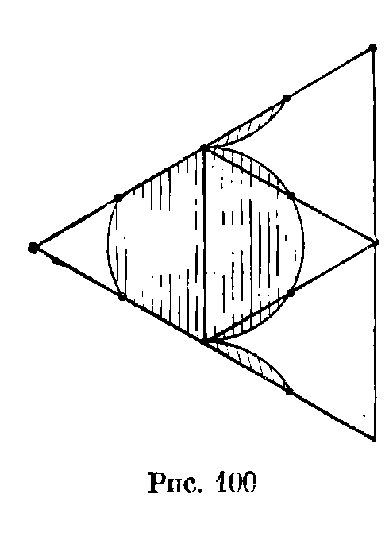
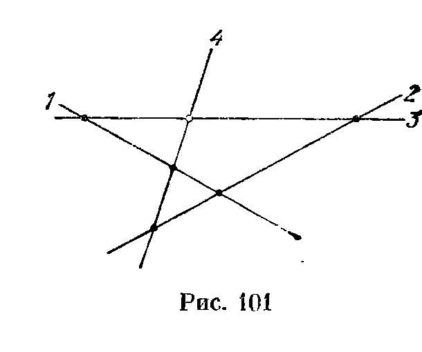
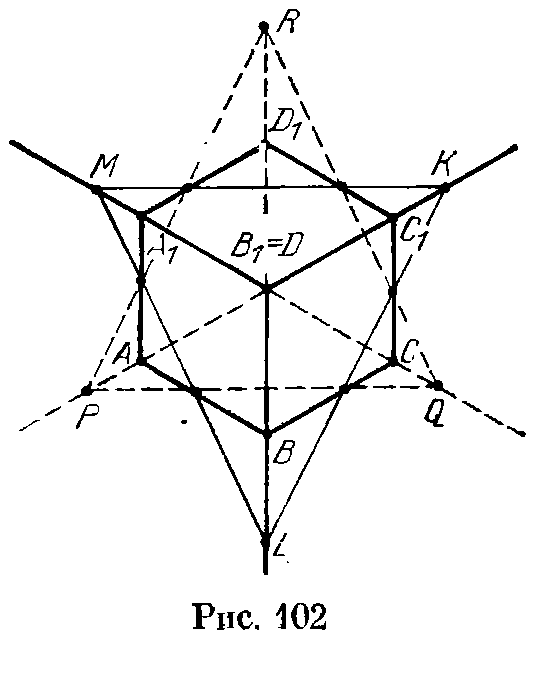
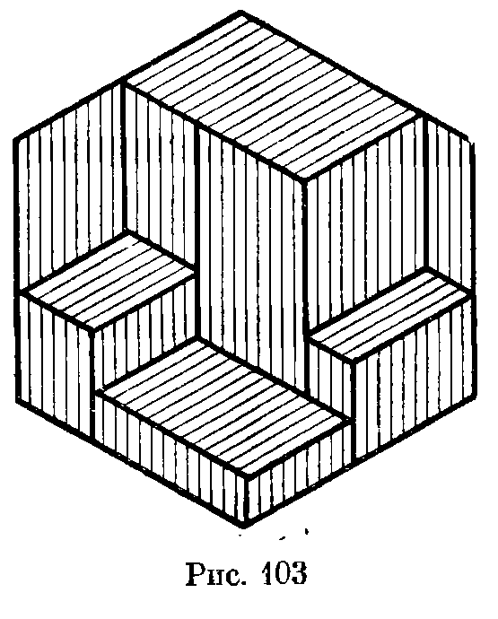
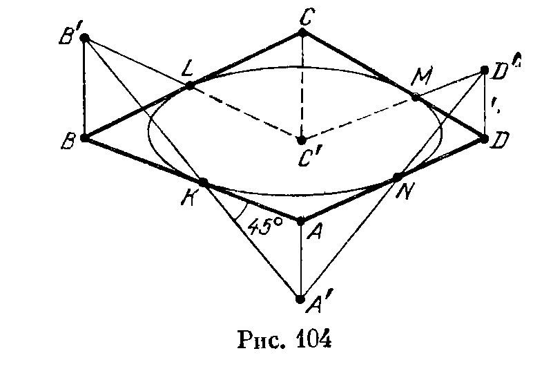
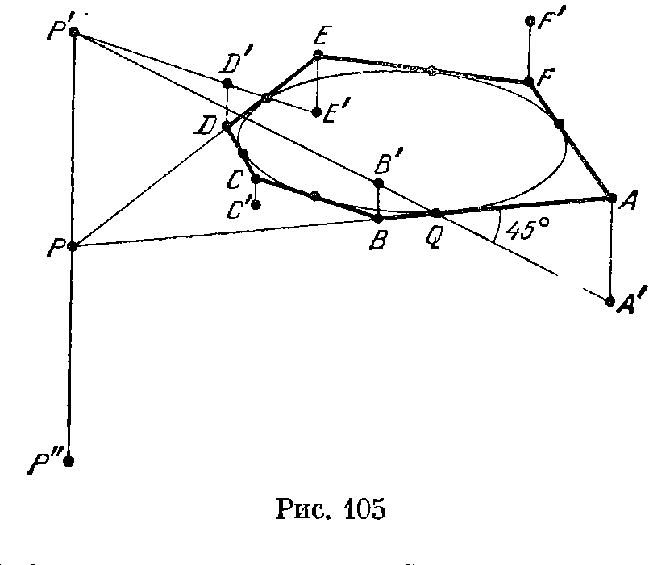

## 13.4. Решения

---
**стр. 235, продолжение**
---

## Решения

**13.1.** Если $AB$ — наибольшая сторона треугольника $ABC$, то $\angle C\geqslant\angle A$ и $\angle C\geqslant\angle B$; поэтому оба угла $A$ и $B$ должны быть острыми. Таким образом, к наибольшему ребру тетраэдра прилегают лишь острые углы.

**13.2.** Сумма углов каждой грани равна $\pi$, а граней у тетраэдра четыре. Поэтому сумма всех плоских углов тетраэдра равна $4\pi$. А так как вершин у тетраэдра тоже четыре, то найдется вершина, сумма плоских углов при которой не больше $\pi$. Поэтому все плоские углы при этой вершине острые, так как любой плоский угол трехгранного угла меньше суммы двух других плоских углов (задача 5.4).

**13.3.** Пусть $AB$ — наибольшее ребро тетраэдра $ABCD$. Так как
$$(AC+AD-AB)+(BC+BD-BA)=(AD+BD-AB)+(AC+BC-AB)>0,$$
то $AC+AD-AB>0$ или $BC+BD-BA>0$. В первом случае треугольник можно составить из ребер, выходящих из вершины $A$, а во втором — из ребер, выходящих из вершины $B$.

**13.4.** Построим на плоскости угол $BAC$, равный $\alpha$, где $\alpha=\angle SA_1A_2=\ldots=\angle SA_nA_1$. Будем считать, что длина отрезка $AB$ равна стороне правильного многоугольника, лежащего в основании пирамиды. Тогда для каждого $i=1,\ldots,n$ на луче $AC$ можно так построить точку $S_i$, что $\triangle AS_iB=\triangle A_iSA_{i+1}$. Предположим, что не все точки $S_i$ совпадают. Пусть $S_k$ — ближайшая к $B$ точка, $S_l$ — наиболее удаленная от нее. Так как
$$S_kS_l>|S_kB-S_lB|,$$
то
$$|S_kA-S_lA|>|S_kB-S_lB|,$$
т. е.
$$|S_{k-1}B-S_{l-1}B|>|S_kB-S_lB|.$$
Но в правой части этого неравенства стоит разность между наибольшим и наименьшим

---
**стр. 236**
---

числом, а в левой — разность двух чисел, заключенных между ними. Получено противоречие. Поэтому все точки $S_i$ совпадают, а значит, точка $S$ равноудалена от вершин основания $A_1\ldots A_n$.

**13.5.** Пусть $O$ — точка грани $ABC$, равноудаленная от указанных прямых. Можно считать, что $A$ — наиболее удаленная от точки $O$ вершина основания $ABC$. Рассмотрим треугольники $AOB_1$ и $BOC_1$. Стороны $AB_1$ и $BC_1$ этих треугольников равны, причем это — наибольшие стороны (см. задачу 10.5), т. е. основания высот, опущенных на эти стороны, лежат на самих сторонах. А так как эти высоты равны, то из неравенства $AO\geqslant BO$ следует неравенство $OB_1\leqslant OC_1$. В прямоугольных треугольниках $BB_1O$ и $CC_1O$ катеты $BB_1$ и $CC_1$ равны, поэтому $BO\leqslant CO$.

Итак, из неравенства $AO\geqslant BO$ следует неравенство $BO\leqslant CO$. Продолжая аналогичные рассуждения, получаем: $CO\geqslant AO$ и $AO\leqslant BO$. Следовательно, $AO=BO=CO$, т. е. $O$ — центр правильного треугольника $ABC$.

**13.6.** Рассмотрим пару планет $A$ и $B$, расстояние между которыми наименьшее. Тогда их астрономы наблюдают планеты друг друга: астроном планеты $A$ наблюдает планету $B$, а астроном планеты $B$ наблюдает планету $A$. Возможны следующие два случая.

1. Хотя бы одну из планет $A$ и $B$ наблюдает еще какой-нибудь астроном. Тогда на $2k-1$ планет остается $2k-2$ наблюдателя. Поэтому найдется планета, которую никто не наблюдает.

2. Никакой из оставшихся астрономов не наблюдает ни планеты $A$, ни планеты $B$. Тогда можно выбросить эту пару планет и рассматривать такую же систему с меньшим числом планет (число планет при этом уменьшается на 2). В конце концов либо встретится первая ситуация, либо останется одна планета, которую никто не наблюдает.

**13.7.** Рассмотрим сначала случай двух планет. Каждая из них делится экватором, перпендикулярным соединяющему их центры отрезку, на два полушария, причем из одного полушария вторая планета видна, а из другого — нет. Заметим, что, вообще говоря, в условии задачи следовало бы уточнить, как считать — видна ли другая планета из точек этих экваторов или нет? Но так как площадь экваторов равна нулю, это не имеет никакого значения. В дальнейшем точки экваторов рассматривать не будем.

Пусть $O_1,\ldots,O_n$ — центры данных планет. Достаточно доказать, что для любого вектора $\mathbf a$ длиной 1 на планете с некоторым номером $i$ найдется точка $X$, для которой $\overrightarrow{O_iX}=\mathbf a$ и из которой не видна ни одна другая планета, причем такая точка единственна.

---
**стр. 237**
---

Докажем сначала единственность точки $X$. Предположим, что $\overrightarrow{O_iX}=\overrightarrow{O_jY}$ и из точек $X$ и $Y$ не видно никаких других планет. Но из рассмотренного выше случая двух планет следует, что если из точки $X$ не видна планета с номером $j$, то из точки $Y$ планета с номером $i$ будет видна. Получено противоречие.

Докажем теперь существование точки $X$. Введем систему координат, направив ось $Ox$ в направлении вектора $\mathbf a$. Тогда та точка данных планет, для которой координата $x$ имеет наибольшее значение, является искомой.

**13.8.** Предположим, что куб разрезан на несколько попарно различных кубиков. Тогда каждая из его граней разрезана на квадратики. Выберем наименьший из всех квадратиков разбиения граней. Нетрудно убедиться, что наименьший из квадратиков разбиения квадрата не может прилегать к его границе. Поэтому кубик, основание которого — выбранный наименьший квадратик, лежит внутри «колодца», образованного прилегающими к его боковым граням кубиками. Таким образом, его грань, противоположная основанию, должна быть заставлена еще меньшими кубиками. Выбираем среди них наименьший и повторяем для него те же самые рассуждения. Действуя таким образом, в конце концов мы дойдем до противоположной грани, и на ней окажется квадратик разбиения, меньший, чем тот, с которого мы начинали. Но мы начинали с наименьшего из всех квадратиков разбиения граней куба. Получено противоречие.

**13.9.** Пусть число граней многогранника равно $n$. Тогда каждая его грань может иметь от трех до $n-1$ сторон, т. е. число сторон каждой из $n$ граней может принимать одно из $n-3$ значений. Следовательно, найдутся две грани с равным числом сторон.

**13.10.** Рассмотрим проекцию на прямую, перпендикулярную данной плоскости. Исходный шар проецируется при этом в отрезок длиной 3, а внутренние шары — в отрезки, сумма длин которых равна 25. Предположим, что требуемой плоскости не существует, т. е. любая плоскость, параллельная данной, пересекает не более 8 внутренних шаров. Тогда любая точка отрезка длиной 3 принадлежит не более чем 8 отрезкам — проекциям внутренних шаров. Следовательно, сумма длин этих отрезков не превосходит 24. Получено противоречие.

**13.11.** Рассмотрим многогранник $P$, являющийся образом многогранника $P_1$ при гомотетии с центром $A_1$ и коэффициентом 2. Докажем, что все 9 многогранников лежат внутри его. Пусть $A_1,A_2^*,\ldots,A_9^*$ — вершины многогранника $P$. Докажем, например, что многогранник $P_2$ лежит внутри $P$. Для этого достаточно заметить, что при параллельном переносе на вектор

---
**стр. 238**
---

$\overrightarrow{A_1A_2^*}$ точки $A_1,A_2,A_3,\ldots,A_9$ переходят в точки $A_2^*,A_2',A_3',\ldots,A_9'$, где $A_i'$ — середина отрезка $A_2^*A_i^*$.

Сумма объемов многогранников $P_1,P_2,\ldots,P_9$, лежащих внутри многогранника $P$, равна $9V$, где $V$ — объем многогранника $P_1$, а объем многогранника $P$ равен $8V$. Следовательно, указанные 9 многогранников не могут не иметь общих внутренних точек.

**13.12.** Докажем сначала, что прожектор можно повернуть так, чтобы он освещал соседние вершины $A$ и $B$ куба. Если $\angle AOB<90^\circ$, то из центра $O$ куба можно осветить отрезок $AB$. Для этого нужно поместить отрезок $AB$ в одной из граней освещаемого прожектором угла, а затем слегка пошевелить прожектор. Остается проверить, что $\angle AOB<90^\circ$. Это следует из того, что
$$
AO^2+BO^2=\frac34AB^2+\frac34AB^2>AB^2.
$$

Повернем прожектор так, чтобы он освещал две вершины куба. Плоскости граней освещаемого прожектором угла разбивают пространство на 8 октантов. Так как в одном из них лежат две из восьми вершин куба, найдется октант, не содержащий ни одной вершины. Этот октант задает требуемое положение прожектора.

**Замечание.** Мы не рассматриваем того случая, когда одна из плоскостей граней октантов содержит вершину куба. От этого случая можно избавиться, слегка пошевелив прожектор.

**13.13. а)** Легко проверить, что середины ребер $AB$, $BC$, $CD$, $DA$ обладают требуемым свойством. В самом деле, на двух ребрах каждой из граней лежат выбранные точки. Рассмотрим теперь, например, грань $ABC$. Пусть $B_1$ — середина ребра $AC$. Тогда треугольники $ABB_1$ и $CBB_1$ накрыты кругами радиуса 0,5 с центрами в серединах сторон $AB$ и $CB$ соответственно.

**б)** Возьмем на поверхности тетраэдра три точки и рассмотрим часть поверхности тетраэдра, покрытую шарами радиуса 0,5 с центрами в этих точках. Будем говорить, что некоторый угол грани покрыт, если для некоторого числа $\varepsilon>0$ покрыты все точки грани, удаленные от вершины данного угла меньше чем на $\varepsilon$. Достаточно доказать, что в случае трех точек всегда найдется непокрытый угол грани.

Если шар радиуса 0,5 с центром $O$ покрывает две точки $A$ и $B$, расстояние между которыми равно 1, то $O$ — середина отрезка $AB$. Таким образом, если шар радиуса 0,5 покрывает две вершины тетраэдра, то его центр — середина ребра, соединяющего эти вершины. Из рис. 100 видно, что в этом случае шар покрывает 4 угла граней. При этом для непокрытых углов остаются непокрытыми их биссектрисы, и поэтому не может

---
**стр. 239**
---

случиться так, что каждый шар в отдельности не покрывает угла, а все они вместе покрывают его. Ясно также, что если шар покрывает всего лишь одну вершину тетраэдра, то он покрывает лишь три угла.

Всего в тетраэдре имеется 12 углов граней. Таким образом, три шара радиуса 0,5 могут их покрыть, только если центры шаров — середины ребер тетраэдра, причем даже середины несмежных ребер, так как шары с центрами в серединах смежных ребер имеют общий покрытый ими угол.

Ясно, что в тетраэдре нельзя выбрать три несмежных ребра.

**13.14.** Введем наряду с координатами в плоскости, в которой движутся пешеходы, еще и третью ось координат — ось времени. Рассмотрим графики движения пешеходов. Ясно, что пешеходы встречаются, когда их графики движения пересекаются. Из условия задачи следует, что графики третьего и четвертого пешеходов лежат в плоскости, заданной графиками двух первых пешеходов (рис. 101). Поэтому графики третьего и четвертого пешеходов пересекаются.

**13.15.** Возьмем в пространстве точки $C_1'$ и $C_2'$ так, что они проецируются в точки $C_1$ и $C_2$, причем сами они не лежат в исходной плоскости. Тогда точки пересечения прямых $A_1C_1'$ и $A_2C_2'$, $B_1C_1'$ и $B_2C_2'$ проецируются в точки пересечения прямых $A_1C_1$ и $A_2C_2$, $B_1C_1$ и $B_2C_2$. Поэтому указанные в условии задачи точки лежат на проекции прямой пересечения плоскостей $A_1B_1C_1'$ и $A_2B_2C_2'$, где прямая $C_1'C_2'$ содержит точку $O$.

**13.16.** Построим сферы, для которых наши окружности являются экваторами. Тогда общие хорды пар этих окружностей — проекции окружностей, по которым пересекаются построенные сферы. Поэтому достаточно доказать, что сферы имеют общую точку. Рассмотрим для этого окружность, по которой пересекаются две из наших сфер. Один конец диаметра этой

---
**стр. 240**
---

окружности, лежащего в исходной плоскости, находится вне третьей сферы, а другой — внутри ее. Поэтому окружность пересекает сферу, т. е. три сферы имеют общую точку.

**13.17.** Рассмотрим для каждой нашей окружности конус, основанием которого является данная окружность, а высота его равна ее радиусу. Будем считать, что все эти конусы расположены по одну сторону от исходной плоскости. Пусть $O_1$, $O_2$, $O_3$ — центры окружностей, а $O'_1$, $O'_2$, $O'_3$ — вершины конусов. Тогда точка пересечения общих внешних касательных к окружностям с номерами $i$ и $j$ совпадает с точкой пересечения прямой $O'_iO'_j$ с исходной плоскостью. Таким образом, точки $A$, $B$ и $C$ лежат на прямой пересечения плоскости $O'_1O'_2O'_3$ с исходной плоскостью.

**13.18.** При решении этой задачи воспользуемся тем, что площадь полоски, высеченной на сфере диаметра $d$ двумя параллельными плоскостями, расстояние между которыми равно $h$, равняется $\pi dh$ (см. задачу 4.24).

Пусть круг диаметра $d$ покрыт $k$ полосками шириной 1. Рассмотрим сферу, для которой этот круг служит экватором. Проведя через границы полосок плоскости, перпендикулярные экватору, получим на сфере сферические полоски, причем площадь каждой из них равна $\pi d$ (точнее говоря, не превосходит $\pi d$, так как одна граница исходной полоски может не пересекать круга). Сферические полоски тоже покрывают всю сферу, поэтому их площадь не меньше площади сферы, т. е. $k\pi d\geqslant\pi d^2$ и $k\geqslant d$. Ясно, что если $k\geqslant d$, то $k$ полосками можно покрыть круг диаметра $d$.

**13.19.** Достроим квадрат $ABCD$ до куба $ABCDA_1B_1C_1D_1$. Из условия задачи следует, что $CM=DN$ и $BM=CN$. Возьмем на ребре $BB_1$ точку $K$ так, что $BK=DN$. Пусть отрезки $AM$ и $AN$ пересекают диагональ $BD$ в точках $P$ и $Q$, а $R$ — точка пересечения отрезков $AK$ и $BA_1$. Докажем, что стороны треугольника $PBR$ равны соответствующим отрезкам диагонали $BD$. Ясно, что $BR=DQ$. Докажем теперь, что $PR=PQ$. Так как $BK=CM$ и $BM=CN$, то $KM=MN$, а значит, $\triangle AKM=\triangle ANM$. Кроме того, $KR=NQ$, поэтому $RP=PQ$. Остается заметить, что $\angle RBP=\angle A_1BD=60^\circ$, так как треугольник $A_1BD$ — равносторонний.

**13.20.** Обозначим исходный шестиугольник через $ABCC_1D_1A_1$ и будем считать, что он является проекцией куба $A'B'C'D'A'_1B'_1C'_1D'_1$ на плоскость, перпендикулярную диагонали $D'B'_1$. Пусть $K'$, $L'$, $M'$ — точки прямых $B'_1C'_1$, $B'_1B'$ и $B'_1A'_1$, проецирующиеся в точки $K$, $L$ и $M$ (рис. 102). Тогда $H$ — это сечение куба плоскостью $K'L'M'$, в частности, стороны треуголь-

---
**стр. 241**
---

ника $PQR$ лежат на проекциях прямых, по которым плоскость $K'L'M'$ пересекается с плоскостями нижних граней куба (мы считаем, что точка $B'_1$ расположена выше точки $D'$). Следовательно, точки $P$, $Q$, $R$ являются проекциями точек пересечения продолжений нижних ребер куба ($D'A'$, $D'C'$, $D'D'_1$) с плоскостью $K'L'M'$, а значит, они лежат на продолжениях диагоналей исходного шестиугольника.

**13.21.** Рассмотрим проекцию куба, сложенного из $n^3$ кубиков, на плоскость, перпендикулярную его диагонали. Тогда рис. 97, а можно рассматривать как проекцию всего этого куба, а рис. 97, б — как проекцию лишь задних граней куба. Допустимая операция — это вставление или убирание кубика, причем вставлять кубик можно только так, что три его грани соприкасаются с уже имеющимися гранями. Ясно, что $n^3$ кубиков меньше чем за $n^3$ операций вынуть нельзя, а за $n^3$ операций их вынуть можно.

**13.22.** Правильный шестиугольник, разрезанный на параллелограммы, можно представить как проекцию куба, из которого вырезано несколько прямоугольных параллелепипедов (рис. 103). Тогда проекции прямоугольников, параллельных граням куба, покрывают грани одним слоем. Таким образом, в исходном шестиугольнике сумма площадей параллелограммов каждого из трех видов (параллелограммы одного вида имеют параллельные стороны) равна одной трети площади шестиугольника. Так как параллелограммы равновелики, число параллелограммов каждого вида одно и то же. Поэтому их общее число делится на 3.

**13.23.** Проведем через вершины четырехугольника $ABCD$ перпендикуляры к плоскости, в которой он расположен, от-

---
**стр. 242**
---

ложим на них отрезки $AA'$, $BB'$, $CC'$ и $DD'$, равные касательным, проведенным к окружности из соответствующих вершин четырехугольника, причем так, что точки $A'$ и $C'$ лежат по одну сторону от исходной плоскости, а $B'$ и $D'$ — по другую (рис. 104). Так как $AA'\parallel BB'$ и $\angle AKA'=45^\circ=\angle BKB'$, точка $K$ лежит на отрезке $A'B'$. Аналогично точка $L$ лежит на отрезке $B'C'$, а значит, прямая $KL$ лежит в плоскости $A'B'C'$. Аналогично прямая $MN$ лежит в плоскости $A'D'C'$.

Если прямая $A'C'$ параллельна исходной плоскости, то прямые $AC$, $KL$ и $MN$ параллельны прямой $A'C'$. Пусть теперь прямая $A'C'$ пересекает исходную плоскость в точке $P$, т. е. $P$ — точка пересечения плоскостей $A'B'C'$, $A'D'C'$ и исходной плоскости. Тогда прямые $KL$, $AC$ и $MN$ проходят через точку $P$.

**13.24.** Проведем через вершины шестиугольника $ABCDEF$ перпендикуляры к плоскости, в которой он лежит, и отложим на них отрезки $AA',\ldots,FF'$, равные касательным, проведенным к окружности из соответствующих вершин, причем отложим так, что точки $A'$, $C'$ и $E'$ лежат по одну сторону от исходной плоскости, а $B'$, $D'$ и $F'$ — по другую (рис. 105). Докажем, что прямые $A'B'$ и $E'D'$ лежат в одной плоскости. Если $AB\parallel ED$, то $A'B'\parallel E'D'$. Если же прямые $AB$ и $ED$ пересекаются в некоторой точке $P$, то отложим на перпендикуляре к исходной плоскости, проведенном через точку $P$, отрезки $PP'$ и $PP''$, равные касательной к окружности, проведенной из точки $P$. Пусть $Q$ — точка касания окружности со стороной $AB$. Тогда отрезки $P'Q$, $P''Q$, $A'Q$ и $B'Q$ образуют с прямой $AB$ углы в $45^\circ$ и лежат в плоскости, перпендикулярной исходной плоскости и проходящей через прямую $AB$. Поэтому прямая $A'B'$ проходит либо через точку $P'$, либо через точку $P''$. Нетрудно убедиться, что через ту же точку проходит и прямая $E'D'$. Таким образом, прямые $A'B'$ и $E'D'$ пересекаются, а значит, прямые $A'D'$ и $B'E'$ тоже пересекаются. Аналогично доказывается, что прямые

---
**стр. 243**
---

$A'D'$, $B'E'$ и $C'F'$ попарно пересекаются. Но так как эти прямые не лежат в одной плоскости, они должны пересекаться в одной точке. Прямые $AD$, $BE$ и $CF$ проходят через проекцию этой точки на исходную плоскость.

**13.25.** Возьмем произвольную сферу, касающуюся данной плоскости, и рассмотрим стереографическую проекцию плоскости на сферу. На сфере получается конечная система точек, и они являются вершинами некоторого выпуклого многогранника. Для получения требуемой триангуляции нужно соединить те исходные точки, образы которых на сфере соединены ребрами получившегося выпуклого многогранника. Единственность триангуляции эквивалентна тому, что все грани многогранника являются треугольниками, а это, в свою очередь, эквивалентно тому, что никакие четыре данные точки не лежат на одной окружности.

**13.26.** Данные лучи и точки можно представить как изображение проекции трехгранного угла с тремя отмеченными на его гранях точками. В задаче требуется построить сечение этого угла плоскостью, проходящей через данные точки. Соответствующее построение описано в решении задачи 12.22, б.

**13.27.** Данные прямые можно представить как проекции прямых, на которых лежат ребра трехгранной призмы, а данные точки — как проекции точек, лежащих на ее гранях (или продолжениях граней). В задаче требуется построить сечение призмы плоскостью, проходящей через данные точки. Соответствующее построение описано в решении задачи 12.23.
