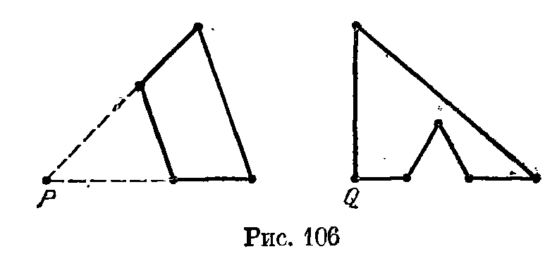
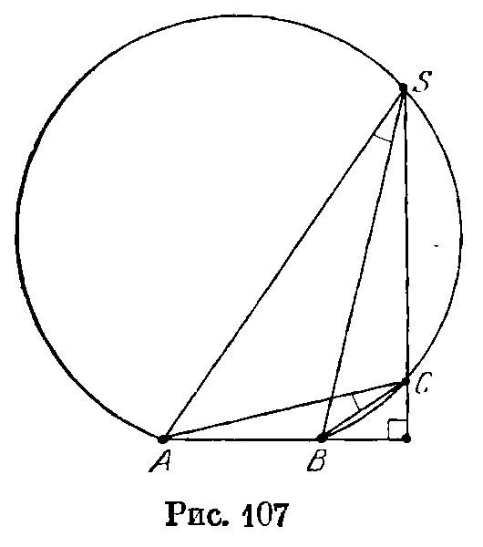
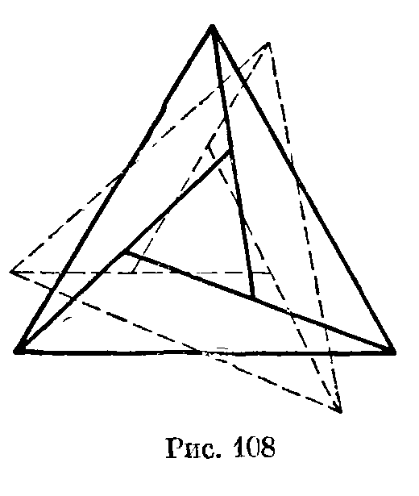
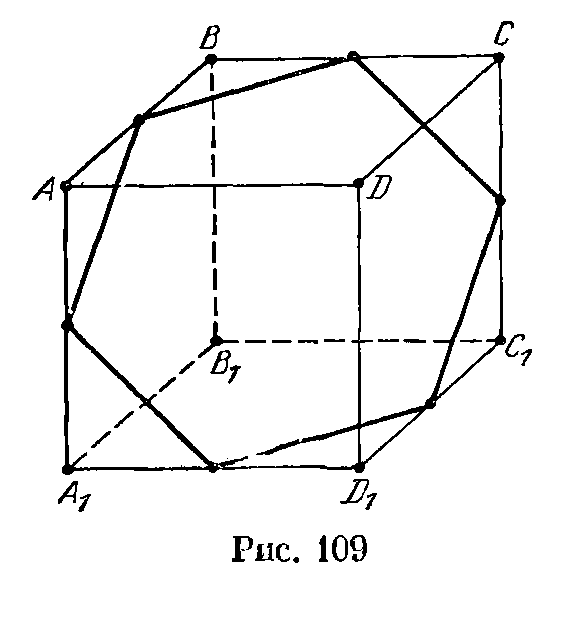
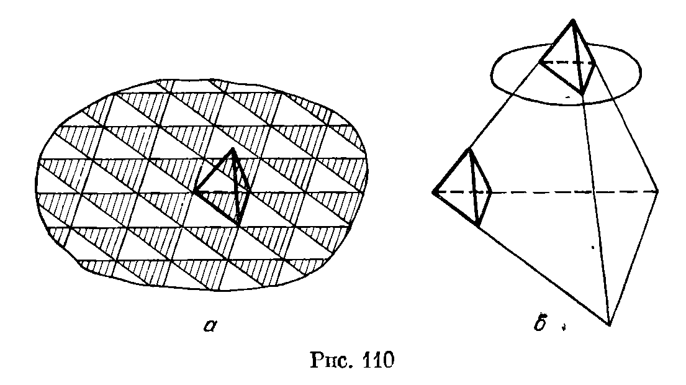
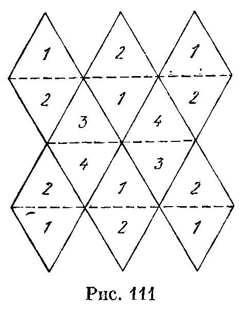
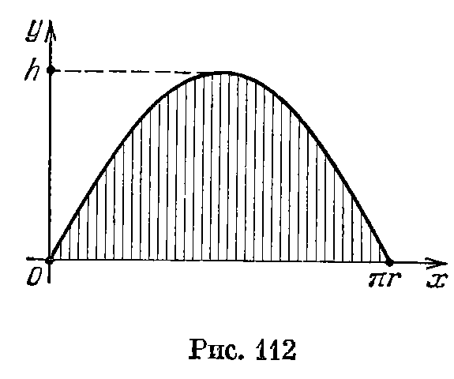

## 15.5. Решения

---
**стр. 257, продолжение**
---

## Решения

**15.1.** Да, такие пирамиды существуют. В качестве их оснований можно взять, например, четырехугольник и невыпуклый шестиугольник, изображенные на рис. 106; вершины этих пирамид лежат на перпендикулярах, восставленных из точек $P$ и $Q$ соответственно.

**15.2.** Нет, не обязательно. Рассмотрим равнобедренный треугольник $ABC$, основание $AC$ которого много меньше боковой стороны. Вершину $D$ поместим вблизи середины стороны $AC$,

---
**стр. 258**
---

а вершину $E$ — внутри тетраэдра $ABCD$ и вблизи вершины $D$. Периметр внешнего тетраэдра можно сделать сколь угодно близким к $3a$, где $a$ — длина боковой стороны треугольника $ABC$, а периметр внутреннего — к $4a$.

**15.3.** Да, существует. Пусть в треугольнике $ABC$ угол $C$ тупой, точка $D$ лежит на высоте, опущенной из вершины $C$. Слегка приподняв точку $D$ над плоскостью $ABC$, получим требуемый тетраэдр.

**15.4.** Да, существует. Этим свойством обладает тетраэдр, у которого два противоположных двугранных угла тупые. Для построения такого тетраэдра можно, например, взять две диагонали квадрата и чуть-чуть приподнять одну над другой.

**Замечание.** Основание наименьшей высоты любого тетраэдра попадает внутрь треугольника, стороны которого проходят через вершины противоположной грани параллельно ее ребрам (см. задачу 12.16).

**15.5.** Да, могут. Пусть точки $C$ и $S$ лежат на одной дуге окружности, проходящей через $A$ и $B$, причем $SC\perp AB$ и точка $C$ ближе к прямой $AB$, чем точка $S$ (рис. 107). Тогда треугольник $ABS$ можно так повернуть вокруг оси $AB$, что отрезок $SC$ станет перпендикулярен плоскости $ABC$.

**15.6.** Нет, не любой. Рассмотрим трехгранный угол $SABC$, у которого $\angle BSC<60^\circ$ и ребро $AS$ перпендикулярно грани $SBC$. Предположим, что его сечение $ABC$ является правильным треугольником. В прямоугольных треугольниках $ABS$ и $ACS$ равны гипотенузы, поэтому $SB=SC$. В равнобедренном треугольнике $SBC$ угол при вершине $S$ наименьший, поэтому $BC<SB$. Ясно также, что $SB<AB$, а значит, $BC<AB$. Получено противоречие.

**15.7.** Докажем сначала, что любое сечение трехгранного угла с прямыми плоскими углами является остроугольным треугольником. Пусть секущая плоскость отсекает от ребер отрезки длиной $a$, $b$ и $c$. Тогда квадраты длин сторон сечения равны $a^2+b^2$, $b^2+c^2$ и $a^2+c^2$. Сумма квадратов любых двух сторон больше квадрата третьей, поэтому треугольник остроугольный.

Докажем теперь, что если не все плоские углы трехгранного угла прямые, то у него есть сечение — тупоугольный треуголь-

---
**стр. 259**
---

ник. Если в трехгранном угле есть тупой плоский угол, то отложим на его сторонах равные отрезки $SA$ и $SB$; если точка $C$ на третьем ребре взята достаточно близко к вершине $S$, то треугольник $ABC$ тупоугольный. Если же в трехгранном угле есть острый плоский угол, то на его сторонах можно так выбрать точки $A$ и $B$, что угол $SAB$ тупой; если точка $C$ на третьем ребре взята достаточно близко к вершине $S$, то треугольник $ABC$ — тупоугольный.

**15.8.** Да, можно. Проведем прямые, соединяющие центр икосаэдра с его вершинами (см. задачу 9.4). Легко проверить, что любые две такие прямые проходят через две точки, являющиеся концами одного ребра.

**15.9.** Нет, не обязательно. Возьмем куб и приложим к каждой из его граней по такому же кубу. У полученного (невыпуклого) многогранника все грани являются равными между собой квадратами.

**15.10.** Нет, не обязательно. Построим внешним образом на гранях куба как основаниях правильные четырехугольные пирамиды с двугранными углами при основании, равными $45^\circ$. В результате получим 12-гранник, имеющий 14 вершин, причем 8 из них — вершины куба, а 6 — вершины построенных пирамид; ребра куба являются диагоналями его граней, а поэтому его ребрами не являются.

Все ребра этого многогранника равны, и они равноудалены от центра куба. Одной сфере его вершины принадлежать не могут, так как вершины куба удалены от центра на расстояние $a\sqrt{3/2}$, где $a$ — ребро куба, а остальные вершины удалены от центра куба на расстояние $a$.

**15.11.** Да, может. Легко проверить, что вершины правильного шестиугольника обладают требуемым свойством. Рассмотрим теперь два правильных шестиугольника с общим центром $O$, лежащие в разных плоскостях. Если $A$ и $B$ — вершины разных шестиугольников, то в качестве $C$ и $D$ можно взять точки, симметричные $A$ и $B$ относительно точки $O$.

**15.12.** Можно. На рис. 108 сплошной линией изображены 4 треугольника (один лежит внутри трех других). Рассмотрим 4 треугольные пирамиды с общей вершиной, основаниями которых служат эти треугольники. Аналогично строятся еще 4 треугольные пирамиды с общей вершиной (лежащей по другую сторону от плоскости рисунка), основаниями которых служат треугольники, изображенные пунктиром. Полученные 8 тетраэдров обладают требуемым свойством.

**15.13.** Каждая из трех координат узла целочисленной решетки может быть либо четной, либо нечетной; всего получается $2^3=8$ различных вариантов. Поэтому среди девяти вершин

---
**стр. 260**
---

многогранника найдутся две вершины с координатами одной четности. Середина отрезка, соединяющего эти вершины, имеет целочисленные координаты.

**15.14. а)** Докажем сначала, что при $n=3$, $4$, $6$ существует правильный $n$-угольник с вершинами в узлах целочисленной решетки. Рассмотрим куб $ABCDA_1B_1C_1D_1$, вершины которого имеют координаты $(\pm1,\pm1,\pm1)$. Тогда середины ребер $AB$, $BC$, $CC_1$, $C_1D_1$, $D_1A_1$ и $A_1A$ являются вершинами правильного шестиугольника и все они имеют целочисленные координаты (рис. 109); середины ребер $AB$, $CC_1$ и $D_1A_1$ являются вершинами правильного треугольника; ясно также, что $ABCD$ — квадрат с целочисленными вершинами.

Докажем теперь, что при $n\ne3$, $4$, $6$ не существует правильного $n$-угольника с вершинами в узлах целочисленной решетки. Предположим, что такой $n$-угольник существует при некотором $n\ne3$, $4$, $6$. Среди всех $n$-угольников с вершинами в узлах решетки можно выбрать тот, у которого длина стороны наименьшая. Чтобы доказать это, нужно проверить, что длина стороны такого $n$-угольника может принимать лишь конечное число значений, меньших данного. Остается заметить, что длина любого отрезка с концами в узлах решетки равна $\sqrt{n_1^2+n_2^2+n_3^2}$, где $n_1$, $n_2$ и $n_3$ — целые числа.

Пусть $A_1A_2\ldots A_n$ — выбранный $n$-угольник с наименьшей длиной стороны. Рассмотрим правильный $n$-угольник $B_1\ldots B_n$, где точка $B_i$ получается из точки $A_i$ переносом на вектор $\overrightarrow{A_{i+1}A_{i+2}}$, т. е. $\overrightarrow{A_iB_i}=\overrightarrow{A_{i+1}A_{i+2}}$. Так как при переносе по вектору с целочисленными координатами узел решетки переходит в узел решетки, $B_i$ является узлом решетки. Для того чтобы получить противоречие, остается доказать, что длина сто-

---
**стр. 261**
---

роны многоугольника $B_1\dots B_n$ строго меньше длины стороны многоугольника $A_1\dots A_n$ (и не равна нулю). Доказательство этого достаточно очевидно; нужно только разобрать отдельно два случая: $n=5$ и $n\geqslant7$.

б) Докажем сначала, что куб, правильный тетраэдр и октаэдр можно расположить требуемым образом. Рассмотрим для этого куб $ABCDA_1B_1C_1D_1$, вершины которого имеют координаты $(\pm1,\pm1,\pm1)$. Тогда $AB_1CD_1$ — требуемый тетраэдр, а середины граней рассматриваемого куба являются вершинами требуемого октаэдра.

Докажем теперь, что додекаэдр и икосаэдр нельзя расположить требуемым образом. Как следует из предыдущей задачи, не существует правильного пятиугольника с вершинами в узлах решетки. Остается проверить, что и у додекаэдра, и у икосаэдра найдется набор вершин, задающих правильный пятиугольник. Для додекаэдра это вершины одной из граней, а для икосаэдра это вершины, являющиеся концами выходящих из одной вершины ребер.

**15.15.** Нельзя. Пусть в пространстве задано $n$ плоскостей. Если кубик решетки пересекается с некоторой плоскостью, то он целиком лежит внутри полосы шириной $2\sqrt3$, состоящей из всех точек, удаленных от данной плоскости не более чем на $\sqrt3$ ($\sqrt3$ — наибольшее расстояние между точками кубика). Рассмотрим шар радиуса $R$. Если все кубики решетки, имеющие общие точки с этим шаром, пересекаются с данными плоскостями, то полосы шириной $2\sqrt3$, определяемые данными плоскостями, заполняют весь шар. Объем части каждой такой полосы, лежащей внутри шара, не превосходит $2\sqrt3\pi R^2$. Так как объем шара не превосходит суммы объемов полос, то
$$
\frac{4\pi R^3}{3}\leqslant2\sqrt3n\pi R^2,
$$
т. е. $R\leqslant\dfrac{3\sqrt3}{2}n$. Следовательно, если $R>\dfrac{3\sqrt3}{2}n$, то $n$ плоскостей не могут пересекать всех кубиков решетки, имеющих общие точки с шаром радиуса $R$.

**15.16.** Можно считать, что числа $a$, $b$ и $c$ в совокупности взаимно просты, т. е. наибольшее число, на которое все они делятся, равно 1. Вектор, перпендикулярный этой плоскости, имеет координаты $(\lambda a,\lambda b,\lambda c)$; эти координаты целые, только если $\lambda$ целое, поэтому $l$ — длина вектора $(a,b,c)$. Если $\mathbf u$ и $\mathbf v$ — векторы соседних сторон параллелограмма с вершинами в целочисленных точках данной плоскости, то их векторное произведение (см. с. 133) является вектором с целочисленными координатами, перпендикулярным данной плоскости, причем длина этого вектора равна площади рассматриваемого параллелограмма. Следовательно, $S\geqslant l$.

---
**стр. 262**
---

Докажем теперь, что $S\leqslant l$. Для этого достаточно указать целочисленные векторы $\mathbf u$ и $\mathbf v$, лежащие в данной плоскости, векторное произведение которых имеет координаты $(a,b,c)$. Пусть $d$ — наибольший общий делитель чисел $a$ и $b$; $a'=a/d$ и $b'=b/d$. В качестве $\mathbf u$ возьмем вектор $(-b',a',0)$. Если $\mathbf v=(x,y,z)$, то
$$
[\mathbf u,\mathbf v]=(a'z,b'z,-a'x-b'y).
$$
Поэтому в качестве $z$ нужно взять $d$, а числа $x$ и $y$ подобрать так, чтобы выполнялось равенство $ax+by+cz=0$, т. е. $-a'x-b'y=c$.

Остается доказать, что если числа $p$ и $q$ взаимно просты, то существуют такие целые числа $x$ и $y$, что $px+qy=1$; тогда $px'+qy'=c$ для $x'=cx$ и $y'=cy$. Можно считать, что $p>q>0$. Будем последовательно производить деления с остатком:
$$
p=qn_0+r_1,\quad q=r_1n_1+r_2,\quad r_1=r_2n_2+r_3,\ \ldots,\quad r_{k-1}=r_kn_k+r_{k+1},\quad r_k=n_{k+1}r_{k+1}.
$$
Так как числа $p$ и $q$ взаимно просты, то $q$ и $r_1$ взаимно просты, а значит, $r_1$ и $r_2$ взаимно просты и т. д. Поэтому $r_k$ и $r_{k+1}$ взаимно просты, т. е. $r_{k+1}=1$. Подставим в формулу $r_{k-1}=r_kn_k+1$ значение $r_k$, полученное из предыдущей формулы $r_{k-2}=r_{k-1}n_{k-1}+r_k$; затем подставим значение $r_{k-1}$, полученное из формулы $r_{k-3}=r_{k-2}n_{k-2}+r_{k-1}$, и т. д. На каждом шаге получаются соотношения вида $xr_i+yr_{i-1}=1$, поэтому в конце получится требуемое соотношение.

**15.17.** Пусть $(x_i,y_i,z_i)$ — координаты $i$-й вершины правильного тетраэдра $A_1BC_1D$. Его центр, совпадающий с центром куба, имеет координаты $(x_1+x_2+x_3+x_4)/4$ и т. д. Точка, симметричная $(x_1,y_1,z_1)$ относительно центра куба, имеет координаты
$$
(x_1+x_2+x_3+x_4)/2-x_1=(-x_1+x_2+x_3+x_4)/2
$$
и т. д. Четность числа $-x_1+x_2+x_3+x_4$ совпадает с четностью числа $x_1+x_2+x_3+x_4$. Итак, нужно доказать, что числа $x_1+x_2+x_3+x_4$ и т. д. — четные. Будем считать, что начало координат находится в четвертой вершине тетраэдра, т. е. $x_4=y_4=z_4=0$.

Пусть $u$, $v$, $w$ — целые числа. Легко проверить, что если число $u^2+v^2+w^2$ делится на 4, то все числа $u$, $v$ и $w$ — четные. Поэтому достаточно проверить, что число $u^2+v^2+w^2$, где
$$
u=x_1+x_2+x_3,\quad v=y_1+y_2+y_3\quad\text{и}\quad w=z_1+z_2+z_3,
$$
— четное. Пусть $a$ — ребро куба. Так как
$$
x_1^2+y_1^2+z_1^2=2a^2
$$
и
$$
x_1x_2+y_1y_2+z_1z_2=(\sqrt2a)^2\cos60^\circ=a^2,
$$
то
$$
u^2+v^2+w^2=6a^2+6a^2=12a^2.
$$
Число $a^2$ целое, потому что оно является суммой квадратов трех целочисленных координат.

**15.18.** а) Можно считать, что одна из вершин данного параллелепипеда находится в начале координат. Рассмотрим куб $K_1$, абсолютные величины координат точек которого не превосходят некоторого целого числа $n$. Разобьем пространство на параллелепипеды, равные данному, проведя плоскости, параллельные

---
**стр. 263**
---

его граням. Соседние параллелепипеды получаются друг из друга переносом на целочисленный вектор, поэтому все эти параллелепипеды имеют целочисленные вершины. Пусть $N$ — число наших параллелепипедов, имеющих общие точки с кубом $K_1$. Все они расположены внутри куба $K_2$, абсолютные величины координат точек которого не превосходят $n+d$, где $d$ — наибольшее расстояние между вершинами данного параллелепипеда.

Обозначим объем данного параллелепипеда через $V$. Так как рассматриваемые $N$ параллелепипедов содержат куб $K_1$ и содержатся в кубе $K_2$, то $(2n)^3\leqslant NV\leqslant(2n+2d)^3$, т. е.
$$
\left(\frac1{2n+2d}\right)^3\leqslant\frac1{NV}\leqslant\left(\frac1{2n}\right)^3. \tag{1}
$$

Для каждого из рассматриваемых $N$ параллелепипедов напишем рядом с его целочисленными точками следующие числа: рядом с внутренней точкой — число 1, рядом с точкой грани — число $1/2$, рядом с точкой ребра — число $1/4$, а рядом с вершиной — число $1/8$ (в итоге рядом с точками, принадлежащими нескольким параллелепипедам, будет написано несколько чисел). Легко проверить, что сумма чисел, стоящих рядом с каждой целочисленной точкой куба $K_1$, равна 1 (нужно учесть, что каждая точка грани принадлежит двум параллелепипедам, точка ребра — четырем, а вершина — восьми); для целочисленных точек внутри куба $K_2$ такая сумма не превосходит 1, а для точек вне $K_2$ таких чисел нет. Поэтому сумма всех рассматриваемых чисел заключена между количествами целочисленных точек кубов $K_1$ и $K_2$. С другой стороны, она равна $N(1+a+b/2+c/4)$. Поэтому
$$
(2n+1)^3\leqslant N(1+a+b/2+c/4)\leqslant(2n+2d+1)^3. \tag{2}
$$

Перемножая неравенства (1) и (2), получаем, что для любого натурального $n$ справедливы неравенства
$$
\left(\frac{2n+1}{2n+2d}\right)^3
\leqslant
\frac{1+a+b/2+c/4}{V}
\leqslant
\left(\frac{2n+2d+1}{2n}\right)^3.
$$
Так как при $n$, стремящемся к бесконечности, и верхняя и нижняя оценки стремятся к 1, то
$$
1+a+b/2+c/4=V.
$$

б) Рассмотрим прямоугольный параллелепипед $ABCDA_1B_1C_1D_1$ с целочисленными вершинами, ребра которого параллельны осям координат и их длины равны $1$, $1$ и $n$. Целочисленными точками тетраэдра $A_1BC_1D$ являются лишь его вершины, а его объем равен $n/3$.

**15.19.** а) Середины ребер тетраэдра с ребром $2a$ являются вершинами октаэдра с ребром $a$. Если из тетраэдра вырезать этот октаэдр, то останутся 4 тетраэдра с ребром $a$.

---
**стр. 264**
---

б) Если от октаэдра с ребром $2a$ отрезать 6 октаэдров с ребром $a$, одна из вершин каждого из которых является вершиной исходного октаэдра, то останется 8 тетраэдров, основаниями которых являются треугольники, образованные серединами ребер граней.

**15.20.** Возьмем правильный тетраэдр с ребром $a$ и проведем плоскости его граней, а также все параллельные им плоскости, удаленные от них на расстояния $nh$, где $h$ — высота тетраэдра. Докажем, что эти плоскости разбивают пространство на тетраэдры и октаэдры с ребром $a$.

Каждая плоскость грани исходного тетраэдра разрезана на правильные треугольники с ребром $a$, причем треугольники эти двух типов: треугольники одного типа можно совместить переносом с гранью исходного тетраэдра, а треугольники другого типа нельзя (рис. 110, а). Докажем, что и любая рассматриваемая

плоскость разрезана остальными плоскостями на правильные треугольники. Для этого достаточно заметить, что если эта плоскость удалена от плоскости грани исходного тетраэдра на расстояние $nh$, то существует правильный тетраэдр с ребром $(n+1)a$, при одной из вершин которого расположен исходный тетраэдр, а наша плоскость является плоскостью грани тетраэдра при другой вершине (рис. 110, б). Рассматриваемая система плоскостей переходит в себя при переносе, переводящем вершину одного из этих тетраэдров в вершину другого. Так как любая грань каждого многогранника, на которые разбито пространство, является одним из треугольников, на которые разрезаны плоскости, то еще одним параллельным переносом можно либо совместить ее с гранью исходного тетраэдра, либо совместить пару их ребер (имеется в виду, что тетраэдр и многогранник имеют общую плоскость грани и расположены по одну сторону от нее).

---
**стр. 265**
---

В первом случае многогранник является правильным тетраэдром, а во втором — правильным октаэдром (см. решение задачи 15.19,а).

**15.21.** В качестве общей вершины этих пирамид возьмем одну вершину куба, а в качестве оснований — три несмежные с ней грани куба.

**15.22.** Если из куба $ABCDA'B'C'D'$ вырезать тетраэдр $A'BC'D$, то оставшаяся часть куба распадается на 4 тетраэдра, т. е. куб можно разрезать на 5 тетраэдров.

Докажем, что на меньшее число тетраэдров куб разрезать нельзя. Грань $ABCD$ не может быть гранью тетраэдра, на которые разбит куб, поэтому к ней прилегает по крайней мере два тетраэдра. Рассмотрим все тетраэдры, прилегающие к грани $ABCD$. Их высоты, опущенные на эту грань, не превосходят $a$, где $a$ — ребро куба, а сумма площадей их граней, лежащих на $ABCD$, равна $a^2$. Поэтому сумма их объемов не превосходит $a^3/3$. Так как грани одного тетраэдра не могут располагаться на противоположных гранях куба, к граням $ABCD$ и $A'B'C'D'$ прилегает по крайней мере 4 тетраэдра, причем сумма их объемов не превосходит $2a^3/3<a^3$. Следовательно, есть еще один тетраэдр разбиения.

**15.23.** Сумма углов каждой из четырех граней тетраэдра равна $180^\circ$, поэтому сумма всех плоских углов тетраэдра равна $4\cdot180^\circ$. Следовательно, сумма плоских углов при одной из четырех вершин тетраэдра не превосходит $180^\circ$, а значит, сумма двух плоских углов при ней меньше $180^\circ$. Пусть для определенности сумма двух плоских углов при вершине $A$ тетраэдра $ABCD$ меньше $180^\circ$. Возьмем на ребре $AC$ точку $L$ и построим в плоскости $ABC$ угол $ALK$, равный углу $CAD$. Так как $\angle KAL+\angle KLA=\angle BAC+\angle CAD<180^\circ$, то лучи $LK$ и $AB$ пересекаются, и поэтому можно считать, что точка $K$ лежит на луче $AB$. Аналогично строим на луче $AD$ точку $M$ так, что $\angle ALM=\angle BAC$. Если точка $L$ достаточно близка к вершине $A$, то точки $K$ и $M$ лежат на ребрах $AB$ и $AD$. Покажем, что плоскость $KLM$ разрезает тетраэдр требуемым образом. В самом деле, $\triangle KAL=\triangle MLA$, поэтому существует движение пространства, переводящее $\triangle KAL$ в $\triangle MLA$. При этом преобразовании тетраэдр $AKLM$ переходит в себя.

**15.24.** Проведем все плоскости, содержащие грани данного многогранника. Все части, на которые они разбивают пространство, выпуклые. Поэтому они задают требуемое разбиение.

**15.25.** а) Возьмем внутри многогранника произвольную точку $P$ и разрежем его грани на треугольники. Треугольные пирамиды с вершиной $P$, основаниями которых являются эти треугольники, дают искомое разбиение.

---
**стр. 266**
---

б) Докажем утверждение индукцией по числу вершин $n$. Для $n=4$ оно очевидно. Предположим, что оно верно для любого выпуклого многогранника с $n$ вершинами, и докажем, что тогда оно верно и для многогранника с $n+1$ вершинами. Выделим одну из вершин этого многогранника и отрежем от него выпуклую оболочку остальных $n$ вершин, т. е. наименьший выпуклый многогранник, содержащий их. По предположению индукции эту выпуклую оболочку — выпуклый многогранник с $n$ вершинами — можно разрезать требуемым образом. Оставшаяся часть является многогранником (возможно, невыпуклым) с одной выделенной вершиной $A$, а все остальные вершины соединены с ней ребрами. Разрежем на треугольники его грани, не содержащие вершину $A$. Треугольные пирамиды с вершиной $A$, основаниями которых являются эти треугольники, дают искомое разбиение.

**15.26.** Плоскости граней обоих многогранников пересекаются только по прямым, содержащим их ребра. Поэтому каждая из частей, на которые разбито пространство, имеет общие точки с многогранником. Более того, каждой вершине, каждому ребру и каждой грани можно сопоставить ровно одну прилегающую к ней часть, причем этим будут исчерпаны все части, кроме самого многогранника. Таким образом, требуемое число равно $1+В+Г+Р$. Для куба оно равно $1+8+6+12=27$, а для тетраэдра $1+4+4+6=15$.

**15.27.** Обозначим требуемое число через $S_n$. Ясно, что $S_1=2$. Выразим теперь $S_{n+1}$ через $S_n$. Рассмотрим набор из $n+1$ окружностей на сфере и выделим среди них одну окружность. Пусть остальные окружности делят сферу на $S_n$ частей ($s_n\leqslant S_n$), а число частей, на которые они делят выделенную окружность, равно $k$. Так как $k$ равно числу точек пересечения выделенной окружности с остальными $n$ окружностями, а любые две окружности имеют не более двух точек пересечения, то $k\leqslant2n$. Каждая из частей, на которые разделена выделенная окружность, делит на две части не более чем одну из ранее полученных частей сферы. Поэтому рассматриваемые $n+1$ окружностей делят сферу на не более чем $s_n+k\leqslant S_n+2n$ частей, причем равенство достигается, когда любые две окружности имеют две общие точки и никакие три окружности не проходят через одну точку. Следовательно, $S_{n+1}=S_n+2n$, а значит,
$$
S_n=S_{n-1}+2(n-1)=S_{n-2}+2(n-2)+2(n-1)=\ldots=S_1+2+4+\ldots+2(n-1)=2+n(n-1)=n^2-n+2.
$$

**15.28.** Докажем сначала, что $n$ прямых, никакие две из которых не параллельны и никакие три не проходят через одну точку, разбивают плоскость на $(n^2+n+2)/2$ частей. Доказательство проведем индукцией по $n$. Для $n=0$ утверждение очевидно,

---
**стр. 267**
---

Предположим, что оно доказано для $n$ прямых, и докажем его для $n+1$ прямых. Выделим среди них одну прямую. Остальные прямые делят ее на $n+1$ частей. Каждая из них делит на две части какую-либо из тех частей, на которые делят плоскость $n$ прямых. Поэтому после проведения одной прямой число частей увеличилось на $n+1$. Остается заметить, что

$$
\frac{(n+1)^2+(n+1)+2}{2}
=
\frac{n^2+n+2}{2}+n+1.
$$

Для плоскостей доказательство проводится почти так же, как и для прямых. Нужно лишь воспользоваться тем, что $n$ плоскостей пересекают выделенную плоскость по $n$ прямым, т. е. они разбивают ее на $(n^2+n+1)/2$ частей. Для $n=0$ утверждение очевидно; равенство

$$
\frac{(n+1)^3+5(n+1)+6}{6}
=
\frac{n^3+5n+6}{6}
+
\frac{n^2+n+2}{2}
$$

проверяется простыми вычислениями.

**15.29.** Рассмотрим все точки пересечения данных плоскостей. Докажем, что среди данных плоскостей имеется не более трех, не разделяющих эти точки. В самом деле, предположим, что есть 4 такие плоскости. Никакая плоскость не может пересекать всех ребер тетраэдра $ABCD$, заданного этими плоскостями; поэтому пятая данная плоскость (она есть, так как $n\geqslant5$) пересекает, например, не ребро $AB$, а его продолжение в некоторой точке $F$. Пусть для определенности точка $B$ лежит между $A$ и $F$. Тогда плоскость $BDC$ разделяет точки $A$ и $F$, чего не может быть.

Таким образом, имеется $n-3$ плоскости, по обе стороны от которых лежат рассматриваемые точки. Заметим теперь, что если среди всех рассматриваемых точек, лежащих по одну сторону от некоторой из данных плоскостей, взять ближайшую, то три плоскости, проходящие через эту точку, задают вместе с нашей плоскостью один из требуемых тетраэдров. В самом деле, если бы этот тетраэдр пересекала какая-либо данная плоскость, то нашлась бы более близкая к нашей плоскости точка пересечения. Следовательно, имеется $n-3$ плоскости, к каждой из которой прилегает по крайней мере 2 тетраэдра, а к трем оставшимся плоскостям прилегает хотя бы по одному тетраэдру. Так как каждый тетраэдр прилегает ровно к четырем плоскостям, всего тетраэдров не менее

$$
\frac{2(n-3)+3}{4}=\frac{2n-3}{4}.
$$

**15.30.** Нет, не могут. Разобьем плоскость на треугольники, равные грани тетраэдра, и занумеруем их так, как показано на рис. 111. Вырежем треугольник, состоящий из четырех таких треугольников, и свернем из него тетраэдр. Легко проверить,

---
**стр. 268**
---

что если этот тетраэдр перевернуть через ребро, а затем вновь развернуть на плоскость, разрезав по боковым ребрам, то номера треугольников развертки совпадут с номерами треугольников на плоскости. Следовательно, после любого числа переворачиваний тетраэдра номера треугольников его развертки совпадут с номерами треугольников на плоскости.

**15.31.** Вырежем из данного параллелепипеда полоску толщиной в два кубика и склеим оставшиеся части. Докажем, что раскраска нового параллелепипеда обладает прежним свойством, т. е. соседние кубики окрашены в разные цвета. Это нужно проверить лишь для кубиков, прилегающих к плоскости разреза. Рассмотрим четыре кубика с общим ребром, прилегающих к плоскости разреза и расположенных по одну сторону от нее. Пусть они окрашены в цвета 1—4; будем двигаться в исходном параллелепипеде от этих кубиков ко второй плоскости разреза. Прилегающие к ним кубики первого вырезанного слоя должны быть окрашены в другие цвета, т. е. в цвета 5—8. Далее, прилегающие к этой новой четверке кубов кубики окрашены не в цвета 5—8, т. е. в цвета 1—4, а к ним, в свою очередь, прилегают кубики, окрашенные не в цвета 1—4, т. е. в цвета 5—8. Таким образом, к рассматриваемой четверке кубиков в новом параллелепипеде прилегают кубики других цветов. Рассмотрев для кубика, прилегающего к разрезу, все 4 такие четверки, получим требуемое.

Из любого прямоугольного параллелепипеда размером $2l\times2m\times2n$ с помощью описанной выше операции можно получить куб размером $2\times2\times2$, причем у него будут те же самые угловые кубики. Так как любые два кубика куба размером $2\times2\times2$ имеют хотя бы одну общую точку, все они окрашены в разные цвета.

**15.32.** Пусть $O$ — центр нижнего основания цилиндра; $AB$ — диаметр, по которому плоскость пересекает основание; $\alpha$ — угол между основанием и секущей плоскостью; $r$ — радиус цилиндра. Рассмотрим произвольную образующую $XY$ цилиндра, имеющую общую точку $Z$ с секущей плоскостью (точка $X$ лежит на нижнем основании). Если $\angle AOX=\varphi$, то расстояние от точки $X$ до прямой $AB$ равно $r\sin\varphi$. Поэтому $XZ=r\sin\varphi\mathop{\rm tg}\alpha$. Ясно также, что $r\mathop{\rm tg}\alpha=h$, где $h$ — высота цилиндра.

---
**стр. 269**
---

Развернем поверхность цилиндра на плоскость, касающуюся его в точке $A$. Введем на этой плоскости систему координат, выбрав в качестве начала точку $A$, а ось $Oy$ направив вверх, параллельно оси цилиндра. Точка $X$ переходит при развертке в точку $(r\varphi,0)$, а точка $Z$ — в точку $(r\varphi,h\sin\varphi)$. Таким образом, развертка поверхности сечения ограничена осью $Ox$ и графиком функции $y=h\sin(x/r)$ (рис. 112). Ее площадь равна

$$
\int_0^{\pi r}h\sin(x/r)\,dx
=
\left.(-hr\cos(x/r))\right|_0^{\pi r}
=
2hr.
$$

Остается заметить, что площадь осевого сечения цилиндра тоже равна $2hr$.

**15.33.** Докажем сначала, что через любые две точки, лежащие внутри некоторого многогранника, можно провести плоскость, разбивающую его на две части с равными объемами. В самом деле, если некоторая плоскость разбивает его на части, отношение объемов которых равно $x$, то при поворачивании этой плоскости на $180^\circ$ вокруг данной прямой отношение объемов непрерывно изменяется от $x$ до $1/x$. Поэтому в некоторый момент оно равно 1.

Докажем требуемое утверждение индукцией по $n$. При $n=1$ проведем через две из трех данных точек плоскость, разбивающую многогранник на части с равными объемами. Та часть, внутренности которой не принадлежит третья из данных точек, является искомым многогранником. Индукционный шаг доказывается таким же способом. Через две из $3(2^n-1)$ данных точек проводим плоскость, разбивающую многогранник на части с равными объемами. Внутри одной из этих частей лежит не более

$$
\frac{3(2^n-1)-2}{2}=3\cdot2^{n-1}-2{,}5
$$

точек. Так как число точек целое, оно не превосходит $3(2^{n-1}-1)$. Остается применить к полученному многограннику предположение индукции.

**15.34.** Рассмотрим параллелепипед, для которого данные точки служат вершинами, и отметим его ребра, соединяющие данные точки. Пусть $n$ — наибольшее число отмеченных ребер этого параллелепипеда, выходящих из одной вершины; число $n$ может изменяться от 0 до 3. Несложный перебор показывает, что возможны лишь варианты, изображенные на рис. 143. Вычис-
