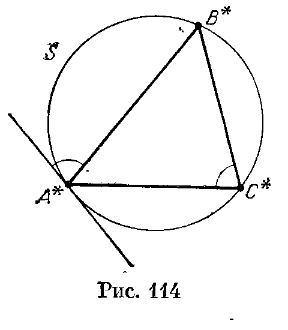
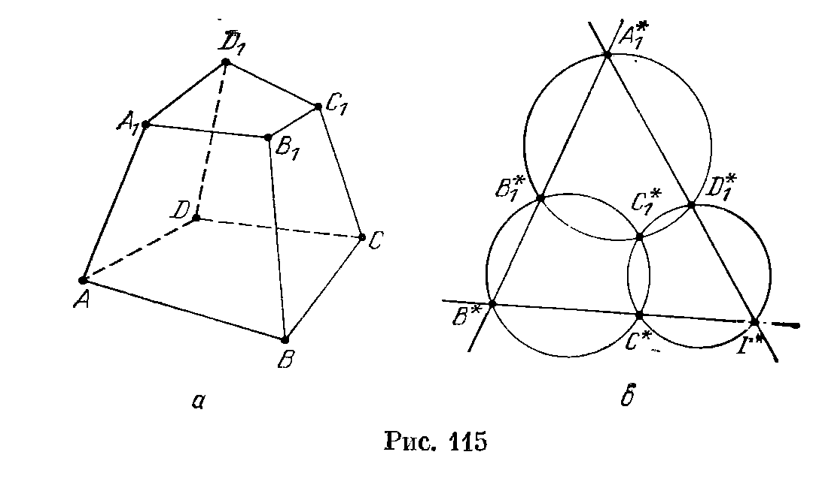
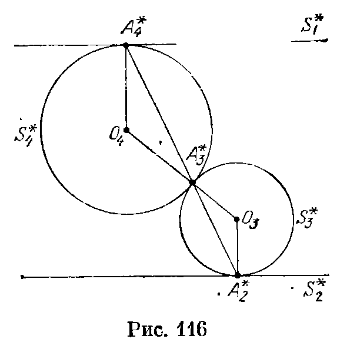
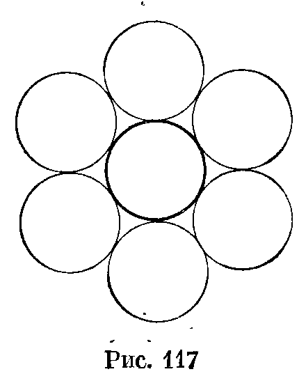
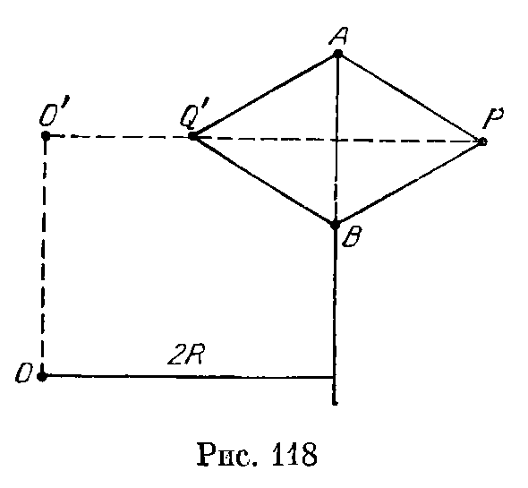

## 16.5. Решения

---
**стр. 274, продолжение**
---

## Решения

**16.1.** Пусть $R^2$ — степень рассматриваемой инверсии.

а) Рассмотрим луч с началом в точке $O$ и введем на нем координаты. Тогда точка с координатой $x$ переходит при инверсии в точку с координатой $R^2/x$. Поэтому луч с началом в точке $O$ переходит при инверсии в себя. Следовательно, плоскость, проходящая через точку $O$, переходит в себя.

б) Пусть $A$ — основание перпендикуляра, опущенного из точки $O$ на данную плоскость, а $X$ — любая другая точка этой плоскости. Достаточно доказать, что $\angle OX^*A^*=90^\circ$ (в самом деле, это означает, что образ любой точки рассматриваемой плоскости лежит на сфере с диаметром $OA^*$). Ясно, что
$$
OA^*:OX^*=\left(\frac{R^2}{OA}\right):\left(\frac{R^2}{OX}\right)=OX:OA,
$$
т. е. $\triangle OX^*A^*\sim\triangle OAX$. Поэтому $\angle OX^*A^*=\angle OAX=90^\circ$. Для полноты доказательства следует заметить, что любая точка $Y$ сферы с диаметром $OA^*$, отличная от точки $O$, является образом точки данной плоскости — точки пересечения луча $OY$ с данной плоскостью.

в) Можно провести такие же рассуждения, как в предыдущей задаче, а можно и более или менее прямо ею воспользоваться, так как $(X^*)^*=X$.

---
**стр. 275**
---

**16.2.** Пусть $A$ и $B$ — точки, в которых данную сферу $S$ пересекает прямая, проходящая через точку $O$ и центр $S$, а $X$ — произвольная точка $S$. Достаточно доказать, что $\angle A^*X^*B^*=90^\circ$. Из равенств $OA\cdot OA^*=OX\cdot OX^*$ и $OB\cdot OB^*=OX\cdot OX^*$ вытекает, что $\triangle OAX\sim\triangle OX^*A^*$ и $\triangle OBX\sim\triangle OX^*B^*$, а из этого получаем следующие соотношения между ориентированными углами (определение и свойства ориентированных углов см. Прасолов, I, с. 36):
$$
\angle(A^*X^*,OA^*)=\angle(OX,XA)
$$
и
$$
\angle(OB^*,X^*B^*)=\angle(XB,OX).
$$
Поэтому
$$
\begin{aligned}
\angle(A^*X^*,X^*B^*)
&=\angle(A^*X^*,OA^*)+\angle(OB^*,X^*B^*)\\
&=\angle(OX,XA)+\angle(XB,OX)=\angle(XB,XA)=90^\circ.
\end{aligned}
$$

**16.3.** Легко проверить, что любую прямую можно представить в виде пересечения двух плоскостей, а любую окружность — в виде пересечения сферы и плоскости. В задачах 16.1 и 16.2 было показано, что при инверсии плоскость или сфера переходит в плоскость или сферу. Поэтому при инверсии прямая или окружность переходит в фигуру, являющуюся пересечением либо двух плоскостей, либо сферы и плоскости, либо двух сфер. Остается заметить, что пересечением сферы и плоскости (а также пересечением двух сфер) является окружность.

**16.4.** а) Докажем сначала, что касающиеся сферы переходят при инверсии либо в касающиеся сферы (сферу и плоскость), либо в пару параллельных плоскостей. Это легко следует из того, что касающиеся сферы — это сферы, имеющие единственную общую точку (и того, что при инверсии сфера переходит в сферу или плоскость). Поэтому угол между образами сфер равен углу между образами касательных плоскостей, проведенных через точку пересечения.

Таким образом, остается провести доказательство для двух пересекающихся плоскостей $\Pi_1$ и $\Pi_2$. При инверсии с центром $O$ плоскость $\Pi_i$ переходит в сферу, проходящую через точку $O$, причем касательная плоскость к ней в этой точке параллельна плоскости $\Pi_i$. Из этого следует, что угол между образами плоскостей $\Pi_1$ и $\Pi_2$ равен углу между плоскостями $\Pi_1$ и $\Pi_2$.

б) Для начала нужно сформулировать определение касания окружностей в сохраняющемся при инверсии виде. Сделать это несложно: две окружности в пространстве касаются тогда и только тогда, когда они принадлежат одной сфере (или плоскости) и имеют единственную общую точку. Теперь уже легко доказать, что касающиеся окружности переходят при инверсии в касающиеся окружности (окружность и прямую) или пару

---
**стр. 276**
---

параллельных прямых. Дальнейшее доказательство проводится точно так же, как и в задаче а).

**16.5.** Ясно, что $OA\cdot OA^*=R^2=OB\cdot OB^*$. Поэтому $OA:OB^*=OB:OA^*$, т. е. $\triangle OAB\sim\triangle OB^*A^*$. Следовательно,

$$
\frac{A^*B^*}{AB}=\frac{OB^*}{OA}=\frac{OB^*}{OA}\cdot\frac{OB}{OB}=\frac{R^2}{OA\cdot OB}.
$$

**16.6.** Пусть $X$ и $Y$ — точки пересечения данной сферы с прямой, проходящей через точку $O$. Рассмотрим инверсию с центром $O$ и коэффициентом $R^2$. Легко проверить, что в обеих задачах фактически требуется подобрать коэффициент $R^2$ так, чтобы для любой прямой, проходящей через точку $O$, выполнялось равенство $OX\cdot OY=R^2$. Остается заметить, что величина $OX\cdot OY$ не зависит от выбора прямой.

**16.7.** Пусть $A_1$ — точка сферы $S$, а $A_2$ — вторая точка пересечения прямой $OA_1$ со сферой $S$ (если $OA_1$ — касательная к $S$, то $A_2=A_1$). Легко проверить, что величина $d=OA_1\cdot OA_2$ одна и та же для всех прямых, пересекающих сферу $S$. Если $R^2$ — степень инверсии, то

$$
OA_1^*=\frac{R^2}{OA_1}=\frac{R^2}{d}OA_2.
$$

Таким образом, если точка $O$ лежит внутри сферы $S$, то $A_1^*$ — образ точки $A_2$ при гомотетии с центром $O$ и коэффициентом $-R^2/d$, а если точка $O$ лежит вне сферы $S$, то $A_1^*$ — образ точки $A_2$ при гомотетии с центром $O$ и коэффициентом $R^2/d$.

**16.8.** Рассмотрим инверсию с центром в вершине $D$ тетраэдра $ABCD$. Описанные окружности граней $DAB$, $DAC$ и $DBC$ при этом перейдут в прямые $A^*B^*$, $A^*C^*$ и $B^*C^*$, а описанная окружность грани $ABC$ — в описанную окружность $S$ треугольника $A^*B^*C^*$. Так как при инверсии углы между окружностями (или прямыми) сохраняются (см. задачу 16.4, б), нужно доказать, что угол между прямой $A^*B^*$ и окружностью $S$ равен углу между прямыми $A^*C^*$ и $B^*C^*$ (рис. 114). Это непосредственно следует из того, что угол между касательной к окружности в точке $A^*$ и хордой $A^*B^*$ равен вписанному углу $A^*C^*B^*$.

**16.9.** Пусть $X$ и $Y$ — точки пересечения сферы с прямой, проходящей через точку $P$. Нетрудно убедиться, что величина $PX\cdot PY$ не зависит от выбора прямой; обозначим ее через $R^2$. Рассмотрим инверсию с центром $P$ и степенью $R^2$. Тогда $X^*=$

---
**стр. 277**
---

$=Y$. Таким образом, множество вторых точек пересечения со сферой прямых, соединяющих $P$ и точки окружности $S$, является образом $S$ при рассматриваемой инверсии. Остается заметить, что образ окружности при инверсии является окружностью.

**16.10.** Пусть $O$ — центр данной сферы, $XA$ — некоторая касательная к сфере. Так как $AC$ — высота прямоугольного треугольника $OAX$, то $\triangle ACO\sim\triangle XAO$. Поэтому $AO:CO=XO:AO$, т. е. $CO\cdot XO=AO^2$. Таким образом, точка $C$ является образом точки $X$ при инверсии с центром $O$ и степенью $AO^2=R^2$, где $R$ — радиус данной сферы. Образом плоскости $\Pi$ при этой инверсии является сфера диаметра $R^2/OP$, где $P$ — основание перпендикуляра, опущенного из точки $O$ на плоскость $\Pi$; эта сфера проходит через точку $O$, а ее центр лежит на отрезке $OP$.

**16.11.** Пусть дан тетраэдр $ABCD$. Рассмотрим инверсию с центром $D$ и степенью $r^2$. Тогда

$$
A^*B^*=\frac{ABr^2}{DA\cdot DB},\qquad
B^*C^*=\frac{BCr^2}{BD\cdot DC}
$$

и

$$
A^*C^*=\frac{ACr^2}{DA\cdot DC}.
$$

Следовательно, если взять $r^2=DA\cdot DB\cdot DC$, то $A^*B^*C^*$ — искомый треугольник.

Для вычисления площади треугольника $A^*B^*C^*$ найдем объем тетраэдра $A^*B^*C^*D$ и его высоту, проведенную из вершины $D$. Описанная сфера тетраэдра $ABCD$ переходит при инверсии в плоскость $A^*B^*C^*$. Поэтому расстояние от этой плоскости до точки $D$ равно $r^2/2R$. Далее, отношение объемов тетраэдров $ABCD$ и $A^*B^*C^*D$ равно произведению отношений длин ребер, выходящих из точки $D$. Следовательно,

$$
V_{A^*B^*C^*D}
=V\frac{DA^*}{DA}\frac{DB^*}{DB}\frac{DC^*}{DC}
=V\left(\frac r{DA}\right)^2
 \left(\frac r{DB}\right)^2
 \left(\frac r{DC}\right)^2
=Vr^2.
$$

Пусть $S$ — площадь треугольника $A^*B^*C^*$. Воспользовавшись формулой

$$
V_{A^*B^*C^*D}=\frac13hdS,
$$

получим

$$
Vr^2=\frac13\frac{r^2}{2R}S,
$$

т. е. $S=6VR$.

**16.12.** Пусть $ABCDA_1B_1C_1D_1$ — данный шестигранник, причем лишь про вершину $C_1$ не известно, что она лежит на данной сфере (рис. 115, а). Рассмотрим инверсию с центром $A$. При этой инверсии данная сфера переходит в плоскость, а описанные окружности граней $ABCD$, $ABB_1A_1$ и $AA_1D_1D$ — в прямые (рис. 115, б). Точка $C_1$ является точкой пересечения плоскостей $A_1B_1D_1$, $CD_1D$ и $BB_1C$, поэтому ее образ $C_1^*$ является точкой пересечения образов этих плоскостей, т. е. описанных сфер тетраэдров $AA_1^*B_1^*D_1^*$, $AC^*D_1^*D^*$ и $AB^*B_1^*C^*$ (имеется в виду точка, отличная от $A$). Следовательно, чтобы доказать, что точка $C_1$

---
**стр. 278**
---

принадлежит данной сфере, достаточно доказать, что описанные окружности треугольников $A_1^*B_1^*D_1^*$, $C^*D_1^*D^*$ и $B^*B_1^*C^*$ имеют общую точку (см. Прасолов, II, 28.6, а).

**16.13.** Достаточно проверить, что при инверсии с центром в точке касания двух сфер остальные 5 точек касания переходят в точки, лежащие в одной плоскости. При этой инверсии две сферы переходят в пару параллельных плоскостей, а две другие сферы — в пару сфер, касающихся их и друг друга. Точки касания этих двух сфер с плоскостями являются вершинами квадрата, а точка касания самих сфер — точкой пересечения его диагоналей.

**16.14.** Рассмотрим инверсию с центром $A_1$. При этом сферы $S_1$ и $S_2$ переходят в параллельные плоскости $S_1^*$ и $S_2^*$. Нужно доказать, что точки $A_2^*$, $A_3^*$ и $A_4^*$ лежат на одной прямой ($A_2^*$ — точка касания плоскости $S_2^*$ и сферы $S_3^*$, $A_3^*$ — точка касания сфер $S_3^*$ и $S_4^*$, $A_4^*$ — точка касания плоскости $S_1^*$ и сферы $S_4^*$). Рассмотрим сечение плоскостью, содержащей параллельные отрезки $A_2^*O_3$ и $A_4^*O_4$, где $O_3$ и $O_4$ — центры сфер $S_3^*$ и $S_4^*$ (рис. 116). Точка $A_3^*$ лежит на отрезке $O_3O_4$, поэтому она лежит в плоскости сечения. Углы при вершинах $O_3$ и $O_4$ равнобедренных треугольников $A_2^*O_3A_3^*$ и $A_3^*O_4A_4^*$ равны, так как $A_2^*O_3\parallel A_4^*O_4$. Следовательно, $\angle O_4A_3^*A_4^*=\angle O_3A_3^*A_2^*$, а значит, точки $A_2^*$, $A_3^*$ и $A_4^*$ лежат на одной прямой.

**16.15.** Рассмотрим инверсию с центром в одной из точек касания сфер. Эти сферы переходят в пару параллельных плоскостей, а остальные $n-2$ сферы — в сферы, касающиеся обеих этих плоскостей. Ясно, что диаметр любой сферы, касающейся двух параллельных плоскостей, равен расстоянию между плоскостями. Рассмотрим теперь сечение плоскостью, равноудаленно

---
**стр. 279**
---

ной от двух наших параллельных плоскостей. В сечении имеем систему из $n-2$ попарно касающихся равных окружностей. На плоскости нельзя расположить больше трех равных окружностей так, чтобы они попарно касались. Поэтому $n-2\leqslant3$, т. е. $n\leqslant5$.

**16.16.** Рассмотрим инверсию с центром в точке касания сфер $\Sigma_1$ и $\Sigma_2$. При этом они переходят в пару параллельных плоскостей, а образы всех остальных сфер касаются этих плоскостей, и поэтому их радиусы равны. Таким образом, в сечении плоскостью, равноудаленной от этих параллельных плоскостей, получается то, что изображено на рис. 117.

**16.17.** Рассмотрим инверсию с центром в точке касания некоторых двух сфер. При этой инверсии плоскость $\Pi$ переходит в себя, так как точка касания двух сфер лежит на прямой, соединяющей их центры; касающиеся в центре инверсии сферы переходят в пару параллельных плоскостей, перпендикулярных плоскости $\Pi$, а остальные две сферы — в сферы с центрами в плоскости $\Pi$, поскольку они как были симметричны относительно нее, так и останутся. И образы этих сфер, и образ сферы $S$ касаются пары параллельных плоскостей, поэтому их радиусы равны.

Рассмотрим (для образов при инверсии) сечение плоскостью, равноудаленной от пары наших параллельных плоскостей. Пусть $A$ и $B$ (лежащие в плоскости $\Pi$) — центры образов сфер, $C$ — центр третьей сферы, а $CD$ — высота равностороннего треугольника $ABC$. Если $R$ — радиус сферы $S^*$, то
$$
CD=\frac{\sqrt3 AC}{2}=\sqrt3R.
$$
Поэтому для сферы $S^*$ отношение радиуса к расстоянию от центра до плоскости $\Pi$ равно $1:\sqrt3$. Остается заметить, что при инверсии с центром, принадлежащим плоскости $\Pi$, отношение радиуса сферы к расстоянию от ее центра до плоскости $\Pi$ одно и то же и для сферы $S$, и для сферы $S^*$ (см. задачу 16.7).

---
**стр. 280**
---

**16.18.** Рассмотрим инверсию степени $(2R)^2$ с центром $O$ в одной из точек касания сфер с плоскостью; эта инверсия переводит окружность, проходящую через точки касания сфер с плоскостью, в прямую $AB$, удаленную от точки $O$ на расстояние $2R$ ($A$ и $B$ — образы точек касания). Существование двух сфер, касающихся двух параллельных плоскостей (исходной плоскости и образа одной сферы) и образов двух других сфер, очевидно. Пусть $P$ и $Q$ — центры этих шаров, $P'$ и $Q'$ — проекции точек $P$ и $Q$ на плоскость $OAB$. Тогда $P'AB$ и $Q'AB$ — равносторонние треугольники со стороной $2a$, где $a$ — радиус сфер, т. е. половина расстояния между плоскостями (рис. 118). Поэтому
$$
r=\frac{a\cdot4R^2}{PO^2-a^2}
\quad\text{и}\quad
\rho=\frac{a\cdot4R^2}{QO^2-a^2}
$$
(задача 16.5), значит,
$$
\begin{aligned}
\frac1r-\frac1\rho
&=\frac{PO^2-QO^2}{4aR^2}
=\frac{P'O^2-Q'O^2}{4aR^2}
=\frac{(P'O')^2-(Q'O')^2}{4aR^2}\\
&=\frac{(2R+\sqrt3a)^2-(2R-\sqrt3a)^2}{4aR^2}
=\frac{2\sqrt3}{R}.
\end{aligned}
$$
(здесь $O'$ — проекция точки $O$ на прямую $P'Q'$).

**16.19.** Пусть плоскость $\Pi$ касается в точке $A$ сферы $S$ с диаметром $AB$. Пусть, далее, $X$ — точка сферы $S$, а $Y$ — точка пересечения луча $BX$ с плоскостью $\Pi$. Тогда $\triangle AXB\sim\triangle YAB$ и поэтому
$$
AB:XB=YB:AB,
$$
т. е. $XB\cdot YB=AB^2$. Следовательно, точка $Y$ является образом точки $X$ при инверсии с центром $B$ и степенью $AB^2$.

Задачи б) и в) являются следствиями только что доказанного утверждения и соответствующих свойств инверсии.

**16.20.** Так как $\angle AMB=90^\circ$, точка $M$ принадлежит сфере с диаметром $AB$. Поэтому точка $D$ является образом точки $M$ при стереографической проекции сферы с диаметром $AB$ на плоскость, содержащую окружность $S$. Следовательно, все точки $M$ лежат на одной окружности — образе окружности $S$ при инверсии с центром $B$ и степенью $AB^2$ (см. задачу 16.19, а).

**16.21.** Опустим из точки $O$ перпендикуляр $OA_1'$ на грань $SAB$. Пусть $A_1$ — точка пересечения прямых $AB$ и $SA_1'$. Так как $AB\perp OS$ и $AB\perp OA_1'$, плоскость $SOA_1'$ перпендикулярна прямой $AB$

---
**стр. 281**
---

и поэтому $OA_1\perp AB$, т. е. $A_1$ — проекция точки $O$ на сторону $AB$. Ясно также, что $A_1$ — образ точки $A'$ при стереографической проекции сферы с диаметром $SO$ на плоскость основания. Таким образом, нужно показать, что проекции точки $O$ на стороны четырехугольника $ABCD$ лежат на одной окружности (см. Прасолов, 2.31 или Шарыгин, II, 247).

**16.22.** Так как точки $X_1$ и $X_2$ симметричны относительно плоскости, перпендикулярной отрезку $AB$ и проходящей через его середину, то $\angle ABX_1=\angle BAX_2$. Поэтому прямоугольные треугольники $ABX_1$ и $AX_2B$ подобны. Следовательно,
$$
AB:AX_1=AX_2:AB,
$$
т. е. $AX_1\cdot AX_2=AB^2$.
